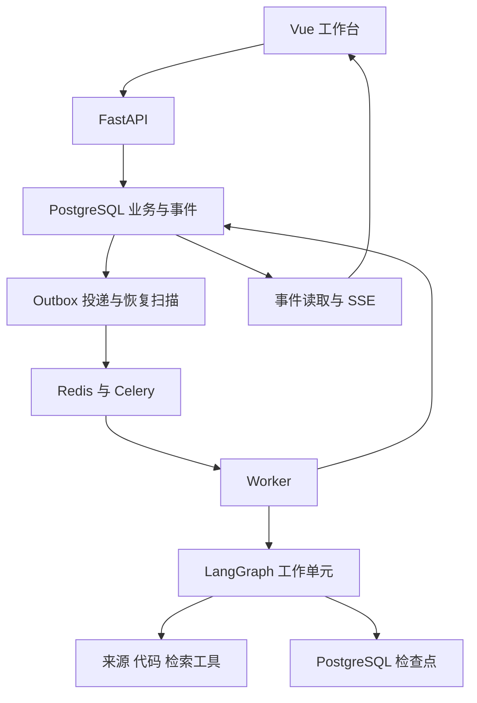

# CareerForge 技术设计与工程约定

版本：1.0  
日期：2026-10-12  
实施目标：R1 最小六模块闭环、R2 可靠版本、R3 可评测增强、R4 小范围试用。

本文规定后端边界、数据关系、工作流、恢复方式和部署约定。产品行为见 [产品需求](01_PRODUCT_REQUIREMENTS.md)，开发顺序见 [实现路线](03_IMPLEMENTATION_ROADMAP.md)，接口字段见 [接口契约](05_API_CONTRACTS.md)，验证方法见 [评测与验收](04_EVALUATION_AND_ACCEPTANCE.md)。本包是待实现的设计，不代表平台已运行或已通过测试。

## 1 实施时采用的技术选择

| 部分 | V1 选择 | 选择理由与边界 |
| --- | --- | --- |
| 前端 | Vue 3、TypeScript、Pinia、Element Plus | 继承已有技术基础，先做连续工作台和运行侧栏 |
| API | FastAPI、Pydantic、SQLAlchemy、Alembic | 接口、校验、业务事务和迁移分层 |
| 主数据库 | PostgreSQL | 业务对象、不可变版本、阶段结果、运行与事件的权威记录 |
| 图执行 | LangGraph、PostgreSQL checkpointer | 图内状态、条件分支、受控研究与正常等待恢复 |
| 执行分发 | Celery、Redis | 队列通知与 Worker 分发；不在 Celery Canvas 重建一份业务 DAG |
| 代码定位 | ripgrep、Python ast | V1 只支持 Python 文本，先定位符号和机制，再补读上下文 |
| 文本检索 | 直接读取与词法召回为基线 | S09 评测后按需增加 pgvector 和融合；代码与 JD 分开测 |
| 模型访问 | 一个已通过契约检查的供应商适配器 | 支持结构化结果、工具调用、超时、错误与用量；不建设复杂模型路由 |
| 可观测性 | 结构化日志起步，S10 接 Langfuse | 业务事实仍在 PostgreSQL；外部 trace 不是业务成功依据 |
| 工程工具 | uv、pytest、Ruff、类型检查、Docker Compose、CI | 分别验证格式、类型、业务不变量和可复现运行 |
| Python | 3.12 作为 S00 的默认验证起点 | 若当前依赖不兼容，按验证结果调整并锁定；不把此默认当作已验证组合 |

Windows 主机通过 WSL2 或 Linux 容器运行后端集成环境和 Worker。Celery 官方说明不支持 Windows，原生 Windows 启动结果不作为部署验收依据。[S03](06_REFERENCES_AND_DECISIONS.md)

不为关键词增加框架。Tree-sitter、多语言支持、MCP、重排模型、对象存储分别在真实需求出现后引入；V1 不加入 Neo4j、Kubernetes、A2A、模型后训练或自动运行任意仓库。

## 2 部署与职责边界

一个仓库、一套后端代码，通过多个进程运行。API 处理短事务；Worker 执行有界工作单元；dispatcher 投递 outbox 并处理恢复扫描。后台长期等待用户时不占用 Worker。



| 层 | 可以做什么 | 不承担什么 |
| --- | --- | --- |
| api | 身份、请求校验、调用应用服务、返回 HTTP/SSE | 不放岗位分析提示词和跨步骤业务逻辑 |
| domain | 对象、状态转移、优先级规则、验收与版本约束 | 不依赖 FastAPI、LangGraph 或 Celery |
| application | 用例、事务边界、权限、事件与幂等 | 不把 ORM 对象直接传给模型 |
| workflows | 节点、研究循环、结构化交接、阶段结果复用 | 不绕过应用服务采纳计划或确认验收 |
| tools | 受限资料/代码读取与检索 | 不接受任意 owner_id、任意 shell 或 SQL |
| infrastructure | 数据库、队列、模型、外部来源、文件存储适配 | 不决定用户是否掌握某项能力 |

Python 对象依赖顺序为 API/Workflow → Application → Domain；基础设施实现由应用层定义的协议。这里采用少量 Protocol 和明确模块边界，不引入复杂依赖注入容器。

## 3 拟议代码布局

以下是用户实施时要创建的仓库相对路径，并非本次已经实现的代码。

| 路径 | 内容 |
| --- | --- |
| `backend/pyproject.toml`、`backend/uv.lock` | 后端依赖、工具配置与精确版本 |
| `backend/src/careerforge/api/` | routers、deps、errors、SSE、认证入口 |
| `backend/src/careerforge/domain/` | goals、sources、requirements、evidence、plans、repositories、learning、builds、runs |
| `backend/src/careerforge/application/` | 对应业务 service、unit_of_work、permissions、idempotency |
| `backend/src/careerforge/infrastructure/db/` | ORM、repository、Alembic、租约/outbox/事件实现 |
| `backend/src/careerforge/infrastructure/llm/` | provider 协议、FakeModel、供应商适配、用量收据 |
| `backend/src/careerforge/infrastructure/queue/` | celery_app、execute_run、dispatcher、reconciler |
| `backend/src/careerforge/infrastructure/storage/` | 本地 blob 存储与后续对象存储接口 |
| `backend/src/careerforge/workflows/` | 五类图、通用阶段执行、输入投影、图版本注册 |
| `backend/src/careerforge/tools/` | source、repository、code_search、evidence 工具 |
| `backend/src/careerforge/schemas/` | API DTO、Agent 输出对象、引用与事件 schema |
| `backend/src/careerforge/config/` | Settings、依赖配置、预算和特性开关 |
| `backend/tests/{unit,integration,e2e,faults}/` | 四类测试，各自有明确范围 |
| `frontend/src/{api,views,components,stores,types,router}/` | 客户端封装、业务页面、共享视图和路由 |
| `evals/{datasets,runners,scorers,reports}/` | 数据清单、离线实验、评分器、报告 |
| `docs/` | 本包、ADR、阶段报告、操作手册 |
| `scripts/`、`compose.yaml` | 开发、迁移、评测和演示入口 |

一个模块先使用少量文件；当职责分裂时再拆。不要仅为对称目录给每个实体生成无内容的层。

## 4 数据共同约定

### 4.1 身份 时间 版本

- 实体 ID 使用 UUID。时间在数据库以带时区时间存储，接口返回 UTC ISO 8601，界面按用户时区展示。
- V1 业务记录都有 `owner_id`；公开网页和公开仓库导入后也属于当前用户的研究空间，暂不共享跨用户缓存。
- 稳定身份与不可变内容版本分开。稳定对象保存 `revision`（乐观并发整数）和当前版本指针；内容变化新增版本，禁止原地修改已被引用的正文或条件。
- 接口中的 `expected_version` 指稳定对象的 `revision`，并非 PostgreSQL xmin，也不是对象内容的 UUID。跨对象依赖使用明确的版本 ID。
- 版本表具有 `parent_id`、`version_no`、`content_hash`、`created_at`，唯一约束为 `(parent_id, version_no)`。
- 对应引用和结构化提取保存其依据的快照，不将网页 URL 本身视作不可变证据。

### 4.2 数据字典

| 表或对象 | 关键字段 | 必须成立的约束 |
| --- | --- | --- |
| User、UserSession | 用户、会话令牌摘要、到期时间 | 明文密码与会话令牌不入日志；会话可撤销 |
| Attachment / AttachmentBinding | owner_id、content_hash、blob_locator、mime、size、read_status、revoked_at、revision；绑定根资源和具体版本 | V1 一个 attachment_id 只归一个根资源；下载与重放均检查附件及根资源授权 |
| CareerGoal / CareerGoalVersion | 方向、地区、岗位类型、经验范围、时间预算、用户目标 | 一次分析只绑定一个 goal_version_id |
| Source | 类型、规范 URL、获取方式、availability、deleted_at | 来源身份与正文分开；用户粘贴不是官方 API 获取 |
| SourceSnapshot | source_id、正文 blob、正文 hash、版本化元数据及hash、发布时间及精度、抓取时间 | 同来源同正文且元数据一致可复用；材料类别更正也产生新快照，历史统计读冻结类别 |
| SourceFragment | snapshot_id、block_id、char_start/end、text_hash | 以保存后的规范文本定位；标明 offset 的单位与区间规则 |
| JobPosting / JobPostingVersion | 来源职位ID、公司、名称、地点、经验、薪资原文、snapshot_id | 快照变化不自动增加岗位数；跨来源候选去重可保留未决状态 |
| Requirement | posting_version_id、原文片段、must/preferred/responsibility、skill_concept_id、origin、supersedes_requirement_id | 每个ID为不可变提取条目；更正建立新条目，旧报告仍引用旧ID |
| RequirementCollection | owner_id、posting_version_id、当前条目集合、revision | 管理用户更正的并发；报告单独冻结实际采用的条目ID，不跟随集合更新 |
| DuplicateCandidate / DedupDecision | 两个posting_version_id、候选依据；decision、reason、决策版本 | 判断追加保存；报告冻结使用的决定与未决纳入规则，不物理删除岗位 |
| SkillConcept | 标准名、别名、kind、dictionary_version | 替代工具不强制合并为等价技能；字典更新可追溯 |
| MarketReport | goal_version_id、posting_version_ids、filter、coverage、统计值、结论引用 | 每个比例保存分子分母；统计函数生成数字 |
| PersonalEvidence / PersonalEvidenceVersion | 类型、描述、提交物、核验来源、范围、输入文件版本 | 自述/附材料/已完成某项验收分别表示 |
| AlignmentReport | goal_version_id、requirement_ids、evidence_version_ids、逐项判断、unknown | 缺材料不自动变成能力不足；不输出录用概率 |
| LearningObjective / LearningObjectiveVersion | 稳定目标、具体行为、先修、工作量、缺口和目标深度 | 目标变更保留稳定身份，具体内容产生新版本 |
| AcceptanceCriterionVersion | objective_version_id、场景、expected_behavior、关键项、方法、材料要求 | 通过/失败/未知规则明确；已有提交固定绑定旧条件 |
| LearningPlan / LearningPlanVersion | career_goal_id、goal_version_id、alignment_report_id、kind、目标排序、预留时间、暂缓项 | 每个 CareerGoal 一个稳定 LearningPlan；draft/adopted 内容版本创建后不可变 |
| PlanMembership | plan_version_id、objective_version_id、顺序、selected | 随版本一次创建；采纳生成新 adopted 版本及成员，不修改源草稿，不创建实践任务 |
| Repository / RepositorySnapshot | owner/name、resolved_commit_sha、tree_hash、读取清单、许可证状态 | 读取的是固定 commit；记录覆盖和跳过项 |
| RepositoryFile / CodeSymbol | snapshot_id、path、blob/hash、line_range、符号与导入 | 路径规范化；动态关系只是候选；仅 parse 不 import |
| ProjectRecommendation | objective_version_ids、criterion_version_ids、repo_snapshot_id、code_evidence | README 声明与实际实现分级；不使用伪精确匹配百分比 |
| LearningUnit / LearningUnitProgress | objective_version_id、repo_snapshot_id、阅读步骤、实验、task_drafts、supersedes_unit_id；进度revision | 单元ID对应不可变产物，进度独立保存；task_draft_id 在该单元内稳定 |
| ArtifactFeedback / PlanDeltaProposal | 产物ID、反馈类型/理由/引用；assessment_id、base_plan_version_id、目标差异 | 反馈或差异不原地改写旧产物，采纳仍走新草稿及正式计划操作 |
| BuildProject | 用户场景、约束、项目材料位置 | 参考项目和用户自主项目身份分开 |
| BuildTask / BuildTaskVersion | project_id、task_draft_id、目标/学习单元/条件版本、依赖、status、current_submission_id | 同项目同草稿只能物化一次；任务状态与计划版本独立 |
| Submission | task_version_id、commit、附件清单、环境、test_evidence、用户说明 | 新提交是新记录；不得覆盖旧提交 |
| Assessment | submission_id、criterion_version_ids、不可变模型提案、revision | 模型建议不直接改变 task accepted；unknown 关键项阻止通过 |
| AssessmentReview / AssessmentConfirmation | assessment_id、完整分项决定、method、assessor、self_review、evidence_refs；review_id、decision、撤销记录 | 用户确认追加审阅与确认记录，不覆盖模型提案；只允许当前提交确认 |
| Citation | source_snapshot_id 或 repo_snapshot_id、定位信息、hash、availability | 两种引用目标恰选一种；失效引用明确标记 |

阶段结果可先以有 schema_version 的 JSONB 保存，再将真正需要查询/约束的字段提升为列。不能把所有对象塞进一个无类型 JSON 字段，也不必一开始为每个小字段拆表。

### 4.3 运行模型

| 表 | 关键字段 | 用途 |
| --- | --- | --- |
| AgentRun | run_type、status、input_manifest、graph_version、graph_generation、thread_id、epoch、lease_until、budget、last_event_seq、revision | 一个有界业务工作单元 |
| RunAttempt | run_id、epoch、worker_id、开始结束、结束原因 | 一次获租约的执行尝试 |
| StageArtifact | run_id、stage_key、input_fingerprint、stage_version、output_refs、validation | 节点重放时复用有效结果 |
| OutboxMessage | run_id、dispatch_seq、available_at、状态、投递尝试 | 业务创建与待投递通知同事务 |
| RunEvent | run_id、seq、schema_version、type、payload、created_at | 页面断线后可以回放的业务事件 |
| ModelCallReceipt | run_id、stage_key、call_id、attempt、provider_request_id、used/reserved、usage_status | 外部调用的用量和未知结果独立记账 |
| WaitRequest | run_id、stage_key、input_fingerprint、question_version、wait_sequence、question、schema_hash | 稳定业务等待身份；当前 generation 的 runtime interrupt 只映射到此记录 |
| ResumeDecision | wait_request_id、payload_hash、payload、input_manifest_hash、accepted_at | 一个等待只接受一个决定；新图线程按业务等待身份复用，不按旧 interrupt_id 查找 |
| IdempotencyRecord | owner_id、operation、key、request_hash、response_code、response_refs、response_summary | 复用前重新检查引用授权；不缓存含私人正文的完整响应 |

重要唯一约束：`(run_id, seq)`、`(run_id, epoch)`、`(run_id, dispatch_seq)`、`(owner_id, operation, key)`、`(owner_id, career_goal_id)`（LearningPlan）、`(build_project_id, task_draft_id)`（非空时）、`(run_id, stage_key, input_fingerprint, stage_version)`（StageArtifact）、`(run_id, stage_key, input_fingerprint, question_version, wait_sequence)`（WaitRequest），以及 ResumeDecision 的 `wait_request_id`。

StageArtifact 的唯一键不能加入 attempt_id 或 epoch，否则每次重试都可以创建一个新的“唯一”业务结果，失去防重意义。

## 5 身份 权限与写入事务

### 5.1 认证模式

S01 可在只绑定本机的开发环境使用显式 `auth_mode=dev_single_user`，服务端固定当前用户，仍通过同一个 `CurrentUser` 依赖检查数据归属。该模式禁止绑定公共监听地址，禁止用于多人验收。

R2/S11 的多人试用使用普通登录与服务端会话：密码由成熟密码哈希库处理；随机会话令牌在数据库只保存摘要；Cookie 使用 HttpOnly，HTTPS 下 Secure，SameSite 设置与同源部署一致；写入请求检查 CSRF 令牌和 Origin。登录限流、登出撤销、会话过期都要测。V1 不实现组织 SSO 或社交 OAuth。

每个 repository/service 方法的首个访问范围来自 CurrentUser，而非模型参数。对不存在和无权限的业务对象统一返回不泄露内容的 404。内部日志可以记录权限失败类别，不能带他人正文。

### 5.2 幂等与乐观并发

所有有业务效果的 POST/PATCH/DELETE 均定义幂等规则。使用 `Idempotency-Key` 请求头；更新稳定对象时还传 `expected_version`。

同事务中：检查并锁定幂等记录 → 校验 request_hash → 检查对象归属和 revision → 进行业务写入 → 写关键事件 → 保存可重复返回的响应。

相同键和同一规范请求在结果引用仍获授权时返回原结果；同键但 payload 不同返回 409。复用响应之前必须重新检查当前身份、输入和结果引用的可读性，不能绕过删除或权限变化。并发请求由数据库唯一约束和行锁处理，不能仅用 Redis setnx 作为唯一保障。幂等键作用域包含用户和操作。

幂等记录只保留响应摘要、对象 ID 与响应重建所需的非敏感字段；读取私人正文始终经过当前授权。窗口外重试不保证返回历史 HTTP 响应，但业务自然唯一约束仍防止重复物化任务。初始建议窗口为 7 天，属于配置起点。删除必须清除或脱敏历史记录中可能遗留的私人 payload；旧幂等键不能重新发布已撤销内容。

### 5.3 计划与实践任务分开

`POST /plans/{id}/adopt` 从指定源草稿和选中目标子集创建新的 `kind=adopted` 计划版本及最终 PlanMembership；源草稿与旧版本保持不变。事务按 CareerGoal → LearningPlan 的固定顺序加锁，检查当前 goal_version 与 plan revision 后更新稳定计划的 active_plan_version_id；目标详情从计划读取该指针，不维护第二份可独立修改的活跃指针。一个 CareerGoal 下所有草稿共享同一稳定 LearningPlan，避免并发采纳两个计划互相覆盖。

响应分别返回 source_plan_version_id 和新 active_plan_version_id。同键重试复用原采纳结果；选择变化需要新请求和新版本。此操作不创建实践任务。用户之后创建 BuildProject，再通过 `POST /build-projects/{id}/tasks` 将学习单元中的任务草稿物化为实践任务。

后者绑定 `task_draft_id`、`objective_version_id`、`criterion_version_ids` 与 `learning_unit_id`，并验证四者的真实关联与服务器冻结的完整条件集合。同一草稿在同一项目下重试创建，返回原任务；手工创建无草稿的任务仍由幂等键防重。计划换版不自动复制、取消、复活或接受旧任务。

## 6 状态机与成功条件

### 6.1 运行状态

允许的运行状态：`queued`、`running`、`waiting_user`、`succeeded`、`partially_succeeded`、`failed`、`budget_stopped`、`cancelled`。

| 当前状态 | 允许转移 | 条件 |
| --- | --- | --- |
| queued | running、cancelled | 获得租约，或用户取消 |
| running | waiting_user、succeeded、partially_succeeded、failed、budget_stopped、cancelled | 满足各阶段条件；图调用返回不自动等于成功 |
| running 且租约失效 | queued | 恢复扫描撤销旧 epoch，准备新的图 generation 和投递 |
| waiting_user | queued、cancelled | 有效 interrupt 回复被保存，或取消 |
| 终态 | 不直接恢复 | 需要新 run；用户等待恢复与终态重新运行是不同接口语义 |

`partially_succeeded` 只用于允许局部缺失的产物，例如部分来源无法读取，但剩余材料足以形成带覆盖说明的报告。验收材料不足不能被包装为确定性的能力通过。

取消事务将 run 标为 cancelled、撤销执行资格并写事件。已经在外部执行的请求可能稍后结束；其用量可以结算，业务结果不能再发布到该 run。

### 6.2 实践任务状态

`todo → in_progress → submitted → accepted / needs_revision`，`needs_revision → in_progress / submitted`；非 accepted 的未结束任务可经用户动作进入 cancelled。提交按钮可将 todo/in_progress/needs_revision 变为 submitted。

accepted 任务若验收被撤销，按业务事务变成 needs_revision，并保留原确认记录与原因。accepted 必须先撤销再修改任务内容；cancelled 不提供内容改版或隐式恢复。submitted 任务修改内容会建立新版本并转为 needs_revision；todo 改版保留 todo，in_progress/needs_revision 改版转为 needs_revision。任务改版清空 current_submission_id，旧提交仍保留历史。用户若继续已取消任务的意图，应显式建立新任务。

评估分项只使用 `pass/fail/unknown`。关键项 unknown 或 fail 阻止确认 accepted。确认人可以补充新的自验或人工审阅记录，但不得把上传一份日志的动作直接升级为可信执行。

### 6.3 五类产物的完成定义

| run_type | 最少有效产物 | 降级或停止条件 |
| --- | --- | --- |
| market_research | 样本集合、要求、可复算统计、来源引用 | 无可用正文时 failed；部分不可读时可以部分成功 |
| alignment | 逐项证据判断、unknown、目标及条件、可执行计划草稿 | 缺必需信息时等待；不能把所有未知强行判为不会 |
| project_research | 目标对应候选、固定版本及证据等级 | 无适合仓库可以返回可说明的小实验建议，不伪造实现 |
| learning_path | 固定版本的阅读单元、引用、实验及待验证项 | 关键实现没有读到时明确不完整 |
| assessment | 对本次提交和条件逐项审阅，方法与限制 | 审阅成功可以包含 unknown；task 是否accepted是后续业务动作 |

## 7 运行创建 投递和重放

### 7.1 创建

1. API 验证所有输入归当前用户、版本存在、未撤销。
2. 冻结 input_manifest，包括版本 ID、内容 hash、图/提示词/工具配置版本。
3. 同事务保存 AgentRun(queued)、OutboxMessage、run.created 事件和幂等响应。
4. 返回 202；API 不等待模型执行。
5. dispatcher 扫描到期 outbox，通过行锁或租约领用后投递 run_id；成功后记录投递状态。网络结果未知可以重复投递，Worker 必须防重。

对于尚未获取的网页和仓库，初始 input_manifest 冻结的是查询条件、来源限制和待解析 ref；获取阶段再以 StageArtifact 提交不可变 acquisition_manifest，记录实际快照/commit/覆盖集合。下游 fingerprint 使用这个已提交集合，重放不重新解析分支的当前 HEAD。初始输入与获取结果均不可被原地覆写；没有成功提交的获取尝试只算临时结果，不作为对外证据。

恢复扫描还检查长时间 queued 但没有有效投递的运行，以及租约失效的 running。Redis 丢失后，可以依赖 PostgreSQL 的待运行事实重新分发。

### 7.2 Worker 领用与阶段提交

Worker 在短事务中校验 run 当前可执行，领取租约、增加 epoch、创建 RunAttempt。重复消息若对应运行仍有有效租约，应立即结束本次无效领用，不再调用模型。

阶段执行采用以下协议，伪代码只表达事务与检查位置：

```text
execute_stage(run_id, stage_key, frozen_inputs):
    key = (run_id, stage_key, fingerprint(frozen_inputs), stage_version)
    if committed StageArtifact(key) exists and inputs remain authorized:
        return its validated output references
    verify current execution lease and reserve bounded call budget
    result = perform bounded model/tool work outside DB transaction
    settle the pre-created call receipt independently, including late/unknown usage
    validate schema, citations and stage-specific requirements
    begin transaction
        lock AgentRun
        verify epoch, lease, status and source authorization again
        insert StageArtifact with unique key, or reuse existing row
        persist business output and RunEvent in the same transaction
    commit
    return output references to LangGraph
```

长时间网络请求不能持有业务行锁或数据库事务。心跳使用数据库时间执行条件更新：run_id、epoch、worker_id 必须匹配，状态必须为 running，且 lease_until 仍大于数据库当前时间；影响零行即失去执行资格，已过期租约不得自行续期。取消、进入等待或结束后的旧心跳不能恢复租约。业务提交前仍要再次检查，不能仅在工具调用前检查一次。

用量收据结算是独立、幂等的小事务，并在外部调用异常/超时路径执行。它只允许结算调用前已登记的 call_id 及其预算记录，不发布业务产物、不改变运行终态。因此旧 Worker 的产物被拒绝时，已发生或仍未知的外部用量不会被误记为零。

### 7.3 正常等待与异常接管分开

**稳定等待身份：**需要提问的阶段先持久化 WaitRequest，业务唯一键为 `(run_id, stage_key, input_fingerprint, question_version, wait_sequence)`，同时冻结问题、选项、响应 schema 和 schema_hash。模型生成的问题先形成可复用阶段产物，不能在重放时随意重生成。该键与 graph_generation 无关；runtime interrupt_id 仅保存为当前图线程到 WaitRequest 的映射。相同键但问题或 schema 不同视为输入冲突，不能把旧答案套到新问题。

**正常等待：**图调用返回中断，相关 checkpoint 写入完成后，Worker 才以有效 epoch 将 run 标为 waiting_user、发布等待信息并释放租约。API 验证 wait_request_id 与当前 interrupt 映射，保存唯一 ResumeDecision，再在同一事务写 queued、run.resumed 和 outbox。恢复时使用同一 thread_id 和兼容的 graph_version，向图提供对应 interrupt 回复。

LangGraph 的节点在中断恢复时可能从节点开头重新执行；需要副作用幂等，不能把 interrupt 当作数据库事务边界。[S01、S02](06_REFERENCES_AND_DECISIONS.md)

**异常 Worker 失联：**恢复扫描先锁定 AgentRun，再使用数据库时间重查当前状态与租约过期条件；在一个事务中撤销旧 epoch、增加 graph_generation、改为 queued，并写 run.recovering 与 outbox。两个扫描器不能为同一次故障各自接管。下一 Worker 使用新 thread_id（如 run UUID 与 generation 的组合），由固定输入、已提交 StageArtifact 和已保存用户决定重新进入图。已完成阶段直接返回其有效结果；等待节点按同一业务键读取已接受 ResumeDecision，存在则消费决定并跳过再次提问。决定被 API 接收后、图继续执行前发生故障，也按此规则恢复。旧线程的 checkpoint 只用于诊断，不再作为新执行的恢复起点。

这样，即便旧 Worker 晚写旧 checkpoint，也不会污染新图线程；旧 Worker 的业务写入仍由 epoch 拒绝。V1 不自定义复杂的 FencedPostgresSaver，也不宣称业务表和 checkpointer 的写入共享原子事务。

`run_id` 和累计预算在上述两种恢复中均保留。一次合法用户等待可有多个 RunAttempt。新 goal/input version 则是新 run，不能塞入旧图 checkpoint。

### 7.4 部署后的图兼容

graph_version、state_schema_version 和 stage_version 随发布记录。旧运行只交给兼容版本 Worker。图不兼容时保留旧版本完成运行，或显式终止并新建运行；不静默迁移未知 checkpoint。

正常暂停前采用能够完成持久化的调用方式；S00/S02 按锁定的 LangGraph 版本验证实际 API 和持久化模式。不要直接复制与当前安装版本不同的示例参数。[S01、S02](06_REFERENCES_AND_DECISIONS.md)

## 8 Agent 与工作流实现

### 8.1 最小共享状态

图状态保存 run_id、goal_version_id、input_manifest_hash、阶段输出 ID、引用 ID、unresolved_questions、预算与阶段状态。大正文保存在快照存储，需要时按 ID 读取；不把全部 JD、个人证据和仓库代码放入所有角色的 messages。

角色输出使用严格 schema：`findings`、`evidence_ids`、`unresolved`、`status`、`usage_refs`。Pydantic 校验通过只代表结构合法，仍需检查引用和业务约束。

### 8.2 五类图的节点

| 工作流 | 固定阶段 | 允许探索的局部 |
| --- | --- | --- |
| market_research | validate_inputs → acquire_sources → extract_requirements → deduplicate → compute_statistics → explain → validate → persist | 来源缺口补查；不让模型计算岗位比例 |
| alignment | load_evidence → align_items → draft_objectives → attach_criteria → validate_dependencies_and_time → review → persist_draft | 证据不足时提出有目的的问题 |
| project_research | load_objectives → inspect_curated_candidates → resolve_commit → inspect_implementation → compare → persist | S09 后按明确缺口搜索额外仓库 |
| learning_path | load_snapshot → locate_symbols → read_context_and_tests → explain → draft_experiment → citation_check → persist | 限定文件/字节/工具预算内补读 |
| assessment | load_submission_and_criteria → inspect_materials → per_criterion_review → classify_evidence → propose_plan_delta → persist | 仅对本次提交补读资料，不执行任意代码 |

等待节点只在当前阶段确实需要用户补充时使用。方向选择、计划采纳和项目选择也可由工作流结束后的业务页面完成，不必让五类图串成一个持续数周的总图。

### 8.3 哪些函数不调用模型

来源权限、URL限制、哈希、去重的明确规则、统计、依赖无环检查、工时总和、版本校验、任务状态流转、预算预留、幂等写入、引用定位和事件排序均由程序处理。

同义词与复杂重复候选可由模型给建议，但保留原文和判断来源；由确定性规则或人工确认决定是否合并。

### 8.4 有限并行与审核

V1 先按串行角色执行。S10 只并行独立来源或不同仓库候选，并发配置起点为 2，属于待测值。每个分支返回自己的结果，汇合节点做去重和冲突处理。角色没有共享自由写入的对话日志。

审核只返回错误位置、引用和定向修复要求。最多一轮模型返工，超过则保留未知或失败原因。重试网络调用和反复修改回答使用不同计数器，均纳入总预算。

## 9 来源采集和岗位处理

### 9.1 导入顺序

S03 首先支持 UTF-8 文本、Markdown 和粘贴 JD；保留原链接、导入者、材料类别与获取方式。扫描 PDF、复杂 OCR、视频内容不进入首版。文件大小和正文长度有明确限制，拒绝时提示可分段导入。

快照包含原始 blob 和规范化文本。规范化规则版本化，例如换行统一、不可见字符处理；Citation 的字符区间以规范文本的 Unicode code point 为单位，采用左闭右开区间。原文未能定位则拒绝把它当有效引用。

### 9.2 网络适配

网络读取由服务端受限 adapter 完成：只接受 http/https，限制重定向次数、响应大小和超时；每次重定向与解析后的连接目标重新检查内网、loopback、link-local 和云元数据地址；防止 DNS 解析和连接之间的目标变化。不能只对用户输入字符串做一次黑名单判断。

S09 优先适配少量正文可读的官方来源。登录墙、验证码和不可读内容返回 read_failed，不绕过限制；搜索摘要只用来发现页面。

### 9.3 结构化要求与统计

要求抽取结果至少含原文片段、must/preferred/responsibility、标准技能、明确/推断标记、缺失字段。模型不能将“未写经验”改成“不限经验”。

去重顺序：来源职位ID → 规范URL → 内容hash → 公司/名称/地区/相似正文的候选确认。报告的唯一岗位分母来自固定有效版本集合，面经与岗位分开。

技能出现率等于同一范围中出现该明确要求的 JD 数，除以正文已读且提取完成的 JD 数；同一 JD 多次命中只计一次。报告输出实际分子、分母和提取覆盖。日薪/月薪、币种、薪资月份未知不混算。只做样本描述，不推断全市场人数或录用概率。

## 10 仓库快照与代码理解

### 10.1 仓库读取

V1 使用公开 GitHub API 或受限静态读取器：先解析仓库身份与选定 ref，解析到完整 commit SHA，再读取 tree 和所需文本 blob。记录 resolved_commit_sha、manifest、读取时间、每个文件的 hash 和覆盖范围。

Git Trees API 的递归结果可能被截断；必须检查 truncated 标志，按子树继续读取或记录不完整，不能把响应当成完整仓库。[S05](06_REFERENCES_AND_DECISIONS.md)

不运行安装脚本、测试、Git hook、导入模块或用户命令。submodule、LFS 指针、symlink、生成目录、依赖目录和超大文件分别标记与跳过。路径正规化后必须保持在该快照根目录内。V1 代码分析只支持可解析的 Python 文本。

### 10.2 索引与上下文

为每个 Python 文件提取函数/类的限定名、签名、起止行、docstring、导入和引用候选。使用 `ast.parse`，不得通过 `import` 目标项目获得信息。语法错误保存 parse_failed，并仍允许受限文本检索。

检索先缩小到 repository_snapshot_id，再根据路径、符号、技术词、异常类和配置名获得候选。补读顺序：命中函数/类 → 入口和直接依赖候选 → 相关测试 → 仍缺失的配置。每次补读都受总字节和 token 预算约束。

Aider 的 repo map 提供了基于符号与相关性组织代码上下文的参考，但这种关系不等于完整运行调用图。[S08](06_REFERENCES_AND_DECISIONS.md)

### 10.3 引用验证

代码引用必须包含 snapshot_id、完整commit、path、start_line、end_line、content_hash。行号为1起始、两端包含。展示前校验文件存在、范围有效和hash一致。

随后检查引用是否足以支持关键解释：结构校验可以由程序完成；语义支持由明确量规、辅助模型与人工抽查评估。不能以链接能打开替代机制正确性。

## 11 检索 记忆和上下文

三个检索空间分别是岗位来源、个人证据、公开代码快照；所有查询携带 owner/goal/snapshot范围。向量库只保存派生表示，删除和版本更新可重建。

词法对照使用明确实现和分词配置。PostgreSQL 的全文排序函数不是 BM25；若引入 BM25，要记录实际实现。中文JD、技术名和代码符号分开验证。pgvector 加全文检索/RRF 是可选增强，不预设比直接读取更优。[S04](06_REFERENCES_AND_DECISIONS.md)

| 数据层 | 内容 | 权威范围 |
| --- | --- | --- |
| 业务表 | 用户确认的目标、计划、提交、条件与验收 | 对应版本和限定条件 |
| 图checkpoint | 线程内部状态和正常中断位置 | 当前graph_generation |
| 检索索引 | 文本/代码的派生索引 | 可重建，不覆盖源数据 |
| Redis | 队列、短期协调、缓存、限流 | 丢失后可从业务事实恢复 |
| 对话摘要 | 辅助解释当前上下文 | 不自动升级为能力证据 |

缓存键至少包括 owner_id、scope、输入版本hash、parser/chunker版本、embedding版本（若使用）、检索配置、模型/提示词/工具schema版本。权限变更和删除先阻止读取，再异步清缓存。

## 12 能力规划与验收实现

### 12.1 对齐判定

对齐分类为可复用、需迁移、深度不足、基础待补、暂不确定。每个判断绑定明确要求和证据版本，附限定理由。材料缺失默认 unknown，不能成为无依据的肯定或否定。

计划优先级按目标JD明确要求、先修依赖、实际缺口、用户时间形成可解释排序；先采用规则和人工可调权重，不先训练推荐器。依赖必须无环；将任务加入排期前检查工作量区间与余量；不足则暂缓或减少范围，不悄悄压缩所有时长。

### 12.2 条件与任务草稿

每个目标至少有一项可观察的验收条件，包括行为、场景、范围、所需材料、通过/失败/未知规则、critical和允许审阅方法。工作量是估计区间，可由实际投入反馈修正。

手工入口可创建 origin=user_goal 的目标及完整条件，允许已有明确实践任务的用户直接进入 M6。该目标仍须由用户确认范围，不能绕过条件、材料要求与版本校验。对同一目标的条件做缩减或调整时创建新目标/条件版本，并展示差异。

学习单元产生任务草稿，用户确认后才物化到自己的 BuildProject。草稿描述借鉴的机制、需要自己决定的业务变化、前置条件、交付物和验收项；不生成一条“完成整个系统”的巨型任务。

草稿、LearningUnit、ObjectiveVersion 与 AcceptanceCriterionVersion 必须形成服务端可验证的关系。BuildTaskVersion 冻结本次任务的完整条件集合；接口中带条件 ID 仅用于显式核对，不能授权客户端选择更容易的子集。缺项、重复项、来自其他目标的条件、同一用户的其他容易条件均拒绝。任务只覆盖目标一部分时，先生成范围明确的子目标及条件版本，不能静默丢弃目标的关键项。

### 12.3 提交和确认

提交固定绑定 task_version 与服务器读取的完整 criterion_version_ids，包含代码版本、环境、执行命令、结果文件及用户说明。创建 Submission、启动审阅、保存分项结果与最终确认都重新读取这一集合；客户端提供的列表必须集合相等。每次提交在同一事务更新 current_submission_id、任务状态 submitted 和 revision。确认要求任务仍为 submitted、提交等于 current_submission_id、提交所指内容版本仍为任务当前版本、revision 匹配及全部关键条件有效；不能只遍历客户端已列出的条目。平台首版只读取材料，不执行导入代码。

方法枚举为 model_review、user_reported、human_review、trusted_execution。trusted_execution 只作未来扩展保留，V1 外部请求不能使用它伪造平台执行。human_review 必须记录审阅者是否本人，自验不冒充独立评审。

Assessment 对每项条件输出 pass/fail/unknown、证据位置和范围，模型提案保存后不可变。用户确认在同一事务追加不可变 AssessmentReview 及完整分项决定，再创建引用该 review_id 的 AssessmentConfirmation；稳定 Assessment 的 revision/当前确认指针可更新，原模型提案不改写。如有关键项 unknown，补充可追踪自验依据或进入 needs_revision；进入返修后需新 Submission 才能再次确认。旧提交迟到的模型审阅可以保存为历史，但不得覆盖当前提交或当前任务状态。

成果表现、解释证据、迁移证据分开呈现；一次测试通过不提升为“掌握分布式系统”。确认之后生成计划差异建议，采纳差异仍通过新的 alignment/plan版本与用户操作。

## 13 版本变化与删除

### 13.1 依赖关系

先用有限关系表记录 `consumer_artifact_id → input_version_id`；变更标记只沿已登记的直接依赖传播，逐层处理。相同内容hash可以复用，但必须保留原始来源身份。

| 变化 | 处理 |
| --- | --- |
| JD 新快照 | 旧报告仍指旧快照；新分析形成新要求，相关对齐待复核 |
| 用户更改目标 | 建新goal_version；旧run不注入新目标 |
| 新个人成果 | 新evidence_version；只重审相关能力目标 |
| 参考commit变化 | 新repository_snapshot；关联单元待复核 |
| 条件变化 | 新criterion版本；旧提交与旧验收保持原范围 |
| 计划重排 | 新plan_version与成员关系；保留稳定目标/任务身份 |

### 13.2 删除

删除事务立即设置不可读状态、增加权限修订、阻止新的工具读取和引用展开、标记相关任务/运行输入失效，并创建清理记录。未完成的相关运行在提交前再次检查来源授权，不能发布包含已删除正文的新产物。

Attachment 保存 owner_id、content_hash、受控 blob_locator、mime、size、read_status、revoked_at 与 created_at；AttachmentBinding 指向根资源和具体 SourceSnapshot/EvidenceVersion/Submission。V1 不跨根复用同一 attachment_id：复用于独立材料需生成新附件身份，避免删除一个根时误删另一个根。根删除撤销其附件与全部绑定；单独删除附件也会让所有引用它的版本失效。尚未绑定的上传只允许上传者在有效临时窗口读取。内容下载、历史页面、检索缓存、checkpoint 重放和幂等响应重建均检查这些授权，物理文件还在不代表可以读取。

清理范围包括原始blob、规范文本、代码副本、片段、向量、缓存、包含正文的派生产物、checkpoint、外部trace、幂等缓存私人 payload 和临时导出。历史报告只可保留去除私人正文后的必要关系与失效状态；不能因为有引用链而保留私人文本。

保留窗口属于部署配置：日志默认不含正文；调试正文开关默认关闭。若备份无法立即逐条删除，应记录备份到期时间和恢复时重放删除清单的机制，界面准确显示“访问已撤销/清理中/清理完成”。S11前填写实际保留策略并验证。

## 14 事件 SSE 和前端状态

事件 envelope 由服务端定义：run_id、seq、schema_version、type、created_at、payload。seq在单run内递增，数据库事务锁定run并分配；唯一约束保护重复。事件只记录业务状态、工具结果摘要、引用、用量和可展示错误，不包含隐藏推理。

前端首次读取 run详情，再按after_seq补读事件；SSE断线用Last-Event-ID或after_seq恢复，二者同时存在必须一致。按(run_id,seq)去重，发现缺口时补读，不能用本地到达顺序重新编号。

SSE心跳不是业务事件，不占seq。token增量可以作为可丢弃的临时展示，关键最终内容与状态必须持久化。终态以AgentRun为准，不以连接关闭或某条文本“完成”作为判据。

页面将“待你确认”“资料不完整”“研究部分完成”“验收仍待补充”明确呈现。前端不根据模型文本直接设置task accepted，不乐观显示已经采纳成功。

## 15 预算 错误与可观测性

### 15.1 初始可调限制

以下只作为工程默认配置起点，均需S00/S03/S06实际材料校准：每次研究最多20份详情；最多2轮补查；候选最多5个、深入2个；代码最多30文件且累计规范文本不超过1MiB；单工具返回还需设置独立字节上限；审核最多1轮；并行最多2个分支。

文件数、字节数、token数、调用次数和总时长共同约束。模型输出max_tokens使用适配器实际支持参数。初始总token和货币预算由使用者在第一次真实调用前配置，系统不默认无限；FakeModel测试无需真实供应商凭据。

max_duration_seconds 表示同一 run 累计的有效执行时长，排除 queued 和 waiting_user，恢复后不清零；时长依据数据库中的有效租约区间核算。每个外部请求另有独立超时，不能因为用户等待数小时便消耗整个执行时长预算。

调用前预留配额；调用后以实际usage结算；并行分支只能使用未消耗且未预留的额度。超时导致usage未知时保存unknown_receipt和已预留值，不编造零费用。用户可追加预算后创建新run；旧预算终态不静默续跑。

### 15.2 错误类别

| 类别 | 处理 |
| --- | --- |
| rate_limited / transient_network | 有限退避，尊重retry-after，仍消耗请求预算 |
| provider_auth / permission_denied | 立即停止对应调用，不循环重试 |
| invalid_tool_arguments / invalid_schema | 明确字段错误，至多一次定向修复 |
| source_unreadable / repository_incomplete | 记录覆盖缺口，按阶段允许范围部分交付 |
| citation_invalid / unsupported_claim | 阻止有效产物发布，修复或保留未知 |
| stale_version / stale_execution | 拒绝写入，不自动覆盖 |
| budget_exceeded | 停止新调度，保留已确认有效产物与用量 |
| input_revoked | 停止受影响阶段，撤销对应结果读取 |

一个外部请求的网络重试由一个明确层负责，避免HTTP库、provider、LangGraph和Celery各自重试造成次数相乘。Celery只负责运行重投与基础异常，业务模型修复留在workflow层。

### 15.3 观测字段

日志/trace至少关联request_id、run_id、epoch、graph_generation、stage_key、tool_call_id、artifact_id。记录耗时、模型标识、token、重试次数、缓存命中、预算终止、证据覆盖和错误类别。

Langfuse用于trace和实验比较；独立评测集、评分器与business receipts保存在项目自己的可复现路径。trace发不出去不应丢业务结果，也不应阻塞所有用户请求。[S09](06_REFERENCES_AND_DECISIONS.md)

## 16 环境配置与部署验收

Settings最少包括数据库、Redis、模型provider/base_url/model/key、auth_mode、cookie策略、存储根、预算、来源开关、并发、租约/心跳、图版本和trace开关。秘密只来自环境或部署秘密管理，不进入前端构建、提示词或仓库。

Docker Compose按阶段启用postgres、redis、api、worker、dispatcher、frontend；pgvector可作为S09数据库镜像扩展；Langfuse使用已配置实例或单独观测栈，不强迫S01部署整套观测基础设施。

数据库迁移由一次性migration任务运行，API/Worker不同时自动修改schema。就绪检查验证数据库和必要配置，存活检查不触发模型调用。服务只公开必要入口，私人原文存储目录不直接作为静态目录。

部署流程：锁定依赖与镜像 → 备份 → 运行迁移 → 启动兼容Worker和API → 执行无模型费用的冒烟 → 按预算执行少量真实样例 → 核对回滚策略。回滚代码不能假定自动回滚数据库，破坏性迁移要另行设计。

S11发布门槛包含：退出dev_single_user、跨用户访问测试、删除流程、恢复演示、成本上限、备份恢复、前端重连，以及未执行测试不显示通过。具体用例见文档04。

## 17 复用与原创边界

joblearn与EchoMind当前源码未随本次任务提供；文档只给复用审查清单，不承诺可直接复制某文件。确认依赖、权限、工具轨迹、错误传播与测试后，再提取适配器或基础组件。

DeerFlow参考运行生命周期、应用与Agent核心分层、事件持久化与工具边界；Open Deep Research参考有限研究分解和汇总；Aider参考代码符号与上下文预算。当前main代码和固定release必须分别记录，实施时固定实际学习commit。[S06、S07、S08](06_REFERENCES_AND_DECISIONS.md)

CareerForge自己实现的是要求与个人证据的关系、验收条件、代码学习映射、计划版本、任务与提交，以及能够证明这些设计有效的评测。复制源码时单独检查许可证并保留要求的归属信息。
