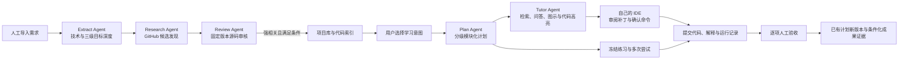

# CareerForge

**把职业需求映射到开源实现的个人 Agent 学习工作台。**

An evidence-based agent workbench for learning from real open-source code.

你导入岗位或技术资料，Agent 提取技术需求，发现并审核开源项目，再根据你选择的学习目标制定模块化计划。在同一页面阅读参考代码、查看计划、提问，以及在自己的项目里审阅并应用代码修改。

项目优先服务本机使用，提供浏览器界面与 Windows Tauri 桌面外壳。采用 Python 显式工作流，不依赖 LangGraph。

## 主流程



- **需求提取**：技术关键词、了解 / 熟悉 / 掌握、原文明确要求与模型推断分开记录。
- **项目研究**：按技术需求搜索 GitHub，读取固定 commit 的代码；候选经过独立角色审核才进入学习项目库。审核支持有界符号调查、相关实现与测试补读，原文位置与解释的语义支持分开记录。
- **学习规划**：支持学习项目构建、整个项目、技术设计、函数实现；计划包含最多三级模块、前置关系、步骤、成果和验收条件。
- **交互导学**：Agent 使用只读代码工具自主检索，输出文字、结构化 SVG 图示和表格；引用连接真实文件和行区间。导师按四区装配上下文，在原预算内补读历史与练习观察、加载学习方法；清单、版本、哈希和计量可回溯。
- **内置 IDE**：同页查看计划、参考代码与问答，可切换自己的项目，编辑文件、审阅并应用 Agent 补丁。
- **模块实践**：从叶模块冻结练习条件，建立独立的多次尝试；提交代码、运行记录、本人解释与迁移说明，逐项人工核对后更新已有计划版本。成果分别记录允许辅助条件、本人声明独立及迁移条件，不自动升级为能力掌握。
- **受控执行**：命令逐条确认后在无网络 Docker 沙箱运行；桌面桥接不提供任意宿主 Shell。
- **持久化运行**：保存阶段产物、事件、调用收据和预算；不确定的模型请求不自动重复收费。

新建方向默认按所选学习目标的代码位置覆盖规划，数量 5（可设 1–10）作为收集偏好；不足时需明确确认开始当前范围。可选择“必须达到指定数量”，历史方向也保留严格数量要求。数量达标仍不能替代目标覆盖；不无限搜索或调用模型。

## 架构

| 层 | 实现 |
| --- | --- |
| 界面 | Vue 3、TypeScript、Element Plus |
| 桌面 | Tauri 2、Rust、Windows WebView2 |
| API | FastAPI、Pydantic |
| 数据 | PostgreSQL、SQLAlchemy、Alembic |
| 后台运行 | Python 显式阶段函数、Celery、Redis、数据库 outbox 与租约 |
| 模型 | 可配置的 OpenAI-compatible Chat Completions 接口、结构化输出与工具调用 |
| 代码知识库 | 固定 commit 快照、Python AST、文本窗口、PostgreSQL 全文检索、符号 / 路径加权 |
| 执行环境 | Docker 隔离沙箱 |

Extract、Research、Review、Plan、Tutor 是同一后端内的角色，复用运行内核与模型适配器。IDE 编码助手独立生成待审阅修改。当前未启用向量检索或模型重排序。

## 快速开始

需要 Git、Docker（Linux containers）、Python 3.12、uv，以及 Node.js / npm。Windows 建议使用 Docker Desktop。

```powershell
git clone https://github.com/Sw1ven-Wang/CareerForge.git
cd CareerForge

Copy-Item .env.example .env
uv sync --project backend --python 3.12 --locked
npm.cmd ci --prefix frontend
npm.cmd run build --prefix frontend

# 先构建后端；本地静态资源网关与沙箱复用 API 镜像。
docker compose --profile app build api worker dispatcher migrate
docker compose -f compose.yaml -f compose.offline.yaml -f compose.ide.yaml --profile app build frontend
docker compose -f compose.yaml -f compose.offline.yaml -f compose.ide.yaml --profile app up -d --no-build
```

打开 **http://127.0.0.1:8080**，注册自己的本地账号。仓库不附带用户数据库、个人材料或预置业务账号。

macOS / Linux 可将上述 PowerShell 的 `Copy-Item` 换成 `cp`，`npm.cmd` 换成 `npm`。桌面外壳目前按 Windows x64 构建，其他平台桌面支持尚未验证。

### 配置真实 Agent

编辑本地 `.env`：

```dotenv
OPENAI_BASE_URL=https://your-provider.example/v1
OPENAI_API_KEY=your-local-api-key
MODEL_NAME=your-provider-model-id
CAREERFORGE_REAL_AGENT_ENABLED=true
CAREERFORGE_MODEL_REASONING_EFFORT=low
CAREERFORGE_STUDY_MAX_OUTPUT_TOKENS=8192
```

Base URL、模型 ID 与兼容能力由所用供应商决定。适配器使用 Chat Completions、`max_completion_tokens`、JSON Schema 和工具调用；请确认供应商支持这些参数。真实请求仅在用户启动操作后发生，并可能产生供应商费用。未配置模型时可以浏览页面、手动导入资料和编辑代码，Agent 功能不会自动切换为模拟结果。

修改配置后重建运行容器以加载新环境：

```powershell
docker compose -f compose.yaml -f compose.offline.yaml -f compose.ide.yaml --profile app up -d --force-recreate api worker
```

`.env` 已被 Git 忽略。不要把密钥写入代码、截图、Issue 或公开运行日志。

### Windows 桌面版

完成上述镜像和静态资源准备后，按 [桌面构建说明](desktop/README.md) 构建：

```powershell
powershell -NoProfile -ExecutionPolicy Bypass -File desktop/build.ps1
```

构建产物位于 `desktop/release/`，不纳入源码仓库。桌面版保留 Docker 后端，提供服务状态与双击启动；首次镜像仍需手动准备。选择本机项目目录后才授予该目录内的代码读写权限。

## 页面入口

| 路径 | 用途 |
| --- | --- |
| `/agent` | 需求提取、项目研究与审核、选择学习意图、生成计划 |
| `/sources` | 人工导入岗位 / 技术正文与来源管理 |
| `/knowledge` | 固定版本开源项目库与代码检索 |
| `/studio` | 学习计划、参考代码、导师问答与自己的 IDE |
| `/runs` | 后台任务、事件、用量与取消 |

旧版分析、计划编辑、采集及验收接口保留兼容，位于次级入口。当前主流程不要求 Agent 自动采集岗位。

## 当前状态与边界

这是持续迭代的本机学习工具，尚未作为公网多用户服务加固或验证。

最近一次受限真实验证完成了需求提取、GitHub 调研和审核入库：3 份岗位正文、15 条有效技术需求、8 个候选、3 个入库项目；6 次模型调用均在 8192 输出 token 请求上限内。部分引用失败经本地修复、复用保存结果恢复，不能视为无人干预一次通过。详见 [验证记录](docs/progress/AGENT_STUDY_LIVE_20261017.md)。

- 审核依据是有界静态代码调查；强相关不代表生产质量、安全性或运行效果通过验收。
- 新模块已接入成果提交、人工验收及已有计划更新。阅读进度仍由用户自报，与验收证据分开；独立尝试暂停本账号导师与 IDE Agent，外部帮助依靠本人声明，同账号自验不代表第三方认证。
- Tutor 展示事件进度，完整回答完成后呈现；目前不是逐 token 流式聊天。
- IDE 支持受限编辑与补丁审阅，尚无完整 VS Code / LSP 功能；命令在沙箱执行。
- 供应商曾报告超过请求上限的用量。客户端会记录并停止后续调用，不能保证供应商在所有请求中严格遵守 token 上限。
- 首次启动不会自动下载他人的项目或执行仓库脚本。公开源码不包含开发机的数据库、资料快照与私有运行记录。

## 目录与文档

```text
backend/      API、业务服务、工作流、模型适配、代码索引、迁移与测试
frontend/     工作台、计划、代码阅读与 IDE 界面
desktop/      Tauri 外壳、服务管理与本机目录桥接
docs/         架构、合同、运维与各阶段历史记录
evals/        离线评测与结果
scripts/      开发、演示、文档导出与运维工具
```

- [文档索引](docs/00_README.md)
- [Agent 主流程设计](docs/decisions/0003-agent-study-pipeline.md) · [A 包覆盖与证据策略](docs/decisions/0004-coverage-and-evidence-levels.md)
- [部署与备份恢复](docs/operations/deployment.md)
- [运行恢复和取消](docs/operations/recovery.md)
- [本机 IDE 的边界](desktop/README.md)
- [贡献指南](CONTRIBUTING.md) · [安全说明](SECURITY.md)

部分历史文档记录了当时的产品结构与开发机验证条件，请结合日期阅读；当前主流程以本 README、ADR 0003 及其修订 ADR 0004、[ADR 0005](docs/decisions/0005-bounded-code-investigation.md) 及 [ADR 0006](docs/decisions/0006-study-practice-evidence.md)、[ADR 0007](docs/decisions/0007-context-manifest-and-recall.md) 为准。新增调查与成果链路的验证范围见 [B 包记录](docs/progress/REVIEW_B_20261017.md)、[C 包记录](docs/progress/REVIEW_C_20261017.md) 与 [D 包上下文记录](docs/progress/REVIEW_D_20261017.md)。

## 许可证

CareerForge 原创代码与文档采用 [MIT License](LICENSE)。保留的第三方参考代码遵循其自身许可证，见 [NOTICE](NOTICE.md)。用户导入的项目、岗位资料与个人材料不因导入本工具而改变权利归属。
