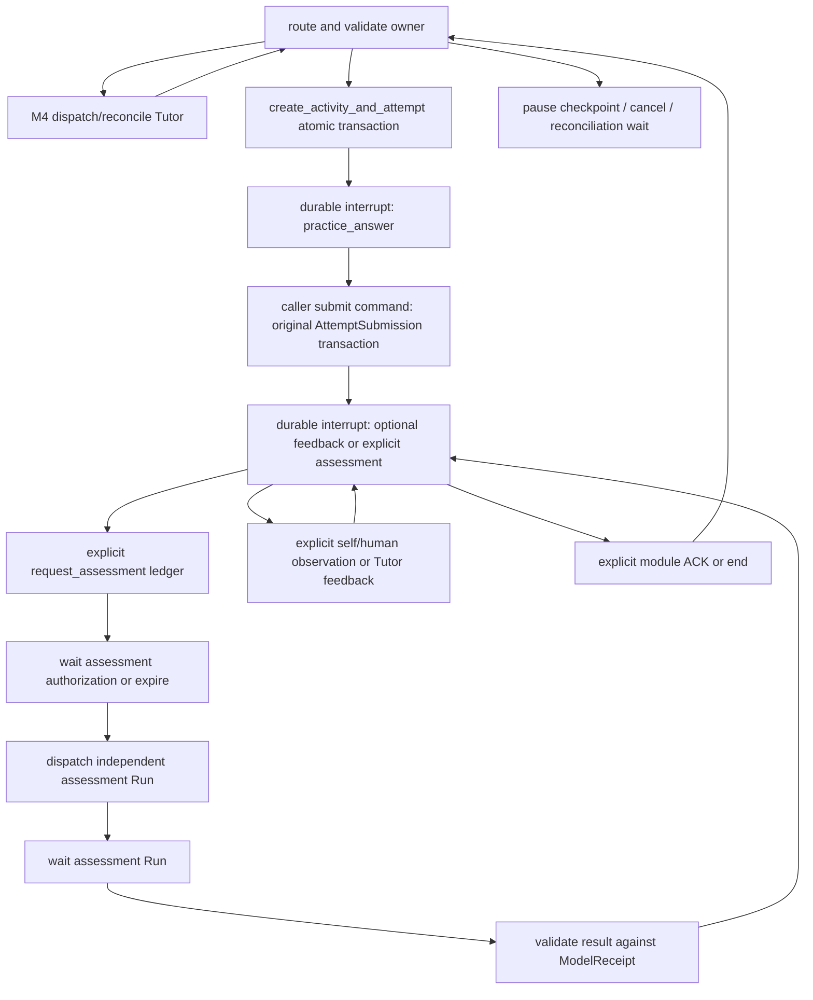

# M5: conversation practice, evaluation candidates and feedback

## Scope and rollout

This is an additive, explicitly opted-in engineering implementation. It is not a claim of real-model pedagogical quality, user competence, production acceptance, or M7 eligibility. Global default remains `workflow_engine=legacy`; `learning_graph_version=None`. M4 native acceptance remains independent of its engineering gates.

To admit **new** M5 learning executions, configure `CAREERFORGE_WORKFLOW_ENGINE=langgraph`, `CAREERFORGE_SESSION_GRAPH_VERSION=knowledge-session-v2`, `CAREERFORGE_LEARNING_GRAPH_VERSION=learning-session-practice-v1`. The existing explicit accepted-plan admission and completed-knowledge handoff create a new version-pinned execution. Existing `learning-session-v1` executions, action v1/v2/v3 payloads, checkpoints, IDs and frozen request hashes are not rewritten. Admission of a new practice-capable workflow must not overtake a live/unknown Tutor or assessment run. Historical same-conversation v1 can use a new explicit accepted-plan admission; no checkpoint hot migration occurs.

No new Agent, model role, scoring prompt, rubric algorithm or general command bus was introduced. `learning_assessment` still uses the original `evaluation` role, `assessment.model` stage, two existing assessment contracts, call cap 1 and original 30-minute Run request duration, capped by funding expiry. Build context-once, 250k configuration and unlimited build-duration opt-in remain unchanged.

## Actual graph topology

The paid assessment graph is `validate_frozen_input → evaluate_candidate → persist_candidate → finish`. Evaluation and persistence are separate real stages. The result is rebuilt from the completed ModelReceipt, not copied from checkpoint/resume payload. The unpaid session graph never borrows a paid lease or calls a model. A single completion observer schedules the owning learning execution; it does not invoke legacy automatic practice/evaluation progression.

Submission, observations, feedback and ACK are short explicit caller command transactions. The graph reconciles the durable effects, never resubmits them from a generic wake. Graph interrupts carry references only. The `create_practice` node is a real side-effect boundary, not a wrapper around a monolithic legacy loop.

## Durability and authority

`workflow_practice_requests` binds principal/namespace/conversation/workflow/execution, original action receipt/index, accepted plan/GoalVersion/module hashes, profile selection, ActivityInput, assistance mode and optional real Tutor source. Exactly one active practice slot is enforced by a unique nullable conversation FK plus CHECK constraints. Materialized activity/attempt/workspace/specification fields are all-null or all-present.

The creation node atomically writes the original activity/rubric, empty workspace, attempt, request links, `Idempotency(operation='workflow.practice.create', key=request.id)` and event. Every later read revalidates that effect receipt. A lost checkpoint cannot create a second exercise. Inconsistent already-committed effects stop for reconciliation, not a fresh creation attempt.

Submission stores original response/transfer strings without stripping or rewriting, preserves original AttemptSubmission fingerprint semantics, adds a UTF-8 response SHA-256 witness and seals the workspace. Conversation action receipt and submission witness commit together. An ordinary follow-up is not an answer. Same message key replays the original result before CAS; a changed payload conflicts. New practice requests include and enforce both conversation focus revision and workflow revision. Failed blank submissions are immutable failed action receipts; a corrected explicit submission uses a new key.

`workflow_assessment_requests` is separately receipt-bound. Its original expiration is included in the frozen request hash, never extended by wake/restart. Missing or owned-but-unusable funding keeps a bounded pending request without a Run. Foreign/unknown grants are rejected before a new action receipt. Exact authorization seals once; no fallback grant. Dispatch creates the Run/link/outbox in the same transaction. A periodic existing session reaper schedules expired waits; no in-memory timer/poll loop is required. Unknown external outcomes require reconciliation; a new key/Run/workflow cannot silently evade the original pending/unknown work.

New product writes follow Principal → Conversation → W/L → exact Funding → Plan → Profile, then Attempt/Workspace as required. ACK retains its existing Funding → true Plan → Profile → Turn ordering. No DB transaction spans graph invoke, checkpointer I/O or model calls. Paid workers use existing Funding/Run lease order and read immutable owner witnesses without taking reverse conversation write locks.

The shared Principal mutex uses PostgreSQL `FOR NO KEY UPDATE`, not `FOR KEY SHARE`. It still serializes account writers and repeated nested acquisitions, while allowing foreign-key `KEY SHARE` checks during receipt insertion. Using `FOR UPDATE` for this mutex creates a real reverse dependency when ACK holds Plan/Profile and another account operation holds Principal while waiting for selection. All non-Principal locks, foreign keys, privacy fences and authorization checks remain unchanged. Key-changing updates and deletion retain PostgreSQL's own stronger protection. SQLite test results cannot establish these PostgreSQL concurrency properties.

## Evaluation, observations and progress

- Model output is only `model_assessment_candidate`, not human observation or mastery. It does not call `record_observation` or advance the learning profile.
- Self review remains owner-authored. Human review requires a different genuinely authorized identity. Runtime evidence verification uses the attempt owner after reviewer access validation.
- Runtime evidence follows frozen Attempt → Submission → CommandAuthorization → ExecutionSnapshot and recomputes authorization digest, argv/manifest/environment identity and receipt fields. Genuine runtime observations require trustworthy non-synthetic execution-path fields. Text saying “ran successfully”, synthetic fixtures or source-code reading cannot substitute.
- Legacy observation records are never rewritten. Read-only projection marks an unverifiable historical runtime `demonstrated` outcome as `unknown`, retains the recorded outcome/assessment and exposes evidence unavailability.
- Tutor feedback must point to the real completed Tutor source attached to the practice. Consent defaults to false. No Experience is generated without explicit consent; original knowledge-dispute rules remain.
- Explicit ACK requires real teaching delivery and original acceptance checks. A submission/model pass does not bypass mandatory checks or mean permanent mastery.

## Control and legacy endpoint protection

Pause preserves the original answer/authorization wait and requires the exact saved control checkpoint to resume. Cancel seals only the corresponding still-started attempt workspace and retains submitted evidence, receipts and unknown Run state. Module changes while practice is active are rejected. Frozen source/publication/GoalVersion/namespace/privacy checks remain live.

Independent practice is account-wide, including Tutor requests with no Run yet and pending assessment assistance. Existing public Attempt submit/close endpoints use the same bound workflow guard and atomic wake. Standalone assessment/ACK endpoints cannot bypass a new graph-bound practice; use the same-conversation explicit commands. Unbound legacy attempts and assessments keep their existing interfaces.

The first M5 implementation deliberately does **not** offer `practice_help`; ordinary chat while an active practice exists returns `PRACTICE_ACTIVE`, never submits an answer or quietly generates help. End/abandon explicitly, or finish the practice before asking a new Tutor question. No code execution, file import, network use or coding assistance is implied by creating an empty practice workspace.

## Verification boundary

Synthetic engineering fixtures validate transactions, graph stages, controls, exact request identity, receipt integrity, model candidate projection and recovery. They are not real Pi/Kama business/semantic acceptance. Final source fingerprint, exact pass/fail counts, independent review and PostgreSQL/original-Celery hard-exit reports are in the release handoff. Native model quality/cost/latency remains a separate gate; actual billing is unknown rather than inferred from call cap.
