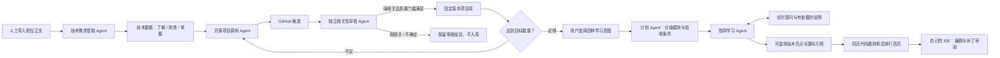

# Agent 主流程重构交付

完成日期：2026-10-15。对应用户最新结构要求；此前六模块为历史实现，不再作为主导航。

## 主流程与使用

在 /agent 新建方向，选择 1–5 份已导入正文，默认项目目标为 5，可改为 1–10。
现已在演示账号创建“Agent 开发”方向，关联资料库里三份既有 Agent 岗位正文；
尚未启动该方向的真实模型任务，未混入离线测试产物。

1. “提取需求”：一次受限模型调用；保存技术、英文/中文关键词、三级目标深度、推断说明和原文偏移。
2. “调研并审核一批”：Research 提出至多 3 个查询，GitHub 返回候选；
   Review 对至多 5 个候选分别读取固定 commit 的文档/源码，最多共 6 次模型调用，
   达到目标即停止。数量不足不自动续费、不无限循环，用户可再启动一轮。
3. 也可送审资料库已有固定版本项目，或单独重新审核某候选。
   同一仓库只计一次；人工副本明确保留远端版本与活跃度未验证的限制。
4. 达到目标后，选择技术、审核项目及学习意图：
   学习项目构建 / 学习整个项目 / 学习技术设计 / 学习函数实现。
   后两项必须指定设计或函数；函数学习还必须从审核项目的代码索引中选定实际函数/实现片段，计划的叶模块必须引用它。计划按最多三级父子模块组织，保留无环前置关系、
   具体步骤、成果、验收条件、源码亮点索引；覆盖全部所选技术。
5. “进入学习”：同页显示模块计划、参考代码、导师问答，可切换自己的 IDE。
   点击技术亮点或导师引用跳转到具体文件与行区间；跟随高亮可关闭。
   导师保留同模块最近 3 轮问答的有界摘要上下文，最多 3 次模型调用、
   7 次只读工具、4 个代码窗口。也支持单调用模式（先读取首个检索结果）。
6. 导学输出支持文字、结构化 SVG 图示、表格及带原文的代码解释。
   事件进度实时更新，完整回答在完成后展示，当前不是逐 token 流式输出。
   不执行模型 HTML/JS，不声称支持位图生成。
7. 模块进度由用户记录；“已完成”是本人记录，不代表正式能力验收。
   本机编辑、补丁审阅和隔离沙箱保留，所有命令仍须逐条确认。

## 架构和数据

- 新增 study_tracks：方向、冻结来源、数量目标、当前需求/计划版本、模块进度。
- 新增 study_artifacts：不可变需求、候选、审核、计划、导师回合。
- 迁移 cf201013a001，位于原最新迁移之后，保留历史数据。
- API：/api/v1/study/tracks，及 /runs、/candidates、/progress 子资源。
- 五个角色使用 agent-study-2.0 的明确 Python 阶段函数，复用 PostgreSQL、
  Celery/Redis、outbox、租约、计量收据、可恢复阶段、取消与来源权限。
  不引入 LangGraph，不依赖新向量数据库。
- 项目下载只走 GitHub API/codeload 公开固定主机；不执行仓库脚本。
  拒绝/不确定项目不会因下载而出现在学习项目库。
- 强相关需要来自已读取源码窗口的精确原文匹配；质量检查包括
  可识别许可证、非归档非 fork（自动发现项目），并记录静态覆盖范围。
  星数只是观测元数据，不能代替审核。
- 原文明确与推断深度分开。了解=解释用途和边界；
  熟悉=追踪流程及修改局部；掌握=独立实现、权衡与排错。
- 新需求版本使原审核不再计数，旧计划不被暗中改写。
  来源撤销会阻止读取派生报告，撤销项目会退出有效数量与计划范围。
- 界面主入口只有 Agent 工作台、需求资料、开源项目；历史功能保留在“更多”。

## 验证与部署

只增加并运行一个新流程离线贯通用例 test_study_pipeline.py。
初次运行在最后的测试删除请求中缺少版本字段；修正为既有删除合同后通过。
同一用例同时验证批次发现/弱相关拒绝/强相关入库/数量门槛/计划层级/
自主检索原文/图示与精确引用/本人进度/需求重提取失效/来源撤销/不同账号隔离。
所有模型和 GitHub 响应均是本地替身，测试库与本机业务库隔离。
开发未调用真实模型，未执行任何导入项目代码，也未开展全量回归。

新增后端 Ruff、前端 TypeScript/Vite 构建通过；已更新 OpenAPI 与生成类型，
构建并部署本机 Docker 后端、Worker、Dispatcher、前端及迁移。
桌面继续使用已构建的 0.2.0 外壳，网页流程更新无需重建 exe。
桌面目录访问权限仍仅在 /studio（含查询参数）授予。

边界：真实供应商输出质量、GitHub 网络/限流下的候选质量和实际学习效果
尚未以本轮真实任务验证；静态源码依据不等于工程运行验收。
研究工具保留 incomplete_results、查询和观测时间，限流时停止，不静默伪造结果。
源码索引继续采用固定版本、词法与结构检索；非 Python 主要按文本窗口索引。
