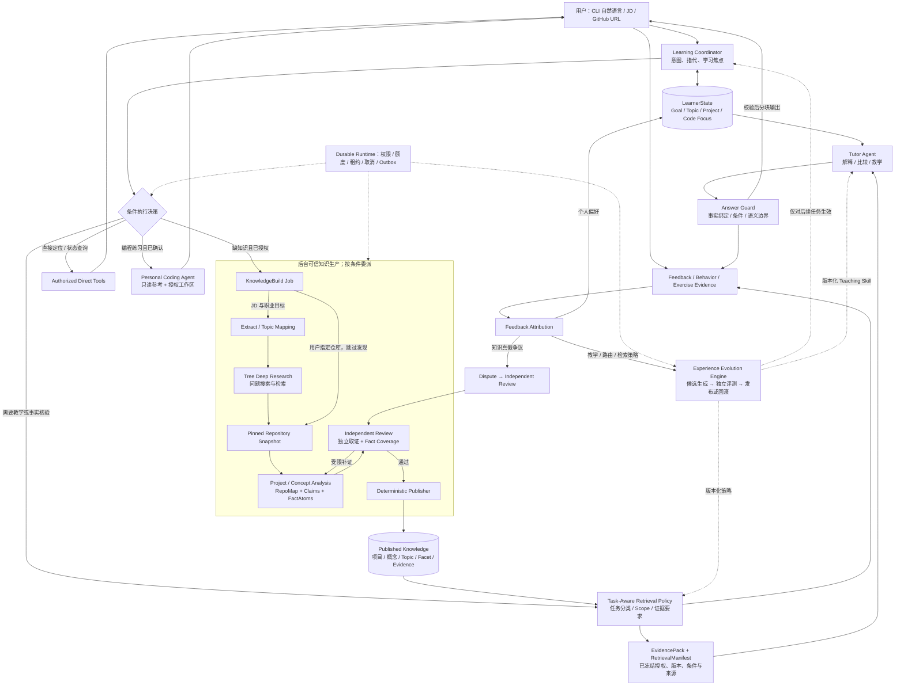
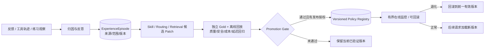

# CareerForge v1.5｜业务架构总览

> **定位**：CLI 优先的职业导向、多 Agent、可信源码学习系统  
> **版本**：v1.5 / 2026-10-29 / 目标架构评审稿  
> **配套**：《CareerForge_v1.5_技术实现方案.md》  
> **严格知识治理合同**：沿用 v1.2.1《整体技术设计与架构评审——架构缺陷修复版》，本稿不放宽其权限、审核、跨域依赖、发布、默认版本及执行审批约束。  
> **事实边界**：下文描述最终业务能力，不表示当前 GitHub 仓库全部实现。现有代码与目标增量分列于第 10 章。

## 1. 产品定位与三项核心架构能力

CareerForge 让用户在 CLI 中自然语言导入岗位 JD、指定开源仓库或提出技术学习问题。系统自动寻找相关项目、生成可验证的项目与概念知识，经独立审核发布后，在后续对话中根据学习上下文自动选择检索方式，用真实源码证据指导学习和编程实践。

用户**不需要选择“按项目检索”还是“按技术检索”**，也不需要手动切换多个 Agent。用户可以说“讲刚才这个函数”“换一个框架比较”“我没看懂，先带我读代码”，系统按当前焦点和任务类型决定接下来执行什么。

v1.5 将 v1.4 的设计正式收敛为三个架构能力：

| 核心能力 | 产品含义 | 非目标或禁止行为 |
|---|---|---|
| **Task-Aware Evidence-Grounded Retrieval**（任务感知、证据驱动的混合检索） | 根据提问任务选择精确符号、架构、概念、跨项目比较或证据核验等不同检索策略；用已审核知识和来源回答 | 不是所有问题都调用 FTS + 向量 + 重排；向量召回不能成为事实证明 |
| **Centralized Orchestration & Conditional Delegation**（集中协调、条件委派） | Coordinator 统一理解意图；确定性 Runtime 决定工具直达、Tutor、后台构建或专业子 Agent 委派 | 不是每个用户问题都执行 Research → Analysis → Review；模型不能自己授权付费或发布知识 |
| **Evaluate-Before-Promote Self-Evolution**（先验证、再发布的自进化） | 从反馈与轨迹生成 Skill/Policy 候选，经过独立回放与 Gold 检验、权限审批后版本化发布，失败可回滚 | 单次点赞不直接更新全局 Prompt；经验系统不能修改已审核项目事实或降低安全门禁 |

**系统的三个数据边界**：

1. **学习状态**：用户正在学什么、当前问题指向哪里、需要怎样教学；它不是源码事实。
2. **可信知识**：项目/概念的已审核 Claim、FactAtom、EvidenceRef、源码版本与适用条件；它不是用户能力分数。
3. **可进化策略**：Teacher Skill、检索配方、路由启发式和经过评测的策略版本；它不能代替知识审核。

## 2. 总体业务架构



**工作流与执行策略的关系**：知识构建必须经过来源固定、Analysis、Independent Review 和 Publisher；但一轮已有知识的普通学习提问不应重新启动整套构建流水线。后台任务与前台对话解耦，用户可以在研究进行时继续学习已有知识。

## 3. 集中协调与条件委派

### 3.1 两层决策，不让模型直接执行高风险动作

**Learning Coordinator** 是模型逻辑角色：从用户话语、最近会话、LearnerState、任务状态中生成 `IntentDecision`，明确意图、实体、学习焦点、信心、所需证据和建议动作。

**Orchestration Policy + Durable Runtime** 是确定性服务：检查授权、预算、版本、工具权限、任务是否已有结果及是否需要委派，再生成实际任务、工具调用或补充澄清。Coordinator 的建议不能自行改变这些规则。

### 3.2 条件执行表

| 用户需求或条件 | 执行策略 | 是否委派专业 Agent |
|---|---|---|
| “打开上次引用的函数”“看任务状态” | 已有引用/状态的确定性工具直达 | **否** |
| “讲一下 Tool Calling 原理” | 自动定位 Topic，检索已审概念与相关项目，交给 Tutor | **只调用 Tutor**，无新 Research |
| “这段代码为什么这样实现？” | 继承当前项目/函数焦点，执行符号与证据定向检索，交给 Tutor | **Tutor + 检索工具** |
| “其他项目如何实现？” | 自动将范围扩为该 Topic 的多个已审项目，使用 Facet 对齐 | **Tutor + 分项目检索** |
| “这个项目完全没有重试吗？” | 检索支持/反证和未分析范围；不足则报告 Gap | 缺口获授权后才交 **Analysis**；不能把无命中当否定 |
| “帮我找能学习 Memory 的项目” | 有已有项目先复用；候选不足且已授权才建 Research Job | **条件委派 Research** |
| 发现未分析的固定仓库 | 先 RepoMap、Analysis，之后独立 Review | **Analysis → Review**；Publisher 不委派给 LLM |
| “写一个小练习并试运行” | 生成练习；补丁和命令分别人工确认 | **Coding Agent**；执行走沙箱 |
| 含糊的“它们”“这段”且无法消解 | 保留候选指代并询问必要澄清 | **不猜测跨项目范围** |

### 3.3 委派的适用条件与返回结果

条件委派由任务合同限定：

- **为什么委派**：已有知识不足、需要源码深读、跨主题搜索、独立审查或编码实践；明确 `reason_code`。
- **委派给谁**：仅注册的专业角色和只读/已授权工具；每个子任务冻结学习目标、来源、Scope、版本、预算、截止时间与交付 Schema。
- **何时不委派**：已审证据足够、确定性工具即可完成、预算或授权不足、知识纠错路径正在处理中。
- **如何交接**：只交结构化 Artifact 和可追溯 Evidence ID，不复制父 Agent 全部聊天历史；子 Agent 不能发布或自行提高额度。
- **如何停止**：达到停止条件、预算耗尽、用户取消、证据不足或审核拒绝均形成明确状态，不虚构完成。

Research Tree 的逻辑层级不等于 Agent 嵌套深度；可以由集中调度器在一个持久 Job 下推进研究树。审核和发布门禁不能被“快速路径”绕过。

## 4. 任务感知、证据驱动的自动检索

### 4.1 任务不是只有“项目 vs 技术”两类

用户不必选择模式。系统先理解**任务类型**，再决定检索范围与证据策略：

| 任务类型 | 检索策略 | 主要证据 |
|---|---|---|
| `locate_symbol` | 当前快照的符号/路径精确查找，词法兜底 | 固定 Commit、文件、行区间及符号 |
| `explain_project_architecture` | RepoMap + 已审架构 Unit + 关键源码 | 架构关系的 Claim/FactAtom 与源码 |
| `explain_implementation` | 已审机制 Unit + 关键函数关联 + 有界源码精读 | 调用路径、条件及异常边界的已审 Claim |
| `teach_concept` | 规范 Topic + 已审概念知识 + 项目实例 | 有来源的 Concept SourceSet、项目实现卡 |
| `compare_projects` | Topic / Facet 约束 + 全部授权项目目录 + 每项目有界召回 | 按 Facet 对齐的 Claim、状态与限制 |
| `verify_claim` | 按 Claim / Evidence ID 直接回读，必要时提 Dispute | 已审决定、原文、反证和审核边界 |
| `discover_projects` | 先复用库；不足再在授权下触发 Research Tree | 候选观察、未证实线索，之后走 Analysis/Review |
| `practice` | 当前学习目标/已审知识 + 练习与工作区合同 | 目标、Rubric、允许帮助、源码引用 |

### 4.2 Evidence-Grounded 的产品承诺与边界

一轮教学回答的项目事实链为：

`UserTurn → TaskSpec / Focus → RetrievalPolicy → Selected Publications → KnowledgeUnitVersion → Claim / FactAtom → EvidenceRef → AnswerDraft → Answer Guard → Validated AnswerBlock`。

- **证据先于结论**：FTS、向量和重排负责“找候选”，不是“批准事实”。真实项目事实必须来自当前有权限、未撤销的已审核知识。
- **条件保留**：若已审 Claim 为“配置 X 开启时调用 Y”，Tutor 不能把它讲成“始终调用 Y”。比较表格、图边和自然语言都执行事实绑定检查。
- **知识缺口可见**：区分未检索到、未分析、审核不足、已反证、版本失效，不把其中任何一种简单回答为“该项目没有”。
- **完整目录与有界回答分离**：技术入口可以分页列出当前授权范围内全部匹配项目，单轮回答仅使用有限且明确列示的项目证据。
- **学习上下文与证据上下文分离**：学习偏好影响解释方法，不能成为项目知识证据；已有知识是否可信由独立审核与版本状态决定。

### 4.3 混合检索的执行策略

简单符号定位优先精确结构化通道；概念性问题优先 Topic、词法与语义候选；跨项目问题按项目分组召回并对 Facet 对齐；核验问题直接回读证据，**不是所有问题一律执行 FTS + pgvector + Reranker 全套流水线**。

Redis 的 Exact/Base/Derived 三级缓存只加速查询，不授予新的检索权限；命中仍须校验 Publication、SelectionManifest 与授权版本。

## 5. 可信知识生产与双向索引

知识构建始终采用：

`Extract / 直接仓库输入 → Research（仅在需要找新项目时）→ Pinned Snapshot → Repository-wide Mapping → Topic-oriented Analysis → Independent Review → Deterministic Publisher → Published Knowledge`。

- **Tree Deep Research**：专注问题拆解、GitHub 搜索、线索追问、跨分支去重和候选多样性；不直接证明实现机制。
- **Project / Concept Analysis**：项目先有 RepoMap，再按需求深读架构、技术、函数和设计取舍；通用前置概念绑定非仓库 SourceSet；产出带条件的 Claim、FactAtom、来源和知识版本。
- **Independent Review**：先独立取证，再审 Analysis 的来源，核查正文中的所有项目事实及 Topic/Facet 关联；“文字流畅”“引用存在”都不足以通过。
- **Knowledge Publisher**：仅由确定性代码发布精确审核版本，保存默认版本指针与依赖图；允许部分知识单元入库，拒绝“整个仓库一票通过”。

同一事实库具有两个**内部检索路径**：

```text
Project-first（内部）：Project / Snapshot → Topic → Unit → Claim / Evidence
Technology-first（内部）：Topic → 全部授权项目目录 → Unit / Facet → Claim / Evidence
```

这两个路径由任务感知路由自动选择，不会在 CLI 中要求用户先切换模式。概念 Unit 可脱离仓库存在，但必须有独立来源和审核状态。知识的 Publication 状态、版本新鲜度、职业适用性和默认选用版本互相独立。

## 6. Tutor、Learning Context 与 Coding 实践

### 6.1 Tutor 不是自由生成的源码讲解器

Tutor 的回答必须以 `EvidencePack` 为知识基础，以 `LearnerState` 决定解释风格；回答分为有证据的项目事实、已审概念教学、用户可选择的教学动作，以及明确标识的知识缺口。新增未审核项目机制不能混入被称为“已审”的回答。

`Answer Guard` 采用分级方式：精确复用已审内容走模板化快路径；新的受控改写检查条件、量词、否定、版本和适用范围；涉及安全、性能、恢复或普遍性断言的高影响解释必须使用受支持的保守表述或进入专门复核。原始模型 token 不能绕过校验提前显示；在服务端冻结已验证块后再流式发送。

### 6.2 Coding 和能力记录

- 用户可要求生成代码练习、理解检查、实现小模块或比较不同代码方案。
- Personal Coding Agent 使用与练习绑定的只读知识和显式选择的用户工作区；补丁、应用、命令执行、验收必须分开授权。
- 保存练习问题、Rubric、运行观察、本人解释和辅助模式；“代码运行成功”不能直接写成“用户已掌握”。

## 7. 验证后发布的自进化

### 7.1 三种反馈路径，不能混淆

| 反馈 | 允许的即时动作 | 需要的后续流程 |
|---|---|---|
| “我看不懂，先看代码” | 修改**该用户**当前教学偏好，换成 code-first | 可以记录可纠正的学习观察 |
| 检索错过关键证据 / Router 选错范围 / Skill 教学效果差 | 保留轨迹与错误归因，创建策略候选 | **独立评测后才能发布新 RoutingPolicy / RetrievalRecipe / TeachingSkill** |
| “这个项目没有自动重试，你讲错了” | 创建 Dispute；必要时暂停受影响知识 | **Independent Review** 复核，不能让自进化直接改已审核事实 |

显式纠错比点击/停留时间更可信，但用户反馈依然不能单独充当源码真实性标签。自动采集行为事件遵守用户同意和私有域隔离。

### 7.2 Evaluate-Before-Promote 闭环



**发布门禁不由提出 Patch 的模型自评。** 候选须与固定基线在独立样本、相同模型与资源约束下比较，记录评测集版本和完整 trace；不能通过优化训练集上的表现冒充线上改进。权限、知识发布、引用有效性、隐私和预算是硬约束，不能为提升点赞率而降级。

### 7.3 分层发布权限

- **个人教学偏好**：可即时生效，限该用户、可删除、可撤回，不等于全局 Skill 发布。
- **低风险 Teaching Skill**：在明确的自动发布策略和 Gold/回归通过后，可由系统版本化自动发布，保留监测与回滚。
- **RoutingPolicy / RetrievalRecipe**：因可能改变证据范围与检索质量，需更严格的离线评测和管理员/用户授权；变更不得扩大数据外发范围。
- **Review / Publisher / Answer Guard 安全门禁**：不作为自进化系统的自动修改对象；若需调整，必须进入单独的工程变更和独立审查流程。

## 8. CLI 用户场景

```text
$ careerforge chat

> 我在找 AI Agent 实习，这是几个 JD
  → Extract 技术要求 → 已审知识复用 → 对明确缺口申请研究授权

> 先学 Tool Calling，给我找几个真实的实现
  → 自动识别 teach_concept + compare_projects → 全部匹配项目分页目录 + 有界证据包

> 就讲这个项目的工具注册流程
  → 沿用当前项目快照 → 已审机制 + 精确函数引用 → Tutor

> 为什么它出现异常后会重试？
  → verify/explain_implementation → 查触发条件与控制流；不够就标记 KnowledgeGap

> 那其他框架怎么处理？
  → 自动切换 compare_projects → Facet 对齐 + 各项目有来源的差异

> 别从定义讲了，先带我看代码
  → 个人教学偏好即时调整；后台积累受控改进经验

> 你刚才说的这段证据不对
  → Dispute → 证据复核；不直接写 Skill 或改 KnowledgeUnit
```

## 9. 产品级验收标准

| 能力 | 必须通过的场景 | 不能只用什么代替 |
|---|---|---|
| 任务感知检索 | 同一轮对话正确分辨定位、架构、机制、概念、比较、核验，并选择不同通道 | 只看一个 Router 准确率 |
| 证据驱动回答 | Claim/FactAtom 到源码与最终句子/表格/图边一致，条件不丢失 | Citation ID 存在或 Reranker 分数高 |
| 集中协调 | 确定性操作直达；有现成知识不触发昂贵研究；缺证据授权后才委派 | Agent 数量多、每轮都有工具调用 |
| 条件委派 | 原因、权限、预算、隔离上下文、完成/失败/取消有追踪 | 子 Agent 输出看起来合理 |
| 自进化 | 候选只在独立评测及硬门禁通过后版本发布，失败/退化可回滚 | 用户点赞或模型自我打分 |
| 长期一致性 | 发布状态撤销后新回答立即阻断；私人计划可合法依赖公共知识 | Redis TTL 自动到期 |
| CLI 体验 | 多轮追问、已验证回答块流、任务继续、恢复不重复调用 | 仅打印一整段 LLM 回复 |
| 教学效果 | 可以记录理解检查、练习、帮助条件，并调整下一轮教学 | 对话轮数或自报完成 |

## 10. 已实现与目标增量

**当前仓库基线 `Sw1ven-Wang/CareerForge@90e32f1`（2026-10-19）已有的基础**：Python/FastAPI/Pydantic、PostgreSQL/SQLAlchemy/Alembic、Redis/Celery 与 Outbox/租约/调用收据、有界 GitHub 搜索与 Commit 固定、Python AST/词法代码检索、Extract/Discover/现有 Review/Plan/Tutor、受限 Pi Coding SDK、补丁审阅与隔离执行、现有 Web/Tauri 界面。

**v1.5 目标、尚需实现和评测**：Typer/Rich CLI；具有任务分类与策略选择器的 Hybrid RAG（pgvector、Embedding、RRF/Reranker 按任务条件调用）；集中 Coordinator 与 `DelegationDecision` 及策略执行合同；Tree Deep Research、两层 Analysis、真正独立的知识审核与发布；严格 Fact/Answer Guard；Redis 三级缓存；从用户轨迹生成并验证/发布 Skill、路由、检索策略的 Experience Evolution Engine；OpenTelemetry/Prometheus 和 Gold 回归体系。

**版本边界**：本稿是业务架构目标，非现有代码可用性声明。用户上传资料、私人学习记录、公开仓库与公共知识在权限和数据外发上分别治理。涉及知识身份、默认版本、跨 Namespace 依赖及其失效传播，以 v1.2.1 严格合同为权威。
