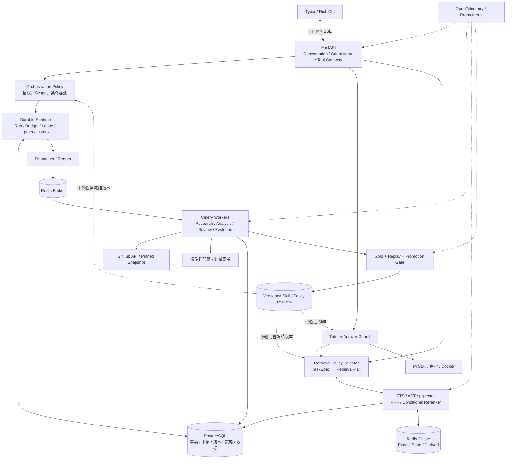
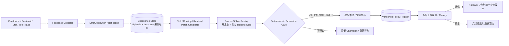

# CareerForge v1.5｜技术实现方案

**副标题：CLI + Task-Aware Evidence-Grounded Retrieval + Centralized Multi-Agent + Verified Self-Evolution**

> **文档类型**：技术栈、模块接口、关键数据合同、工程约束与验收方案  
> **版本**：v1.5 / 2026-10-29 / 目标技术设计，供 Review 及后续 Codex 开发使用  
> **配套业务文档**：《CareerForge_v1.5_业务架构总览.md》  
> **兼容原则**：完整继承 v1.2.1 的 KnowledgeUnit、Claim/FactAtom、跨 Namespace 依赖、Publication/SelectionHead、独立审核和 Coding 执行授权合同；本文对 v1.4 三项核心能力进行细化，不默默降低安全标准。  
> **状态**：`[已有]` = 固定仓库基线已具备相关代码；`[目标]` = 尚待实现和实测。不将技术选型等同于实现成果。

## 1. 技术栈总览：哪些技术负责什么

| 层次 | 技术栈 / 方法 | 职责 | 状态 |
|---|---|---|---|
| CLI | Python、**Typer**、**Rich**、httpx、SSE | 类 Claude Code 的多轮会话、事件、知识引用、任务/改进状态 | `[目标]` CLI；HTTP 基础已有 |
| API / Agent | Python 3.12、**FastAPI**、**Pydantic**、OpenAI-compatible API | 聊天入口、角色结构化输出、Tool Calling、统一任务合同 | `[已有]` 后端与模型基础；Coordinator `[目标]` |
| 集中编排 | **PostgreSQL + Celery + Redis Broker + Transactional Outbox + Lease/Epoch** | Durable Runtime、条件委派、任务幂等、取消、预算与恢复 | `[已有]` 运行内核；新路由/委派合同 `[目标]` |
| 业务数据 | **PostgreSQL、SQLAlchemy、Alembic** | Goals、Topics、Project、Knowledge、Evidence、权限、策略版本、评测与审计 | `[已有]` 基础；新关系与策略表 `[目标]` |
| 项目研究 | **GitHub REST API**、Research Planner、Frontier、Reflector | 有界树状搜索、查询改写、线索跟进、候选聚合 | `[已有]` 基础搜索；研究树 `[目标]` |
| 源码理解 | **Python AST、Tree-sitter**、只读 CodeInvestigation | RepoMap、符号/模块、关键函数及实现机制调查 | `[已有]` Python AST；TS/JS/Go 扩展 `[目标]` |
| 任务感知 RAG | **PostgreSQL FTS、pgvector、Embedding、RRF、Reranker（可选）** | 不同任务选择不同检索通道；有权限的分组召回和证据材料组织 | `[已有]` FTS/路径/符号；向量与策略选择 `[目标]` |
| 三级缓存 | **Redis、Exact/Base/Derived Cache、Singleflight** | 请求合并、索引/证据候选复用、跨项目比较预计算和版本失效 | `[已有]` Redis 设施；业务缓存 `[目标]` |
| 可信知识 | **Claim、FactAtom/FactBinding、EvidenceRef、Independent Review、Publisher** | 审核事实、约束正文、版本化入库、撤销和依赖传播 | `[已有]` 引用位置校验；完整知识合同 `[目标]` |
| Tutor 与 Memory | LearnerState、Context Manifest、EvidencePack、Answer Guard | 记住学习焦点，基于已审知识教学，校验后分块输出 | `[已有]` Tutor/四区上下文基础；严格 Guard `[目标]` |
| 自进化 | **Experience Store、Reflection、Skill/Policy Registry、Gold、Offline Replay、Promotion Gate** | 反馈生成候选、离线验证、受控发布、监控、回滚 | `[目标]`；ACE/GEPA/SkillOpt 等仅作为方法参考 |
| Coding | **Pi Coding Agent SDK、Node.js、Docker Sandbox** | 受限参考源码阅读、补丁建议、显式审批、隔离运行 | `[已有]` 受限基础；学习实践联动 `[目标]` |
| 性能与评测 | **asyncio、OpenTelemetry、Prometheus、pytest、Ruff、mypy** | I/O 并发、请求和模型收据追踪、延迟与质量回归 | `[已有]` pytest/Ruff/mypy/收据；监控和基准扩展 `[目标]` |

**不为简历堆技术**：不强制改写为 LangGraph/LangChain；不同时引入 FAISS、ChromaDB 和 pgvector 三套相似存储；不默认引入微服务、图数据库或模型权重训练。当前 v1.5 主要优化运行策略、检索和教学，而不是改动基础模型权重。

## 2. 技术部署与控制平面



**三个控制原则**：

1. PostgreSQL 保存任务、审核、权限、发布和策略版本的**权威状态**。Redis Broker 是投递媒介，Redis Cache 是易失加速层；二者建议分实例或至少隔离淘汰与容量策略。
2. Coordinator 是“建议做什么”的模型角色，Orchestration Policy 和 Runtime 是“能否做、谁执行、是否收费”的确定性控制层。独立 Reviewer 不能自行批准其审核产物发布。
3. CLI 仅为薄客户端。后台 Research/Analysis/Review/Evolution 不依赖前端在线；已发布知识仍可在构建任务运行时回答问题。

## 3. 统一合同：从用户问题到可执行任务

### 3.1 `IntentDecision`（模型提议，非授权）

```yaml
IntentDecision:
  turn_id: UUID
  interpreted_intent: import_goal | locate_symbol | explain_project_architecture |
    explain_implementation | teach_concept | compare_projects | verify_claim |
    discover_projects | practice | dispute | inspect_progress | other
  resolved_entities:
    goal_version_id: UUID_or_null
    topic_ids: [UUID]
    project_snapshot_ids: [UUID]
    code_focus_ref: UUID_or_null
  reference_resolution: {status: resolved|ambiguous|missing, basis_refs: [UUID]}
  confidence: float                    # 仅供策略参考，不自动扩权
  requested_evidence_level: reviewed_knowledge | direct_source_lookup
  proposed_next_action: direct_tool | retrieve_and_tutor | knowledge_build |
    coding | ask_clarification | record_gap
  rationale_codes: [string]            # 可审计理由，不保存模型隐藏思维链
```

`IntentDecision` 先根据会话焦点和最近引用消解“它们”“刚才这个函数”；若无法确定必要实体，只询问一项关键澄清，不以模型置信度强行挑选另一个项目。用户明确指定的项目/技术优先于历史焦点。

### 3.2 `OrchestrationDecision`（服务端验证后生效）

```yaml
OrchestrationDecision:
  action: direct_tool | invoke_tutor | start_background_job | invoke_coding |
    ask_clarification | return_evidence_gap
  trigger_code: exact_navigation | published_evidence_available | knowledge_gap |
    new_repository | comparison | practice_authorized | ambiguous_focus
  principal_id: UUID
  authorized_scope_ref: UUID
  focus_revision: integer
  source_version_refs: [UUID]
  model_role: tutor | research | analysis | reviewer | coding | null
  task_contract_ref: UUID_or_null
  tool_allowlist_ref: UUID
  budget_reservation_ref: UUID_or_null
  parent_run_id: UUID_or_null
  policy_version: string
  reason_codes: [string]
```

只把服务端批准的 Decision 交给执行器。实际执行不接受模型改写 `principal_id`、工具权限、费用承担者或知识发布决议。路由/委派策略具有版本与回归记录。

### 3.3 委派何时发生

| 状态与触发 | 执行动作 | 不允许的捷径 |
|---|---|---|
| 已有合法精确引用、用户仅请求定位 | 直接查位置/跳转 | 为定位函数启动 Research |
| 证据齐全、用户要求解释 | 检索 + Tutor | 重跑 Analysis 和 Review |
| 目标项目未入库、用户直接指定 URL | 固定仓库 → Analysis → Review | 因跳过 Research 而跳过审核 |
| 用户要求新项目，现有库不满足覆盖 | 获授权后启动 Research Tree | 用户只是闲聊就无限搜索和计费 |
| Analysis 新产出待发布知识 | 委派独立 Reviewer 后交确定性 Publisher | Coordinator 跳过 Reviewer 直接发布 |
| 跨项目比较可用已审 Facet | 分项目检索和 Tutor 比较 | 无审核就用 README 生成比较结论 |
| 需要修改代码且用户明确授权 | Coding Agent 生成待审补丁；命令再单独批准 | 从参考仓库直接运行安装脚本 |
| 证据不足 / 费用、来源权限不足 | `KnowledgeGap` / 等待批准 / 部分完成 | 降低审核或安全条件换取成功 |

### 3.4 集中协调与子 Agent 的运行协议

- 根 `AgentRun` 具有冻结 TaskContract：输入版本、来源、工具、模型 Profile、预算、截止、Prompt/Policy 哈希、幂等键与 Owner/Namespace。
- 专业 Agent 是**按需调用的角色**，不是用户每发一条消息就跑一遍全部角色。子任务仅拿到所需 Artifact 与 Read-only Evidence IDs；不继承父任务完整私人历史。
- 保留现有 `waiting_children`、租约/epoch、预算预留/结算、取消传播及 Outbox。当前子任务“最多两个”的具体既有边界不能被解释成无限总数并发为二；如果扩大总任务数量，必须引入新版本的 Runtime 合同。
- **Research Tree 是逻辑树，不是进程递归树**：Frontier 可以在一个 Run 内检查点式推进多个 SearchNode，而不是为每层无界启动新的 Agent。
- 外部请求结果未知不自动重发付费模型调用；回放仅使用已持久化的阶段产物和收据。失败或被取消的子 Agent 不得自行发布知识。

## 4. Task-Aware Evidence-Grounded Hybrid Retrieval

### 4.1 两层路由：范围选择与检索方案选择

第一层 `Intent Router + Scope Resolver` 从当前问题自动确定 Topic、项目集合、快照、版本和权限。第二层 `Retrieval Policy Selector` 按**任务类型、证据要求、范围、查询复杂度和成本/时延预算**选择检索通道。

**不能只用“项目检索 / 技术检索”表示 Task-Aware**。二者是范围维度，另有定位、解释、概念教学、比较和事实核验等任务维度。

| task_type | 主通道 | 条件通道 | 结果组织与证据要求 |
|---|---|---|---|
| `locate_symbol` | 项目快照 Symbol/AST 精确检索 + 路径 | 词法回退；不默认向量/Reranker | 返回文件、行、Commit、符号；若要求解释再取已审 Claim |
| `explain_project_architecture` | RepoMap、已审 Architecture Unit、Topic | FTS + 语义召回 + 有界重排 | 结构关系/图边绑定 FactAtom、证据和覆盖边界 |
| `explain_implementation` | 机制/函数 Unit、精确代码引用、关联符号 | 词法/向量补召回，必要只读引用复核 | 必须保留行为条件、版本、失败边界 |
| `teach_concept` | Topic/Facet、双语别名、已审概念 SourceSet | 向量语义召回、按教学目标取项目案例 | 概念来源可不依附仓库；项目实现仍需单独证据 |
| `compare_projects` | Topic/Facet 关系层，先分页列全部授权项目 | 各项目有界 FTS/向量/重排 | 每格按项目冻结版本与 Claim；unknown 不能推成“不支持” |
| `verify_claim` | 根据 Claim/Evidence/Publication 直接回读 | 需要新的源码疑点时建 Dispute | 展示支持、反证、限制；不必走普通全库相似检索 |
| `discover_projects` | 已有知识/候选先复用；缺口授权后启动 Research Tree | GitHub 相关搜索与本地快照检索 | ResearchResult 仅是候选，不授予已审知识身份 |
| `practice` | LearnerState + 当前 KnowledgeUnit / Rubric | 定位当前练习工作区与参考代码 | 输出 ExerciseSpec/可审补丁，不绕过沙箱审批 |

### 4.2 `RetrievalTaskSpec` 与 `RetrievalPlan`

```yaml
RetrievalTaskSpec:
  turn_id: UUID
  task_type: locate_symbol | explain_project_architecture | explain_implementation |
    teach_concept | compare_projects | verify_claim | discover_projects | practice
  user_question: string
  focus_revision: integer
  topic_ids: [UUID]
  project_snapshot_ids: [UUID]
  authorized_namespace_refs: [UUID]
  evidence_policy: published_only | direct_source_observation  # source 只能显式标未审
  freshness_policy: selection_manifest | explicit_pinned
  required_facets: [string]
  language_hints: [string]
  max_project_samples: integer
  max_evidence_tokens: integer
  latency_budget_ms: integer
  selected_routing_policy_version: string

RetrievalPlan:
  allowed_channels: [topic_relation, ast_symbol, postgres_fts, pgvector, source_read]
  channel_order: [string]
  query_variants: [string]
  fusion: none | rrf
  rerank: enabled | disabled
  group_by_project: boolean
  per_project_limit: integer
  recipe_version: string
  stop_and_fallback_rules: [string]
```

**Trust boundary**：模型可以提议 Topic、任务与 Query 变体，服务端根据当前授权和 `RetrievalPolicyVersion` 重建 `authorized_namespace_refs`、合法 `project_snapshot_ids` 和 `allowed_channels`。不得由 LLM 选择 `evidence_policy=direct_source_observation` 以绕过已审要求；正式 Tutor 项目事实默认 `published_only`。

### 4.3 多阶段候选召回与证据回读

```text
UserTurn + Focus + Authorized Scope
  → RetrievalTaskSpec
  → Query Normalization：Topic/Facet、中文英文别名、符号候选
  → 根据 RetrievalPlan 选择必要通道
      ├─ Topic / Relation SQL
      ├─ AST / Symbol / Path
      ├─ PostgreSQL FTS
      └─ pgvector Embedding（仅当适用）
  → 稳定 ID 去重 + 可选 RRF 融合
  → 跨项目按项目分组 + 有界 Reranker（必要时）
  → SelectionHead / SelectionManifest 冻结版本
  → 权威 ACL / Publication / 依赖有效性回查
  → 读取已审 Claim / FactAtom / EvidenceRef
  → RetrievalManifest + EvidencePack
```

**RRF 与 Reranker** 仅排序候选，不改变知识发布资格。多语言问题优先规范 Topic/Facet 与中英文别名，再尝试 Query Rewriter；不可因没有嵌入模型就放弃中文到英文代码符号的检索。pgvector 的 ANN 与预过滤/后过滤配置必须在实际权限过滤场景测试 Recall@K。

跨项目 `list_projects_for_topic` 使用有权限的关系查询分页遍历**全部匹配项目目录**；`answer` 在目录中选取有限样本材料，必须显示“本轮用了哪些项目、未读哪些项目”。没有命中应说明是 `unindexed`、`unanalyzed`、`review_insufficient`、`stale`、`no_authorized_match` 等具体状态，不直接得出“功能不存在”的否定结论。

### 4.4 `EvidencePack` 是 Tutor 唯一的项目事实入口

```yaml
EvidencePack:
  retrieval_manifest_id: UUID
  selection_manifest_id: UUID
  focus_revision: integer
  task_type: string
  authorized_source_versions: [VersionedRef]
  knowledge_units:
    - publication_id: UUID
      unit_version_id: UUID
      topic_ids: [UUID]
      claim_ids: [UUID]
      fact_atom_ids: [UUID]
      applicability_conditions: [string]
      citation_refs: [EvidenceRef]
      scope_limitations: [string]
  source_observations: [TypedUnreviewedObservation]  # 单独区隔，默认不能作项目结论
  uncovered_questions: [string]
  provenance_hash: sha256
```

`RetrievalManifest` 另存实际查询变体、通道、候选、排名、去重、裁剪、拒绝原因、模型/Embedding/Reranker 版本、权限与发布修订。这样可以重放检索决策、定位失败原因，也为 Evolution 产生有可审计来源的训练/评测轨迹。

## 5. 可信知识生产：Research / Analysis / Review / Publisher

### 5.1 Research 专注搜索，不当分析器

`ResearchBrief → Planner → ResearchTree/Frontier → GitHub Collector → SearchObservation / CandidateRegistry → Reflector → 动态补问或停止 → ResearchResult`。

研究树节点、查询、来源、GitHub 限流、重复项和成本持久化；Project/Code Search 线上命中只有搜索线索地位。用户直接指定仓库则跳过候选发现，进入固定源码快照，仍不得跳过 Analysis/Review。

### 5.2 Analysis 专注项目和概念知识

项目分析：`Pinned Commit / Scope → RepoMap → Topic-oriented CodeInvestigation → KnowledgeUnitDraft → Claim + FactAtom + EvidenceRef → Render AST`。概念分析：`Concept SourceSet → Topic/Prerequisite → Concept Unit → 独立引用与审核`。

项目范围内的每条行为断言保留适用条件、函数位置、Commit、原文/文件 Hash 和读取记录。解析能力覆盖 Python AST，并将 Tree-sitter 用于 TS/JS/Go 多语言结构候选，不能宣称静态符号图等于准确运行调用图。

### 5.3 Independent Review 与 Publisher 的不可绕过路径

1. Precheck 冻结内容、Claim/FactAtom/Render AST、版本/授权/原文 Hash。
2. Reviewer 获得待核验命题和适用范围，独立检索源码并冻结证据，不先看到 Analysis 选中的证据及自评。
3. 对照 Analysis 的支持/反证，逐项判断 Claim、Facet/Topic 关系和 **Fact Coverage**（正文、图边、比较单元格）是否有未申报事实及条件漂移。
4. Postcheck 检查精确版本、证据与完整事实绑定。新语义改动产生新的 UnitVersion，不能沿用旧审核决议。
5. **确定性 Knowledge Publisher** 按通过的 Unit 和来源授权发布，Reviewer 不自行写入 Published；缓存与向量索引只是投影，不是发布权威。

这一过程可以被 Coordinator **按条件启动**，但一旦打算将新知识作为“已审核项目事实”发布，Independent Review 与 Publisher **不允许按意图简单或成本较高为由跳过**。

## 6. Tutor 与 Answer Guard

一次回答：`问题/Focus → EvidencePack → Teaching Skill → Tutor AnswerDraft → Answer Guard → 校验后流式 AnswerBlock`。

| 输出风险 | 允许的生成方式 | 检查与失败处理 |
|---|---|---|
| L0：精确引用/模板复用 | 仅复用已审 Claim / FactAtom 中已批准的条件化表达 | 确定性检查版本、ACL、Citation、Publication 和条件字段；失败阻断 |
| L1：项目机制的受控改写 | Tutor 可用其他语言解释，必须完整列出 Claim/FactAtom 及条件 | 检查量词、否定、条件、范围与版本；语义边界不确定则重新生成有界块或返回 Gap |
| L2：安全、性能、恢复、普遍否定等高影响断言 | 尽量采用已审限定原话；扩展判断需要新的专门审查 | 不以“带引用”替代新语义批准；不可核验就拒绝项目结论 |

结构化 `AnswerDraft` 中事实句、图边、表格单元必须带来源标识，`general_explanation` 不能成为仓库事实的无引用出口。若已审核单元只有“配置 X 时重试”，回答不得改写为“所有调用均自动重试”。

发送策略：将一个事实块完整生成并检查 → 持久化 block hash、依赖和来源状态 → 只流式发送该已冻结块；断线用 cursor 重放，不重新计费。后续来源撤销要阻断新块，历史已显示内容标记失效。

## 7. Redis 三级缓存与性能优化

| 缓存层 | 对象 | 主键需绑定的维度 | 失效与隔离 |
|---|---|---|---|
| **Exact** | 精确意图/固定导航/已验证模板块 | 归一问题、FocusRevision、策略版本、SelectionManifest、ACL Revision | 私人自由回答不能跨用户缓存；命中仍检查权限与发布状态 |
| **Base** | Topic/项目目录片段、FTS/Embedding 候选、有效 EvidencePack | Namespace + ACL + Topic/Facet + Snapshot/Publication + Index/Recipe Version | 候选可能过期，返回前回查权威 Publication 和授权 |
| **Derived** | Facet 比较、跨项目技术表、热点目录聚合 | 输入 Publications/UnitVersions、FacetSchema、Selection/ACL/Policy Version | 任一来源被撤销立即阻断衍生新读，异步清除失效值 |

内容寻址缓存以 `Commit + Scope + 文件 Hash + Parser/Embedding Version` 复用快照/索引。使用 Cache-aside、TTL Jitter、Singleflight 和短期负缓存防止高并发重复计算。**缓存性能不能用跨 Namespace 的共享 Key 泄露私人对象存在性**；共享公共事实与私人学习回答分开缓存。

| 性能手段 | 适用位置 | 主要评测指标 |
|---|---|---|
| **确定性 Fast Path** | 已知引用跳转、任务状态、预算查询 | 免模型请求率、p95 时延 |
| **Task-Aware Retriever** | 避免无差别运行所有检索通道 | 各任务类型 Recall@K、成本和时延 |
| **asyncio 与限流** | GitHub API、LLM、批量 Embedding | 请求吞吐、排队/限流比例 |
| **增量索引和缓存** | 固定源码、符号、Embedding、已审比较 | 重建次数、命中率、数据库查询量 |
| **上下文裁剪** | 按需 EvidencePack、冻结 Source/Policy 版本 | token/answer、答案质量与单位成本 |
| **Redis Singleflight** | 热门知识相同查询并发 | DB 回源次数、缓存击穿、p95 |

更新顺序：在 PostgreSQL 中先提交权威 Publication/授权撤销，再发失效事件；缓存清理可异步，但新回答必须在返回前检查权威状态。不得依赖 TTL 让不应继续使用的知识“最终失效”。

## 8. Verified Self-Evolution：验证后发布的自进化

### 8.1 新增业务支路



#### 可以进化的内容与风险等级

| 目标 | 可改进内容 | 发布权限 |
|---|---|---|
| 用户个人教学偏好 | code-first、讲解步长、示例顺序 | 在当前用户授权范围内即时调整；可纠正/删除，不算全局进化 |
| `TeachingSkill` | 教学步骤、练习提示、问题拆解、检索到证据后的解释模板 | 通过 Gold、教学回归与硬门禁后，按明确自动发布策略激活或管理员批准 |
| `RoutingPolicy` | 任务分类边界、澄清优先级、调用 Tutor/工具的条件 | 严格路由评测；影响范围/费用时需审批，不能扩大工具能力 |
| `RetrievalRecipe` | FTS/向量通道选择、RRF 权重、Reranker 触发、分项目限额 | 保留原证据规则，需检索 Gold 和跨语言/跨项目回归 |
| `ResearchHeuristic` | Frontier 优先级、查询扩展方式、停止策略 | 同预算标注候选集评测，不能突破授权 GitHub/模型额度 |
| Review/Publisher/ACL/Sandbox 规则 | **不在自动进化范围** | 独立人工工程变更、审查和部署 |

### 8.2 经验输入与归因不能等同于正确标签

`FeedbackEvent` 区分 `user_explicit`（明确反馈）、`behavior_inferred`（重复提问、切换、停留）和 `system_verified`（Guard 失败、检索缺口、测试结果）。弱行为只是线索，不能直接变成正确/错误或能力掌握标签。

知识事实纠错严格走 `Dispute → Independent Review`；进化引擎不能直接更改 `Claim / FactAtom / Publication / KnowledgeSelectionHead`。私有 JD、对话和练习历史不得经共享 Experience Store 泄露；学习记忆与系统策略记忆分开治理。

### 8.3 核心数据合同

```yaml
FeedbackEvent:
  event_id: UUID
  principal_id: UUID
  turn_or_run_ref: UUID
  signal_type: explicit_feedback | correction | reask | navigation |
    retrieval_gap | guard_failure | exercise_result | latency
  signal_origin: user_explicit | behavior_inferred | system_verified
  trace_refs: [UUID]
  consent_revision: integer

ExperienceEpisode:
  episode_id: UUID
  namespace_id: UUID
  goal_or_task_type: string
  policy_versions: {routing: string, retrieval: string, teaching: string}
  trace_refs: [UUID]
  diagnosis: pedagogy | routing | retrieval | research | knowledge_dispute | uncertain
  outcome_refs: [UUID]
  redaction_manifest_id: UUID

EvolutionCandidate:
  candidate_id: UUID
  target: teaching_skill | routing_policy | retrieval_recipe | research_heuristic
  base_version: string
  patch_artifact_hash: sha256
  risk_tier: low | medium | high
  status: proposed | evaluating | validated | approved | active | rejected | rolled_back
  evaluation_manifest_id: UUID
  promotion_authorization_id: UUID_or_null

EvolutionEvaluationReport:
  candidate_id: UUID
  baseline_version: string
  frozen_model_profile_ref: UUID
  holdout_dataset_version: string
  replay_trace_manifest_hash: sha256
  quality_metrics: object
  regression_failures: [string]
  hard_gate_passed: boolean
  statistical_uncertainty: object
  overall_decision: pass | fail | inconclusive
```

Candidate 修改的是**版本化受限配置、Prompt/Teaching Skill 内容和检索权重**，不是任意可执行代码、SQL 或权限声明。所有 Patch 记录 base hash；不能把一个模型生成的自然语言评语直接当成已通过的评测结论。

### 8.4 Evaluate-Before-Promote：明确发布不变量

1. **冻结基线**：同一批任务、同一源码/知识、同一授权范围、同类模型配置和可比较预算，分别运行 Champion 与 Candidate；记录 Prompt、Tool、Policy、Embedding/Index 版本。
2. **隔离样本**：优化集与独立 Holdout Gold 按仓库家族、用户/问题组和时间分开；隐私数据只允许在对应授权环境做离线回放，不放入公共 Gold。
3. **工程硬门禁**：任何越权、错误 Knowledge Publication、引用越界、未授权付费、来源撤销后仍用、取消后写业务效果、未经批准代码执行均为失败。新策略不能改变安全合同。
4. **业务质量门禁**：按目标模块评测（Tutor 事实支持、Router 意图/指代、Retrieval 分项目召回、Research 新有效候选）；改善应在独立样本有支持且其他关键指标未退化。成本/时延在配置门槛内。**具体数值应由基线评测后冻结，不凭空填“提升 20%”**。
5. **不确定就不发布**：样本不足、候选与基线差异不显著或结果矛盾时状态为 `inconclusive`，保留旧版而不是自动晋升。
6. **原子发布**：`Promotion Gate` 仅在精确 `candidate_hash / base_version / eval_manifest / authorization` 均有效时使用数据库 CAS/事务更新 Policy Head，并写审计和 outbox；正在执行的 Run/Turn 继续其冻结的旧版本。
7. **监控与回滚**：在明确授权下对有限流量进行在线对照/Canary；出现严重硬门禁违例立即停止新版本，质量或延迟退化按冻结策略回滚到前一有效版，保留失败轨迹供下一次优化。

**“经过验证”只表示在声明的离线/线上样本和约束内达到了门槛，不保证所有未来对话都更好。** 需要单独报告 Gold 规模、置信区间或不确定性、模型费用和失败分组。

## 9. 知识版本、权限、依赖和一致性

- 可信事实的主链：`SourceSet/RepositorySnapshot → Claim → FactAtom → KnowledgeUnitVersion → ReviewDecision → Publication`；最终 Tutor `AnswerBlock` 的依赖能追溯到有效的知识与原始证据。
- `Publication.status` 决定是否可读；`KnowledgeSelectionHead` 决定多个 active 版本中选哪一版；`SelectionManifest` 冻结当前回答的版本。概念 Unit 默认 Head 按稳定 `unit_id`，**不按不同 SourceSet** 创造多个“唯一默认”。
- `private.AnswerBlock → shared_public.Publication` 是经授权的合法跨域依赖。依赖边保存消费方归属域、两端对象 Namespace 与授权依据；公共影响查询不得泄露私人消费者。无效来源由权威状态同步阻断新回答，历史衍生索引异步标注。
- 使用统一的 `ArtifactDependency` 对象注册表和合法边矩阵，不允许缺失 Claim、FactAtom、Comparison 等节点而假称失效传播覆盖整条链。
- 用户个人预算与系统公共构建预算不能相互挪用；公共出资任务的参与者取消只解除个人订阅，执行是否继续按资金主体和剩余有效授权判断。
- 用户 JD、源码、记忆传给模型时遵守 `DataEgressPolicy`；所有外部 README、Issue 和源码注释作为不可信输入，不能变成对 Runtime 的高权限指令。

## 10. CLI / API / SSE 与 Coding 实践

建议 CLI（**目标命令，不代表已有实现**）：

```text
careerforge chat               # 自然语言对话：自动任务与检索路由
careerforge tasks              # 后台任务、预算和失败状态
careerforge sources            # 本轮回答 Claim / 代码来源
careerforge feedback           # 提交教学反馈或事实争议
careerforge improve status     # Skill / Policy Candidate 与当前活跃版本
careerforge improve history    # 评测、发布、回滚记录
```

建议 API 语义：`POST /conversations/{id}/turns`、`POST /knowledge/query`、`GET /runs/{id}/events`、`POST /knowledge/disputes`、`GET /learning/state`、`GET /evolution/candidates`、`POST /evolution/candidates/{id}/evaluate`、`POST /evolution/candidates/{id}/promote`、`POST /evolution/policies/{id}/rollback`。正式路径以现有 OpenAPI 冲突检查与权限政策为准。`promote` 仅授权主体可调用，不接受模型直接发起公共发布。

SSE 每条事件包含 `stream_id / seq / event_id / type / occurred_at / payload_ref / correlation_id`，对话冻结 `PolicyVersion / FocusRevision / SelectionManifest`。已校验的 `AnswerBlock` 才能产生 `answer.delta`；按 cursor 重放已提交块，不能断线后无意重新调用模型。

Coding 继续采用 `只读参考快照 → 用户编辑 Workspace → 待审补丁 → 明确批准 → 冻结执行 Snapshot/环境 → Docker 隔离运行 → 保存结果与帮助条件`。自进化不会自动打开新的文件/网络/命令权限。

## 11. 评测与性能优化目标

| 组件 | 质量指标 | 成本/时延与独立性指标 | 专项反例 |
|---|---|---|---|
| Coordinator + Delegation | 意图/指代准确率、委派必要性、误触发率 | 每类任务平均/尾部模型调用数、正确免调用率 | 明确引用却误发 Research、没授权却外发 |
| Task-Aware Retrieval | Task-type Recall@K、MRR/nDCG、Project Scope Precision、Facet 覆盖 | 各任务通道消耗、p50/p95、无效重排比例 | 全局 Top-K 被大仓库占满、中文查英文失败 |
| Evidence + Answer Guard | Unsupported Share、条件/量词漂移漏检率、错误拒绝率 | 首个校验后有效块延迟 | 正确引用配错误解释、图边隐藏事实 |
| Research / Analysis / Review | 候选集召回、事实支持、错误接受/拒绝、反证识别 | 单发布 Unit 成本、补证次数 | README-only、版本混用、独立取证失效 |
| Redis Cache | 三级命中率、Singleflight 合并率、数据库回源次数 | 命中与未命中 p95、内存与失效率 | 公共知识撤销但命中缓存、私有对象缓存串域 |
| Self-Evolution | 独立 Holdout 改善、Hard Gate 违例、回滚率、Candidate 晋升率 | 评测/晋升成本、在线不确定性 | 训练样本污染、弱反馈错误奖励、版本竞态 |
| Durable Runtime / Coding | 重复发布、取消迟到写、命令越权、预算违例 | 恢复时延、重复计费风险 | Worker 死亡、租约接管、请求结果未知 |

**基线对比设计**：对混合检索保留 `精确+FTS`、`FTS+Vector`、`RRF`、`RRF+Reranker` 及 Task-Aware Selector 消融；对多 Agent 保留 `全部 Agent 都调用`、`规则快速路径` 与 `集中条件委派` 对照；对自进化采用 `Champion vs Candidate` 冻结输入对照。性能与质量须同时报告，不能只做速度优化而让知识可信度下降。

## 12. 工程改造映射与版本管理

> 以下为**建议逻辑模块**，不是现有文件清单或要求拆微服务。

```text
backend/src/careerforge/
  api/                        # Conversation / Knowledge / Runs / Evolution API
  application/
    conversation_service.py
    orchestration_policy.py   # 条件执行，服务端权限与预算校验
    delegation_service.py     # 复用已有子任务内核，扩展委派合同
    knowledge_build_service.py
    research_tree_service.py
    project_analysis_service.py
    independent_review_service.py
    knowledge_publication_service.py
    retrieval_policy_service.py   # TaskSpec → RetrievalPlan
    knowledge_retrieval_service.py
    tutor_service.py
    answer_guard_service.py
    feedback_service.py
    evolution_service.py
  infrastructure/
    db/                       # PG 状态/索引/策略版本/评测与依赖
    repository/               # GitHub Adapter / 固定 Snapshot
    code_index/               # AST / Tree-sitter / Symbol / 词法
    retrieval/                # FTS / pgvector / RRF / 可选 Reranker
    cache/                    # Exact/Base/Derived/Singleflight
    observability/            # Trace / Metric / Model receipts
  schemas/
    orchestration.py          # IntentDecision / OrchestrationDecision
    retrieval.py              # RetrievalTaskSpec / Plan / Manifest / EvidencePack
    knowledge.py              # KnowledgeUnit / Claim / Fact / Review / Publication
    evolution.py              # Feedback / Candidate / EvaluationReport / PolicyVersion
cli/                          # 新增 Typer + Rich 交互
coding-agent/                 # 沿用现有 Pi SDK
frontend/ desktop/            # 既有保留，不是 CLI 目标依赖
```

**当前仓库可复用的实际路径**（固定基线 `Sw1ven-Wang/CareerForge@90e32f187ba44f9273cd3e2c7c12af2aeaba5e93`）：

- `workflows/study.py`：现有 Extract/Discover/Review/Plan/Tutor；当前调查与 Review 部分耦合，目标是拆独立 Analysis / Review。
- `infrastructure/repository/github_research.py`：GitHub 候选检索；演化为 Research Collector。
- `infrastructure/repository/knowledge_reader.py`：固定 Commit 和只读源码范围。
- `infrastructure/code_index/investigation.py`：CodeInvestigation/符号调查工具的基础。
- `application/knowledge_service.py`：PostgreSQL FTS 和项目快照过滤；增强 Task-Aware Knowledge Retrieval。
- `application/run_service.py`、`application/delegation_service.py`：Run 持久化、子任务/预算、取消与恢复。
- `application/coverage_service.py`：当前主要是源码**位置覆盖**，不可直接叫审核语义覆盖。
- `coding-agent/runner.mjs`：现有 Pi Coding 受限集成基础。

**优先保护的兼容不变量**：老数据不自动取得新审核资格；没有通过 Review 的知识不进入默认 Tutor；已有固定 Commit 证据不会被新索引悄悄更换；新策略只作用于后续冻结版本的任务；v1.2.1 的授权、Namespace、依赖失效、SelectionHead 和 Coding 审批合同保持有效。原有 v1.4 文件保留为历史资料，**v1.5 的两份文档共同作为当前技术与业务目标说明**。

### 参考资料（用于界定来源，不代表相关依赖全部已集成）

- [CareerForge 固定仓库基线](https://github.com/Sw1ven-Wang/CareerForge/tree/90e32f187ba44f9273cd3e2c7c12af2aeaba5e93)
- `CareerForge_v1.4_业务架构总览.md` / `CareerForge_v1.4_技术实现方案.md`
- `CareerForge_整体技术设计与架构评审_统一基线_v1.2.1_架构缺陷修复版.md`
- [pgvector](https://github.com/pgvector/pgvector)；[GPT Researcher Deep Research](https://docs.gptr.dev/docs/gpt-researcher/gptr/deep_research)；[DeepWiki-Open](https://github.com/AsyncFuncAI/deepwiki-open)
- [ACE](https://arxiv.org/abs/2510.04618)；[GEPA](https://dspy.ai/current/tutorials/gepa_ai_program/)；[SkillOpt](https://arxiv.org/abs/2605.23904)
