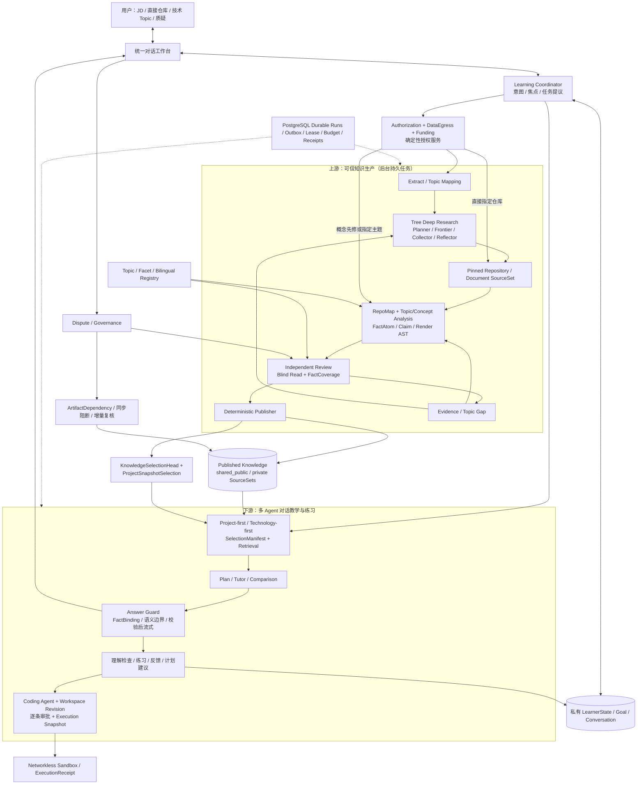
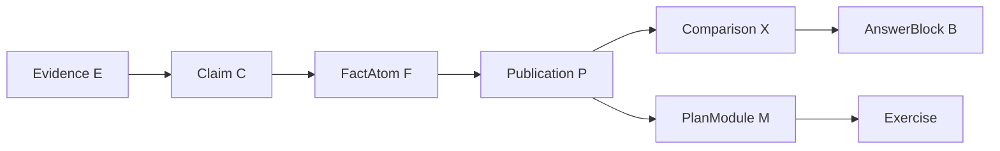
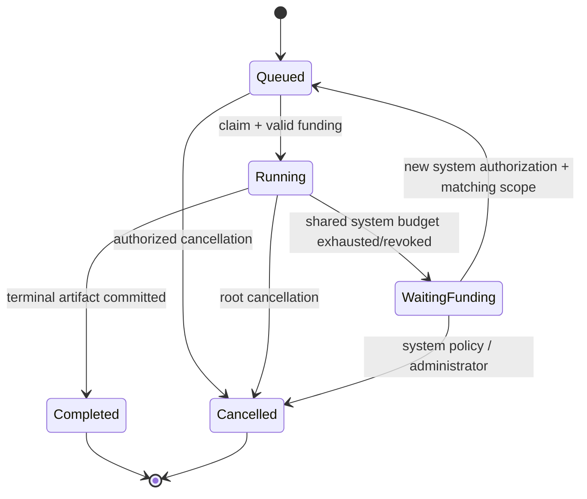
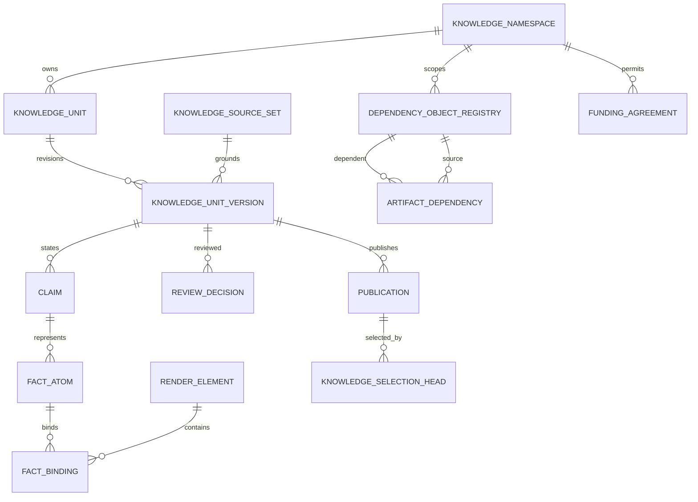
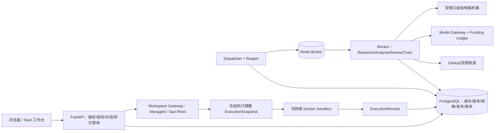

# CareerForge 整体技术设计与架构评审文档

**统一基线 v1.2.1 · 最终产品技术架构（跨域依赖、依赖图类型、概念版本选择修复）· 2026-10-29**

> 产品主线：**对话导入职业需求或直接指定项目 → 问题驱动的树状搜索与检索 → 项目整体知识与专题分析 → 独立审核 → 统一知识库 → 项目 / 技术双入口学习 → 可追溯对话教学 → 练习、反馈与受控编程实践。**

| 文档信息 | 内容 |
|---|---|
| 修订依据 | v1.2 全文、此前三份 Review，以及本轮指出的跨域依赖、依赖对象类型与概念 Head 唯一性问题；保留已确认的职业/项目/技术双向学习目标 |
| 本轮评审视角 | 最终产品是否完整、正确、可学习、可维护；不以开发周期、上线日期或个人开发成本裁剪目标能力 |
| 文档用途 | **完整替代 v1.2** 的目标技术规格；无需结合旧文档才能实施 |
| 事实边界 | 现有实现与历史验证沿用 v1.1 记录的历史证据；本次未重新审计源码、未运行产品测试、未改动仓库 |
| 源码历史基线 | `90e32f187ba44f9273cd3e2c7c12af2aeaba5e93`，2026-10-19；不据此声称当前分支仍无变化 |
| 状态 | Architecture Proposal / 修订待作者评审；本文的接口、配置、表结构与验收数字是目标规格，不是实现完成声明 |
| 评审配套 | 《CareerForge v1.2.1 三项架构问题诊断与修复记录》说明本轮新增裁决；v1.2 原三份 Review 裁决仍作历史依据 |

“已审核”统一解释为：在声明的来源版本、任务范围与证据条件内，经过独立审核及确定性校验。它不是绝对真理、生产安全认证或个人能力认证。下文不再重复这一通用声明。

## 本轮关键修订与评审口径

本版结合三份 Review，保留 v1.1 的产品目标与 Research／Analysis／Review／Publisher 分工，不因上线周期、实施成本或阶段排期删减最终功能。对下述结构性问题给出**可执行的权限、数据、版本与失败语义**，而非只增加更多 Agent 或抽象名词。

| 修订焦点 | v1.2.1 的权威决定 | 章节 |
|---|---|---|
| 审核事实的正文覆盖 | `Claim → FactAtom → FactBinding → RenderBlock`；包括自然语言事实、图边、比较格、脚注；独立覆盖复核；未覆盖不能发布 | §8–9、§13 |
| 新旧知识的默认选择 | `ProjectSnapshotSelection` + `KnowledgeSelectionHead` 独立于 Publication；默认版本唯一、旧版保留可明确固定；每轮冻结 `SelectionManifest` | §10–11 |
| 共享任务的费用归属 | **公共知识构建由系统主体与系统预算承担**；私人任务由发起用户支付，订阅者只订阅结果；不得未经同意转移费用 | §5、§10、§16–17 |
| Coding 工作区/执行 | `managed_workspace` 与 `desktop_selected_root` 两种模式；都以冻结的 WorkspaceRevision 镜像进入无网络沙箱执行，桌面不提供任意 Shell | §15、§23 |
| 可长期复用的概念教学 | 允许无 repository 的 `concept` 类型 KnowledgeUnit，绑定文档 SourceSet、版本、来源与审核；与项目实现建立关系 | §8、§10、§14 |
| Topic / Facet 可冷启动 | 定义种子库负责人、发布/迁移权限、适用条件、增量映射、双语术语词典和历史 schema 查询规则 | §6、§11 |
| Reviewer 独立取证 | 冻结命题后独立搜索与读取，再对照 Analysis 证据，最终检查“全文事实是否被 Claim 覆盖” | §9 |
| Answer Guard 不伪装形式化语义证明 | 精确模板复用走确定性检查；所有非精确改写检查条件、量词、否定与范围；高影响内容限制表达或专项审核 | §13 |
| 依赖失效与增量复核 | **允许授权跨域依赖；统一对象类型注册表与合法边矩阵**；写时登记、跨域受控传播、读时同步资格检查；三档 carry-forward | §10、§12、§18 |
| 概念默认版本的唯一性 | **concept Head 不以具体 SourceSet 为唯一键**；来源随被选中 UnitVersion 追溯；私有视图可在授权下选择公共 Publication | §8、§10–11、§18 |
| 金额与验收可信度 | 技术规格保留计量合同及公式，不保留未经测量的调用数表；Gold 开发集与独立验收集分开，给出样本层级与统计说明 | §17、§21 |

**重要区分**：模型输出的“支持”仍然是有范围的审核判断，不是机器证明；确定性代码能确保身份、结构、哈希、权限与关联关系一致，不能自动保证自然语言语义蕴含。遇到语义不确定时，产品必须能够停止发布、缩小表述或展示证据缺口。

**文件状态**：本次交付是最终目标架构的更新版本，不是代码已实现声明；历史源码基线仍按 2026-10-19 的 `90e32f1` 记录，尚未重新执行代码测试。完整裁决见配套对照文件。

## 目录

1. 产品定义与业务原则
2. 用户旅程与业务闭环
3. 历史实现基线与目标增量
4. 总体架构与控制边界
5. 角色、确定性服务、执行责任与统一合同
6. 职业需求、Topic / Facet 冷启动与术语治理
7. GitHub Tree Deep Research
8. Project Analysis、概念知识与可完整审查的正文合同
9. Independent Review：独立取证、事实覆盖与发布决议
10. 知识发布、版本选择、共享域和资金责任
11. 项目 / 技术双入口、跨语言检索和版本一致性
12. Dispute、依赖图、知识失效和增量复核
13. Learning Coordinator、Plan、Tutor 与可执行的 Answer Guard
14. 学习状态、概念先修、教学反馈与分层记忆
15. 个人 Coding Agent、工作区与隔离执行的完整身份合同
16. 权威状态、长任务、共享取消与并发一致性
17. 成本测量、授权预算和运行体验合同
18. 关系模型、约束、可重建索引与历史数据迁移
19. API、事件和可审计的对话学习工作台
20. 安全、隐私和许可证策略
21. 人工 Gold、专项质量评测、Prompt 回归与最终验收
22. 最终能力依赖、既有代码复用与工程模块边界
23. 部署拓扑、模型配置、治理和运行维护
24. 三份 Review 裁决、架构决策与最终检查表
25. 文件依据、三份 Review 与版本说明

---

## 1. 产品定义与业务原则

### 1.1 产品定义

CareerForge 是职业导向的对话式多 Agent 技术学习系统。用户可以提供 JD、表达职业目标、直接给出仓库，或者从现有知识库选择技术。系统在用户授权的范围内生产、审核和组织项目知识，通过对话和工具调用，帮助用户理解架构、阅读源码、比较实现、完成练习并调整后续学习。

**职业目标回答“为什么学、学到什么目标深度”；技术主题回答“学什么”；项目与概念教材提供真实实现和通用先修；知识单元提供可引用内容；教学与实践回答“怎样学、接下来做什么”。**

### 1.2 不变原则

| 原则 | 产品约束 |
|---|---|
| 对话是统一入口 | 用户不需要手动切换多个 Agent；但可查看任务、证据与审核过程 |
| Research 专注问题搜索 | 保留树状探索、查询改写、线索追问、去重和检索反馈，不承担完整项目知识生产 |
| Analysis 专注知识理解 | 先有项目整体地图，再有架构、技术、函数和设计取舍的专题分析 |
| Review 审核知识 | 审核单元、断言、Facet 值和主题关联，而不是整仓一票通过 |
| 两个学习入口平等 | 项目 → 技术 → 知识；技术 → 各项目实现 → 知识；共用同一事实源 |
| 权限与发布确定性控制 | LLM 只能提议；服务端决定是否执行、展示、发布和扩大范围 |
| 学习不是问答包装 | 必须存在解释、理解检查、练习、反馈、调整和复习的完整闭环 |
| 用户保有控制权 | 学习节奏、预算、数据外发、知识共享、补丁和命令执行均有明确控制 |

### 1.3 范围与非目标

保留完整上游和个人 Coding 的最终产品能力，不因排期删去树状检索、双入口或流式对话。仍不把“自动运行任意陌生仓库”“自动证明职业能力”“无授权索引全部 GitHub”作为目标。模块可在同一后端中实现；最终功能完整不意味着必须拆成微服务或无上限 Agent。

开发先上游、后深化 Coding 的依赖方向保留，但本版不规定上线日期和周数；第 22 章仅描述能力依赖和交付证据。

## 2. 用户旅程与业务闭环

### 2.1 职业需求导入

`消息 / 附件 → 私有 SourceSnapshot → 需求提取 → Topic 映射 → 目标与预算确认 → 查询可复用知识 → 对缺口启动知识构建`。

优先呈现已有且适用的知识。构建批次中第一个知识单元通过发布后即可进入学习，不要求所有候选全部完成；后续发布只更新目录，不自动打断当前教学。

### 2.2 直接指定仓库

`用户给出仓库 URL → 校验来源和授权 → 固定 ref / commit 与范围 → 查询复用 → Snapshot / Analysis → Review → Publish`。

这是一等产品入口，不是测试捷径。它跳过的是发现候选的 Research，**不是**权限、许可证、分析、审核和发布门禁。只有用户提出比较、替代方案或新项目缺口时才追加 Research。没有 JD 也可以独立学习项目；职业映射是可选上下文。

### 2.3 项目驱动学习

先定位项目与版本，浏览整体架构和该项目的技术目录，再选择机制、模块或函数。职业目标突出重点但不强制隐藏用户明确想学的其他内容。默认不混入其他仓库；用户提出比较后扩大检索范围并显示变化。

### 2.4 技术驱动学习

先解析规范 Topic 与子主题范围，再分页列出知识库中所有授权、有效且具有相关已审核知识的项目。回答只读取有界材料，按项目和 Facet 组织；“目录包含全部匹配项目”不等于“本轮读完所有实现”。

### 2.5 持续学习与实践

`问题 → 知识检索 → 带来源讲解 → 可选理解检查 → 针对反馈调整 → 小练习 / 代码实践 → 结果与解释 → 下一步建议`。

允许直接问答，不强迫用户先生成完整计划或接受考试。诊断和练习由用户意图触发或可关闭的教学偏好控制，不能每一轮都变成测验。

### 2.6 用户质疑与知识纠错

用户可以针对一句回答、一个 Claim、一个 Facet 比较值或一个引用提出质疑。系统创建 `Dispute`，展示当前处理状态；有明确风险时暂停相关 Publication，通过复核后恢复、修订或撤销。项目入口、技术入口、比较缓存和历史回答同步呈现变化，见第 12 章。

### 2.7 产品完成标准

用户能说明自己正在学哪个目标、技术、项目版本；系统能解释知识来自哪里、已审范围是什么、材料缺口在哪里、为什么安排下一步。完成项目数量或聊天轮数不替代上述标准。

## 3. 历史实现基线与目标增量

以下是原 v1.1 所继承的历史基础，**不是本轮重新确认的当前仓库状态**。固定源码基线见 §25。

| 领域 | v1.0 记录的已有基础 | 本版完整目标 |
|---|---|---|
| 前后端 | Vue 3 / TypeScript、FastAPI、Tauri | 对话、双入口、任务、知识治理和实践的统一工作台 |
| 知识生产 | Extract / Discover / Review 等，固定快照、受限代码调查 | 树状 Research、两层 Analysis、独立 Claim / Facet Review |
| 数据与检索 | PostgreSQL、源码片段、FTS、Python AST | 共享域与私有域、Topic / Facet、概念 SourceSet、默认知识 Head、多语言和跨语言检索 |
| 运行 | Celery / Redis、outbox、租约、epoch、收据 | 保留内核，扩展研究节点、知识版本 Head、系统出资共享任务、发布和回答事件 |
| Tutor | 引用代码、四区上下文、历史回读 | 回答合同、输出门禁、校验后流式教学和反馈闭环 |
| Coding | Pi SDK、补丁审阅、逐条命令确认、隔离执行 | Managed / Desktop WorkspaceRevision 与 ExecutionSnapshot 绑定、练习、验收和复习 |

历史提交、CI 失败和受限验证按原文件保留在第 25 章来源说明；不能用旧测试或三份文档 review 证明本版功能已通过。

## 4. 总体架构与控制边界

### 4.1 最终业务 / 数据 / 交互拓扑



上游生产与下游教学共享一套权威来源和任务账本，但聊天 Turn 不等待所有 GitHub 调研完成。已有审核知识可立即用于学习；新 Unit 按审核通过的实际完成进度发布。系统不承诺所有事实都能机器证明：源码原文、模型解释、Review 判断、实际执行观察和用户能力证据是不同字段。

### 4.2 三个职责平面

1. **交互与规划**：Coordinator 解释用户意图，提出检索或后台任务，管理当前学习焦点。模型输出的任务提议不授予权限。
2. **确定性控制**：Identity / Namespace / DataEgress / Funding、Snapshot、EvidenceValidator、Publisher、SelectionResolver、AnswerGuard 结构检查、Workspace 与 Sandbox。负责明确权限、合同、哈希、原子更新和预算。
3. **知识与教学内容**：Research Agent、Analysis Agent、Independent Reviewer、Tutor、Concept 教材和 Coding Agent。输出结构化产物，不得改写执行平面的权限。

### 4.3 分清六种不同的关系

研究问题树（搜索方向）、项目架构与静态符号关系（源码候选结构）、Topic / Facet（知识分类与比较维度）、ArtifactDependency（含授权跨域消费者的失效传播）、AgentRun（执行树）、KnowledgeSelectionHead（默认知识版本）分别建模。研究树的逻辑层数不等于子 Agent 数，静态符号同名关系不等于真实运行调用，SelectionHead 也不等于 Publication 的发布资格。

### 4.4 长任务与会话独立

ChatTurn、KnowledgeBuildRun、Analysis/Review 和 Coding Execution 是不同生命周期。用户改 JD 或切换学习模式产生新目标/焦点 revision；旧任务不能把旧结果未经兼容检验写入新目标。页面关闭不自动取消公共系统任务；私人任务取消与公共任务解除订阅在 §10/§16 有不同的授权和资金规则。

## 5. 角色、确定性服务、执行责任与统一合同

### 5.1 LLM 角色（做判断与提出建议，不拥有执行权限）

| LLM 角色 | 输入 | 结构化输出 | 不具备的权力 |
|---|---|---|---|
| Learning Coordinator | Conversation、GoalVersion、LearnerState、任务摘要 | `IntentDecision`、工具/任务提议 | 自行提高预算、外发范围或写知识发布态 |
| Extract Agent | 已授权 JD、岗位资料快照 | `RequirementSetVersion` 与原文依据 | 把目标深度当用户已掌握能力 |
| Research Planner / Reflector | ResearchBrief、已观测结果与缺口 | QueryPlan、ResearchNode 提议 | 任意 URL 请求、认定仓库具备机制 |
| Project Analysis | Pinned SourceSet、RepoMap、Topic / Facet Schema | `KnowledgeDraft`、FactAtom、Claim、Evidence 和依赖 | 修改已审核标记、自动写 Published |
| Independent Reviewer | 待核验 Claim、适用条件、固定来源范围 | IndependentEvidenceBundle、Claim/Fact/Facet 决议 | 不读源码就整体批准、代替 Publisher |
| Plan / Tutor | 有权限的已审知识、焦点、教学反馈 | PlanProposal、AnswerDraft、Activity | 绕过 Answer Guard 或自动认定用户掌握 |
| Answer Semantic Checker | 已审核 FactAtom / Claim 与待发布表达 | 语义保留/越界/不确定的判断及定位 | 取代确定性授权与发布门禁，或宣称形式化证明 |
| Coding Agent | 受控工作区快照、练习与允许工具 | 待审补丁、命令提议、解释 | 直接写宿主目录、执行未经批准的命令 |

同一模型可以承担多个角色，但必须使用不同任务合同与输入范围。Reviewer 必须独立执行取证，不能只把第二次模型调用视为独立审核。事实覆盖审计可以使用独立的模型抽取候选事实，但它的判断须经 Gold 评测，且不能反过来自动宣布原 Claim 正确。

### 5.2 确定性服务（由代码控制实际业务状态）

| 服务 | 职责 | 必须保证的条件 |
|---|---|---|
| Identity / Authorization / DataEgress | 角色、namespace、来源、数据外发授权 | 服务端身份为准；授权有版本与撤销 |
| Research Frontier / GitHub Collector / Snapshot | 队列调度、限流、来源固定、文件校验 | 只读、去重、受限、可恢复 |
| RepoMapper / Structural Index | 文件、符号、范围与解析器清单 | 解析线索与语义事实分开 |
| Evidence Validator / FactBinding Linter | 引用哈希、原文范围、完整渲染覆盖 | 不能以“有引用”宣布语义成立 |
| Knowledge Publisher | 精确版本入库与 Publication / SelectionHead 发布 | 锁定已审内容哈希、来源版本与依赖 |
| Retrieval / Selection Resolver | 双入口与默认知识版本解析 | 授权、投影、版本与 SelectionManifest 一致 |
| Answer Guard / Stream Gateway | 结构校验、风险路由、校验后分块流 | 不提前泄露未经准入的项目事实 |
| ArtifactDependency / Invalidation | 反向依赖、同步阻断、新旧快照影响 | 撤销后新回答不能继续使用失效来源 |
| Funding / Budget Ledger | 出资归属、预留、结算、取消 | 不自动向订阅者或撤销授权者收费 |
| Workspace / Command Sandbox | 镜像、编辑、审批、隔离执行与回执 | 执行环境与 WorkspaceRevision 精确绑定 |

“确定性”仅描述这些服务对合同、权限、版本、数据结构与事务的执行，不代表它们能够纯算法确定任何技术事实的语义真实性。

### 5.3 TaskContract：发起者、执行者与出资者分离

```yaml
TaskContract:
  task_id: UUID
  initiating_principal_id: UUID                # 原始发起者（可为用户）
  execution_principal_id: UUID                 # 实际获得工具权限的执行主体
  namespace_id: UUID                           # 产物归属域
  task_class: private_build | shared_build | learning | review | coding
  conversation_id: UUID_or_null
  goal_version_id: UUID_or_null
  source_set_ref: UUID_or_null
  input_refs: [VersionedRef]
  authorized_scope_ref: UUID
  role: string
  contract_version: string
  prompt_bundle_hash: sha256
  model_profile_version: string
  toolset_version: string
  authorization_id: UUID                       # 有效权限、外发限制
  funding_agreement_id: UUID                   # 谁能承担费用、费用范围
  budget_reservation_id: UUID
  subscriber_refs: [UUID]                      # 观察/结果订阅，不含付费同意
  deadline_at: datetime
  input_hash: sha256
```

出资/收费的权威主体记录在 `FundingAgreement`，不能从 `initiating_principal_id` 或当前订阅者倒推。共享任务只允许系统出资（§10.5）；用户出资任务保持私有，不因后来出现第二个订阅者而自动变为公共任务。`funding_agreement` 同样包含 provider、计费与限额授权，并保留已发出请求的结算义务。

### 5.4 统一业务词义与状态边界

- `Claim`：一个可单独核验的、带条件的原子技术命题；`FactAtom` 是用于表述和呈现的结构化事实语义槽，指向一个或多个已核验 Claim。
- `KnowledgeUnit`：可独立学习、可独立审核的知识对象，可为项目类或概念类，详见 §8。
- `ReviewDecision`：一次固定内容的判断；`Publication`：内容当前可否教学；`KnowledgeSelectionHead`：默认使用哪个有效版本。
- `ReviewDecision=accept_scoped` 不自动等于 `Publication=active`；`Publication=active` 不自动意味着该版本是默认首选。
- `historical` 是明确选择旧知识的查询方式，不是 Publication 状态。
- `ResearchTree` 是问题逻辑树，`AgentRun` 是执行记录，`ArtifactDependency` 是知识/教学的反向影响图；互不代替。

统一 `unit_type = concept | overview | architecture | implementation | function | tradeoff | testing`。扩充 `concept` 后，旧版本历史字段保留原枚举版本，由适配器完成读取；不得将旧数据静默升级为新类别。

## 6. 职业需求、Topic / Facet 冷启动与术语治理

### 6.1 从 JD 到学习目标

用户通过对话或上传资料生成私有 `SourceSnapshot → RequirementSetVersion → RequirementTopicLink`。每条需求保留来源版本、原始片段、明确 / 推断标记、必需 / 优先 / 可选条件，以及“了解 / 熟悉 / 掌握”的目标深度。若多个 JD 条件冲突，保留来源与差异；不得取平均抹平明确要求。技能的目标深度不等于用户当前能力。

未导入 JD 也支持直接指定仓库或 Topic 进行学习；职业范围是可切换视图，不是公共知识本身的所有者。用户对话确认目标和必要的外发/预算策略后，后台只补足缺少的知识，不重复分析已有的合格版本。

### 6.2 Topic Registry 的初始化、权限和演化

`TechnologyTopic` 采用稳定 `topic_id`，其定义、上下位、前置关系、别名属于 `TopicVersion`；一个冻结发布集合称为 `TaxonomyRelease`。同名、相关与同义是三种不同关系，不能仅凭词形归并。

**冷启动责任**：部署者提供带版本号、许可及出处的 `taxonomy-seed` 包，包含基础领域、常见技术、术语类型、中文/英文别名、重要前置关系，以及至少覆盖产品默认学习域的比较主题。该包由具备 NamespaceAdmin 权限的维护者审核和发布；单机模式中，用户是私有命名空间的管理员。可为 AI Agent / AI 后端默认提供约 30 个种子 Topic 和数个核心 Facet Schema 作为**推荐起点**，但数量不是业务真值或启动成功的条件：更重要的是用户当前目标能映射、别名有证据、缺口可处理。

**冷启动不命中**：新技术术语建立带 `provisional` 标签的 TopicProposal；允许在 Research 中保留原词搜索，但不冒充规范 Topic 或已认证覆盖。用户确认个人私有主题；公共注册表的新增、合并、拆分需 NamespaceAdmin 审核。系统允许“暂不归类”而不是强行映射到相似主题。

```yaml
TopicProposal:
  proposal_id: UUID
  namespace_id: UUID
  proposed_canonical_name: string
  topic_kind: domain | language | framework | concept | mechanism | engineering_practice
  aliases: [{term: string, language: zh|en|other, context: string}]
  relation_proposals: [{target_topic_id: UUID, type: broader|prerequisite|related|equivalent_candidate}]
  origin_evidence_refs: [UUID]
  proposer_type: user | analysis | normalizer | admin
  status: proposed | approved | rejected | superseded
  reviewer_id: UUID_or_null
  decision_reason: string_or_null
```

治理操作必须生成新 `TaxonomyRelease`、保留旧 ID / Link / 审核来源：改名和同义别名可在定义不变时维护映射；合并须验证等价而非相关；拆分不能把原关联全部复制到每个子 Topic；先修关系必须防环。公共主题变更通过已版本化工作单审核，禁止未认证 LLM 自行修改共享库。

### 6.3 Facet Schema：初始化、适用性和逐步演化

仅当 Topic 可进行“同一问题下不同项目实现”的比较时才定义 `FacetSchemaVersion`；非比较主题无需强制创建虚假空表。初始 Facet 由维护者根据 Topic 教学问题、代表性项目和可验证证据定义。Analysis 可提出新 Facet，但不能直接改变当前生效版本。

```yaml
FacetDefinition:
  facet_key: string                       # 例如 agent.tool_calling.dispatch
  question_zh: string
  question_en: string
  answer_type: enum | structured | boolean | number | text
  applicability_rule_id: string          # 受限可测试规则 ID，非模型可执行脚本
  applicability_rule_version: string
  preconditions: [TypedPredicate]
  required_evidence_kinds: [source_code | docs | configuration | test_observation]
  required_claim_kinds: [string]
  answer_schema: TypedSchema
  absent_value_policy: unknown | not_applicable | unsupported_when_proven
  alias_refs: [UUID]
  review_policy_version: string
```

**判断逻辑（防止“没找到”误判“不适用”）**：

1. `applicability=applicable`：Topic 与项目存在经证据确认的适用前提，例如已确认的 `AgentLoop` 执行入口；开始调查 execution_policy。
2. `applicability=not_applicable`：适用条件被**有证据地反证**，例如已审核证明该对象本质上是纯数据格式库、没有运行时执行器；由 Reviewer 审核后记录该原因。未发现执行器不足以证明不存在。
3. `applicability=unknown`：项目范围未分析完、解析能力不足或前提不清楚；不得将空值默认化为 `not_applicable`。
4. 如果 facet 适用且已读源码证明“不支持某能力”，其值可为 `known: unsupported`，但需反证或穷尽声明的调查边界；不能用 `not_applicable` 掩盖不支持。

以 `Tool Calling.execution_policy` 为例：Facet 适用于具备已审核工具执行路径的项目；即使执行完全串行，也应记录“串行执行”作为已知值，而不是因没有并发而写 `not_applicable`。未知/未分析需要单独显示。Reviewer 必须审核 `applicability_rule` 的判断依据和 FacetValue 的对应 Claim。

**演化规则**：`FacetProposal → NamespaceAdmin 决议 → FacetSchemaVersion + TaxonomyRelease → 受影响主题投影刷新`。新版本新增维度后，旧版已审核 Fact / Unit 不因新维度自动失真；比较可以明确固定旧 Schema，或对新 Schema 的新增格显示 `unmapped_legacy / unknown`。用户实际需要该维度时创建有界 FacetMappingTask，从旧已审 Claim 中映射可被证明的值；旧 Claim 无法覆盖的维度需新增 Analysis + Review。不得从旧摘要猜测或在无授权情况下重审所有仓库。

Facet schema 修改值类型、单位或适用条件时，旧值不得自动转换为新值，除非存在已审核的无损转换规则。所有转换保留原版本、规则与影响记录。

### 6.4 跨语言词表：先标准化，再调用 Query Rewriter

`TopicVersion`、`FacetSchemaVersion` 内嵌各语言别名；另建 `TechTermTranslation`（可作关系表或可重建的受控术语索引），记录 `source_term / source_lang / canonical_topic_or_facet / target_terms / domain_context / confidence_basis / proposal_status / taxonomy_release_id`。

**查询路线**：原始中文问题 → 精确别名 / 正规化词表 → Topic/Facet 候选及规范术语 → 英文符号与路径、PostgreSQL FTS、源码索引 → 分项目召回 → 若缺口明显且预算允许，调用 `QueryRewriter` → 记录原词、改写词及所选 Topic。词表可从已审 Unit 的双语标签和人工术语表产生候选，但自动提议不等于自动批准；“Memory” 等多义词必须依场景消歧。

中英文的同义项和译名是检索辅助，不能将“tool invocation”与“function schema”等有关联但不等价的术语作为同义映射。

### 6.5 职业学习覆盖合同

`LearningCoverageProfile(topic_version, target_depth, required_knowledge_types, required_facets, practice_criteria)` 定义“这个目标所需资料是否具备”，不是用户熟练度分数。目标深度为“掌握”时，可要求实现链、失败边界、设计取舍、实践案例等；缺资料时显示 `coverage_gap`，不得降低要求来制造完成率。

```yaml
GoalCoverage:
  goal_version_id: UUID
  taxonomy_release_id: UUID
  requirements: [{requirement_key: string, topic_version_id: UUID,
                  target_depth: 了解|熟悉|掌握, available_units: [UUID],
                  missing_knowledge_types: [string], missing_facet_keys: [string],
                  coverage_status: covered | partial | missing | unknown}]
```

知识源自源码与审核，职业只建立与之关联的私有视图。增加职业目标或 JD 不应使通用技术知识自动失效。

## 7. GitHub Tree Deep Research

### 7.1 职责和保留能力

Research 以用户问题和知识缺口为根，执行问题拆解、查询改写、多通道搜索、结果聚合、反思追问和有界递归。完整保留研究树；平铺检索是同预算基线和简单任务策略，不取代最终产品能力。[B §7]

### 7.2 搜索结构

`ResearchBrief → Planner → ResearchTree / Frontier → Query Rewriter → Collector → Observation / Candidate Registry → Reflector → 扩展或结束 → ResearchResult`。

搜索通道覆盖仓库元数据、README / 文档、在线代码线索、Issues / PR / Releases、已下载快照的本地检索。外部文字只支持“值得调查”或“存在此声明”；最终架构事实由 Analysis / Review 处理。

### 7.3 节点、调度与预算

每个节点记录 parent、问题、Topic、派生观测、查询、状态、候选、重复键、停止原因。只在出现实际线索或明确未解决问题时扩展；重复结果、空结果和限流优先由规则结束，不为制造“深度”反复调用模型。

Frontier 优先当前目标缺口、可带来新项目或新实现类型的线索；保留探索预算，不让高星项目垄断。按 repo 稳定 ID 去重，但保留不同分支的发现路径。语义相似查询只是去重建议，不能自动丢弃关键反证问题。

原建议广度 3、深度 3、12 节点作为可选预算档位，不是最终能力上限。节点、外部请求、下载量、模型调用、token 和时间分别限额，末端 Analysis / Review 额度不能被 Research 透支。

### 7.4 GitHub 限流与缓存

Code Search、仓库搜索、core API、下载与本地搜索分别建资源桶。请求速率读取实际鉴权和响应中的剩余额度、reset / retry-after；不能把“每分钟约 10 次代码搜索”写成所有 GitHub 请求的统一限额。API 访问队列与模型分支并发分开管理。[E2]

已有快照优先本地搜索；对可缓存请求保存 ETag、身份和观测时间。遇到限流展示实际停留原因，有限等待，不伪造搜索完成。在线代码命中必须在固定快照重读后才可作为知识证据。

### 7.5 研究产物与反馈

`ResearchResult` 包括研究树、来源观察、候选、相关性假设、未解问题和终止原因。`candidate_scope_sufficient` 只表示候选达到本轮搜索目标，不能直接增加已审核知识覆盖。

Review 指出某仓库内部缺证据时返回 Analysis；所有候选都缺某种实现线索时才向 Research 添加新问题。直接仓库入口不强行生成空研究树。

## 8. Project Analysis、概念知识与可完整审查的正文合同

### 8.1 两层项目分析不变

1. **Repository-wide Mapping**：基于固定快照生成仓库结构地图，识别语言、模块、入口、配置、构建与测试位置、候选 Topic、解析能力和未读范围。源码全局地图不是“已经解释完整个仓库”。
2. **Topic-oriented Deep Analysis**：从某个知识问题出发追踪多文件实现、状态、参数、失败路径、相关测试、方案取舍，形成原子知识断言与可核验证据。可以分析 JD 之外的项目知识，但不能把新发现改写为岗位原文需求。

Research 负责找到项目及资料，不替代 Analysis；Analysis 先固定 `repository_id + commit_sha + scope_manifest_hash`，不执行第三方仓库脚本。当前历史限额 1000 个文件、约 12 MB 文本、单文件 100 KB 作为既有实现记录；目标支持显式范围分片，并提供覆盖与排除文件清单，不把部分调查称为全仓验证。

### 8.2 KnowledgeUnit 既可以是“项目实现”，也可以是“通用概念”

此前的仓库强绑定模型无法长期管理“并发与并行的区别”“什么是幂等”这类可复用的先修知识。统一模型增加 `concept`，**不是另建一个没有审核的概念知识库**：

| Unit 类别 | 允许来源 | 身份约束 | 教学与审核边界 |
|---|---|---|---|
| `concept` | 版本化课程材料、官方规范、授权文档、人工编写内容、可复核教学来源 | **不强制**关联仓库，必须绑定 `source_set_id` 和 Topic / 定义版本 | 概念解释、正反例、先修关系、常见误区；不直接证明某个项目的实现 |
| `overview` / `architecture` | 项目固定快照、仓库文档及读取事件 | 必须关联一个 `repository_snapshot_id` | 有界的模块、数据流或组织事实 |
| `implementation` / `function` | 项目源码、相关配置及可读测试 | 必须关联一个项目快照 | 有证据的技术机制与函数行为，不推导未知动态性质 |
| `tradeoff` / `testing` | 代码、作者文档、约束条件、真实运行报告 | 说明依赖的项目快照；含实验结果时额外绑定执行环境 | 区分设计动机、分析推断和运行观察 |

同一稳定概念知识单元可以在修订版本中更换文档 `SourceSet`（如教材 S1 → S2）；来源更换必须经过受影响 Claim/事实的新审核与来源资格检查，**不会自动创建新的概念默认选择分组**。如果新材料改变了知识单元的核心问题、适用条件或来源身份定义，应按稳定身份策略创建不同 Unit，而不是借更新 SourceSet 偷换主题身份。

概念教材可以有人工原创示例；没有外部文献的原始示例以 `authored_example` 标记，需审查其技术正确性与适用范围，不能伪造成项目运行事实。概念知识与项目知识之间可使用 `prerequisite_of / exemplified_by / contrasts_with` 关系，但仅 `exemplified_by` 关系**不能自动审核项目源码机制**。

```yaml
KnowledgeSourceSet:
  source_set_id: UUID
  namespace_id: UUID
  kind: repository_snapshot | concept_documents | combined
  sources: [{source_kind: repo_file | document_snapshot | authored_example | runtime_receipt,
             source_ref: UUID, version_hash: sha256, license_policy_ref: UUID}]
  source_manifest_hash: sha256
  scope_manifest_hash: sha256

KnowledgeUnitIdentity:
  namespace_id: UUID
  origin_kind: repository | concept
  origin_id: UUID                         # repository_id 或与具体教材无关的稳定概念内容族 ID
  unit_type: concept | overview | architecture | implementation | function | tradeoff | testing
  subject_key: string                    # 稳定 Topic/机制/函数问题键
  applicability_key: string             # 条件归一，不混用不同实验/配置

KnowledgeUnitVersion:
  unit_version_id: UUID
  unit_id: UUID
  revision_no: integer
  source_set_id: UUID                   # 属于 UnitVersion 的证据来源，不参与 concept Head 唯一键
  repository_snapshot_id: UUID_or_null   # concept 允许 null；repo 类强制非 null
  source_scope_hash: sha256
  content_hash: sha256
  topic_version_refs: [UUID]
  facet_schema_refs: [UUID]
  fact_atom_refs: [UUID]
  claim_refs: [UUID]
  render_ast_ref: UUID
  dependency_manifest_ref: UUID
  derived_from_version_id: UUID_or_null
```

同一事实源可服务职业与非职业对话；公有概念材料也要遵循许可和共享策略。概念知识成为长期教学依据后，必须和项目知识一样可质疑、可修订、可撤销并影响历史回答；一次性自由聊天解释可以不入库，但不能借 `general_explanation` 冒充已审概念教学事实。

### 8.3 可审核的最小知识粒度

一个 Unit 回答一个可独立学习且其支持范围可以被单独审查的问题。可以跨文件、跨函数，但项目类 Unit 只能绑定一个原子版本的项目快照和一套声明的适用条件；同一 Topic 下不同项目不能融合成一个无来源的 Unit。跨项目知识比较是多源派生内容，并显式绑定所用 Unit 版本。

- `overview`：项目用途与入口。`architecture`：一组模块关系；不同链路的安全/性能结论另立 Unit。
- `implementation`：一个技术机制，例如 `agent.tool_calling.dispatch`。`function`：单个或协同符号的有限行为。
- `tradeoff`：一个设计选择及其前提。`testing`：测试的存在、覆盖目标或已执行的观察；静态测试文件不自动等于通过。
- `concept`：一个稳定概念的定义、区别、先修或教学案例；可以按教材主题拆成多个 Unit。

同身份下生成新 revision；同安全域、相同来源范围和内容 hash 可以幂等复用；语义近似只提出 `possible_duplicate`，不能自动合并。不同项目的同一机制必须通过 Topic 和 Facet 关联，不合并来源身份。

### 8.4 FactAtom：不仅列出 Claims，还要约束最终正文

**Review 3 的关键问题成立**：核查 Analysis 自己提交的所有 Claim，并不能证明正文没有额外的项目事实。故新增 `FactAtom`（规范表达）和 `FactBinding`（展示元素映射），为**正文事实覆盖**提供可检查的结构；`Claim` 是来源审核对象，`FactAtom` 是该 Claim 在内容中的条件化表示。二者可一对多，但不得无 Claim 自行构造项目事实。

```yaml
FactAtom:
  fact_atom_id: UUID
  unit_version_id: UUID
  source_claim_ids: [UUID]
  subject_ref: string
  predicate_key: string
  object_value: typed_value
  polarity: positive | negative | unknown
  quantifier: exact | exists | some | all | bounded | unknown
  conditions: [TypedCondition]            # 例：feature_flag X = true
  applicability_scope: string             # repo/symbol/runtime/版本等边界
  temporal_scope: string_or_null
  evidence_ref_ids: [UUID]
  review_status_ref: UUID_or_null    # 草稿尚无审核决定

FactBinding:
  binding_id: UUID
  render_element_id: UUID                # TextSpan / Heading / DiagramNode / DiagramEdge / TableCell 等
  fact_atom_ids: [UUID]
  claim_ids: [UUID]
  transformation_kind: exact | template | paraphrase | comparison | inference
  coverage_role: required | supporting | nonfactual
  source_range: SourceRange_or_null
```

如 Claim 是“**配置 X 开启时**，代码路径会调用 Y”，则相应 FactAtom 的 `conditions=[X=true]`。任何后续内容写成“系统总会调用 Y”，丢掉条件，必须被标记为 `scope_broadened`，**哪怕引用正确、Claim ID 也正确**。同理需要防止量词 `some → all`、否定反转、时间/版本移位、范围从一个函数扩张到整个系统。

### 8.5 Render AST：正文、图表和 Wiki 共用一份带 Claim 的底稿

生成的知识卡、Wiki、架构图、表格均来自 `KnowledgeRenderAST`，不是独立生成后再靠全文 hash “碰巧相同”。**每个可以表述外部事实的节点都必须绑定 Claim/FactAtom**：

- `TextBlock` 由一个或多个 `FactSpan` 组成；每个含事实的句子或独立子句有覆盖绑定。
- `DiagramEdge` 的边类型、方向、条件与证据独立审核，节点名称也可能携带事实。
- `TableCell` 的 FactAtom / FacetValue 与列标题的含义版本绑定；空白不代表 false。
- `Heading` 中含“完全支持”“保证恢复”等技术断言时同样是事实节点；装饰性标题可标 `nonfactual`。
- `ConceptExample` 标记为 `authored_example` 或引用来源，不能冒充实际项目行为。

模板渲染可确定性保留经审核的条件、量词与限定语；自由文本解释属于受控 paraphrase 路径，在发布前必须接受额外事实覆盖审计。**禁止在审核后由 Writer 自由改写并沿用原 ReviewDecision**。

### 8.6 全文事实覆盖如何被核查

流程：`结构化生成 → FactBinding 完整性检查 → 独立 Coverage Auditor 提取候选事实 → 比对已申报 FactAtom/Claim → 分类 unresolved / extra / contradicted / scope_changed → 重新绑定或删除 → 独立 Reviewer 核查精确冻结的 Render AST → 发布`。

确定性检查可以证明“每个事实型节点都有绑定、IDs 有效、引用版本可用、类型与条件字段存在”，**不能保证所有自然语言句子已被完全理解**。因此独立 Coverage Auditor（可使用另一个受限模型）需要在不依赖 Analysis 自报 FactBinding 的情况下重新提出事实原子与覆盖缺口，随后由 Reviewer 检查。该模型也会误判：其漏检率、误杀率必须通过 Gold 测量；高风险或无法判断的表达不得直接发布。有限来源可选择**只通过审核过的 FactAtom 模板渲染**避免开放式语义不确定。

审核结果绑定 `render_ast_hash / fact_binding_hash / source_scope_hash`。如任何事实子句改写、图边改向或比较值变化，则重新审核受影响范围；纯排版变化只有在不改变已审事实元素时才可按确定性规则重渲染。

### 8.7 多语言代码索引与跨语言边界

最终产品必须提供 Python、TypeScript/JavaScript、Go 的基础结构索引，可用 Python AST 和 Tree-sitter 等工具实现统一 `CodeStructureProvider`；非支持语言使用明确的文本降级。保存 `language / parser_version / grammar_version / parse_status / structure_coverage`。同名静态调用只是候选关系，不宣称完整运行时调用图。

AST span/字节偏移/行区间与 UI 显示行号必须统一映射，并保留原始换行、编码和归档哈希。可索引的文件不等于全部分析；截断与跳过路径进入 SourceScopeManifest，不得因解析器不支持而认定不存在机制。

### 8.8 Analysis 的工具、证据与停止条件

复用 `list_tree / find_symbol / search_text / read_span / references_of / find_tests / finish_investigation`；模型只能读取已获授权的固定快照，不直接读任意本机路径，也不执行仓库代码。ReadEvent 记录工具参数、实际读取范围、返回哈希与截断标记。`search_text` 命中不能直接当 Evidence；`read_span` 或合法 SourceReadEvent 读到原文，才产生可核验引用。

Analysis 输出 `ProjectKnowledgeDraft`，其中含 RepoMap、KnowledgeUnitVersion 草稿、FactAtom/Claim、Render AST、Topic/Facet 提议、反证、语义依赖、缺口和 `analysis_stop_reason`。遇到证据不足、跨模块未知或资源耗尽，保留 unknown，不强行写完所有 Wiki 页。

## 9. Independent Review：独立取证、事实覆盖与发布决议

### 9.1 审核对象与关键断言

Review 不是给仓库打一个总分；审核的是确定的 `KnowledgeUnitVersion`、其 `Claim`、每个 FactAtom、全部 Render AST 事实元素、TopicLink、FacetValue、已声明条件和来源依赖。允许一个项目的部分机制通过，其他机制保持待核验。

```yaml
Claim:
  claim_id: UUID
  unit_version_id: UUID
  statement: string
  claim_kind: source_fact | documented_intent | analytical_inference | runtime_observation
  applicability: TypedConditions
  criticality: blocking | supporting
  criticality_reason_codes: [string]
  required_by: [unit_purpose | facet_key | diagram_edge | safety_policy]
  support_refs: [UUID]
  counterevidence_refs: [UUID]
  dependency_refs: [UUID]
```

核心结论、Facet 必需值、架构图核心边、可靠性/安全/恢复/性能、否定性/普遍性断言默认是 `blocking`，其严重性由版本化规则基于数据合同确定，Reviewer 可以提升但模型不能自行降低。`supporting` 只是“缺失它不妨碍该 Unit 的核心目的”，不是“可以未经审核写入正文”。

### 9.2 四段式独立审核（解决“先看 Claim 还是先看证据”的冲突）

1. **Precheck / Blind Packet 生成**：冻结 namespace、Unit 身份、当前快照、精确范围、分析对象、**待审核 Claim 的陈述、适用条件与类型**、RepoMap 及工具预算。对 Reviewer 隐藏 Analysis 所选证据引用、模型推理过程、通过/失败自评与其他 Reviewer 结论。这样 Reviewer 知道“要核查什么”，却不能直接照搬分析证据。
2. **Independent Evidence Collection**：Reviewer 自主进行符号/全文检索、`read_span` 和必要反证查找；保存不可变 `IndependentEvidenceBundle`，包含查询、已读原文、哈希、未解问题和停止原因。其引用必须来自本轮独立 ReadEvent，不能将 Analysis 的历史引用当作自己刚读过。
3. **Contrast & Coverage**：展开 Analysis 的 Claim / FactBinding / 支持与反证，对照独立 bundle，逐一判定。再对**冻结后的完整 Render AST**做事实覆盖检查：独立列出句子、子句、图边、比较格中的技术断言，寻找没有 Claim、错配条件、量词、否定、版本或范围的内容。证据无交集不必自动否决——不同引用可能同样有效，但必须有解释其支持范围的复核记录；发现关键反证则禁止相关 Claim 通过。
4. **Postcheck**：确定性校验新引用、所属 Unit 与 Snapshot、全量 FactBinding、Facet 和 Topic 关系、内容与 Schema 哈希，形成精确版本的 `KnowledgeReviewReport`。若需要编辑事实表达，创建新草稿版本；不得修改已审核版本的语义正文。

这是一种取证过程独立性，不是模型统计独立性。不同 Prompt 或不同模型只提供额外差异性，Review 的 False Admission 必须用独立 Gold 评价。术语“独立”不能作为“审核准确率已保证”的理由。

### 9.3 FactCoverageReport：审核是否遗漏正文事实

```yaml
FactCoverageReport:
  unit_version_id: UUID
  render_ast_hash: sha256
  declared_fact_binding_hash: sha256
  extracted_fact_atoms: [CandidateFactAtom]     # 独立审计提取
  uncovered_element_ids: [UUID]
  unsupported_fact_atom_ids: [UUID]
  scope_shift_ids: [UUID]                        # 条件/量词/否定/版本变化
  unknown_or_ambiguous_ids: [UUID]
  graph_edge_coverage: [{element_id: UUID, claim_refs: [UUID]}]
  table_cell_coverage: [{element_id: UUID, claim_refs: [UUID]}]
  coverage_audit_model_profile: string_or_null
  decision: clean | needs_revision | blocked
```

服务端可以确定性确认“所有声明为事实的节点都有绑定”；不能确定性发现任何自然语言未声明事实。故生成链路采用**结构化受限表达优先**：项目事实只允许从已经绑定的 FactAtom / Claim 渲染；需要复杂叙述的段落必须走独立 Coverage Auditor，检查是否新增隐含事实。即便审计器返回 `clean`，语义正确性仍需 Gold 校准。对无法覆盖的关键句子、图边和表格格子，一律不能作为正式已审核知识发布。

三类边界测试必须存在：`X=true → Y` 被误改成无条件 `Y`；`some` 被改成 `all`；“调用函数 A”被改成“保证整个系统安全”。引用即便完全正确也必须拒绝越界表述。未列入 Claim 的正文事实与未绑定的图边不得因其不在 Claim 列表里而绕过审查。

### 9.4 KnowledgeReviewReport 与审核门禁

```yaml
KnowledgeReviewReport:
  review_id: UUID
  unit_version_id: UUID
  source_set_id: UUID
  reviewed_content_hash: sha256
  reviewed_render_ast_hash: sha256
  reviewed_fact_binding_hash: sha256
  reviewed_scope_hash: sha256
  reviewer_contract_version: string
  criticality_policy_version: string
  independent_bundle_id: UUID
  fact_coverage_report_id: UUID
  claim_decisions:
    - claim_id: UUID
      outcome: supported_within_scope | partially_supported | contradicted | insufficient
      support_refs: [UUID]
      independent_read_refs: [UUID]
      counterevidence_refs: [UUID]
      boundary: string
  topic_link_decisions: [TypedLinkDecision]
  facet_decisions: [TypedFacetDecision]
  concept_source_decisions: [TypedSourceDecision]
  decision: accept_scoped | needs_evidence | reject
  blocking_issue_ids: [UUID]
```

`accept_scoped` 的前提是全部**将被发布**的事实型内容都有支持范围内的 Claim/FactAtom，关键断言及必需依赖通过，FactCoverageReport 无未解决的 blocking 漏项，Topic/Facet 与概念来源通过相应审核，且所有来源授权/许可有效。`partially_supported` **不能**原样作为完整支持发布；可缩小陈述或删除相关块，但必须新建精确 UnitVersion 并复审改变的语义。

### 9.5 Publisher 的确定性判定边界

Publisher 可以确定性核对：审稿版本哈希完全一致、审稿收据与 Reviewer 读取轨迹存在、FactBinding 完整、无标记为不支持的关键 Claim、批准的 Topic/Facet 版本匹配、权限与租约有效。它**不能**自己做 NLP 语义审核；对不确定语义依赖显式 ReviewDecision 和 Gold 治理。满足合同时才发布，不得自动删掉失败文字后把剩余自由文本当作已审。

对源码而言，`location_validated`、`semantic_supported_within_scope`、`runtime_observed` 始终独立。CodeCitation 的位置匹配不能证明“函数保证错误重试”；`test_*.py` 的存在不能声称测试已运行。概念知识亦需其指定 SourceSet 的可核验来源或经审教学资料，并与相应 `Claim` 关联。

### 9.6 补证、局部通过与终止

缺证据原因按类型回流：源码未读 → Analysis；多个候选仓库都缺实现线索 → Research；Topic/Facet 口径冲突 → Taxonomy Governance；来源撤销/许可不符 → Policy。自动补证在预先授权预算内有明确上限；用户可另行授权追加任务。失败结论、缺口和耗尽原因保存，不靠降低审核门禁来增加通过率。

不同知识单元可分别发布；同一个 Unit 中无法通过的 FactAtom 不得继续出现在 Published Render AST。一个仓库“总体入库”只表示该仓库至少有某些已审核知识，不代表所有功能、安全或性能均通过审核。

## 10. 知识发布、版本选择、共享域和资金责任

### 10.1 三种不同的“存储 / 发布 / 默认选用”

1. **Raw Source / Draft / Audit**：原始项目、文档快照、研究结果、Analysis 草稿、未通过的 Review 历史，可以保存以供恢复和审计，但默认 Tutor 不可当作已审核知识。
2. **Publication**：一份精确 `KnowledgeUnitVersion` 通过当前来源、权限与审核门禁后取得可教学资格，其状态为 `active / suspended / revoked`。
3. **Default Selection**：项目、技术入口在存在多份合法 Publication 时如何选择默认版本，由**独立于 Publication 的唯一默认指针**决定；一个旧版 `active` 不代表还要出现在默认目录。

不能将“新版本发布”“旧版本不再默认”“内容被发现错误”混成一个状态。历史 Plan 明确固定旧版本仍可继续使用，除非它实际被暂停或撤销。

### 10.2 Namespace 与治理角色（明确谁能批准）

```yaml
KnowledgeNamespace:
  namespace_id: UUID
  namespace_kind: private | shared_public | workspace
  owner_id: UUID_or_system
  policy_version_id: UUID
  sharing_enabled: boolean

NamespaceMembership:
  principal_id: UUID
  namespace_id: UUID
  role: Owner | NamespaceAdmin | PublisherOperator | Reviewer | Reader
  permission_revision: integer
```

`private` 默认归属用户，只允许用户/明确授权角色阅读与修改；单机模式该用户是其私人域 Owner。`shared_public` 表示**部署内部的跨用户可复用知识**，不等于自动发布到互联网；其管理员由部署方配置的 NamespaceAdmin 或系统 Owner 承担。私人域 Owner 不能因为拥有私人内容就直接写入公有域。

公共提升采用显式申请，至少检查：来源许可/再分发策略、用户私有 JD / 会话 / Prompt / 学习事件是否混入、公开数据的外发授权、精确 Render AST 的 FactCoverage/Review、归属与政策版本。**仅是 MIT 许可、无人名或已有两次复用都不构成自动共享充分条件**。带私人上下文的结果必须在纯公共中立任务下重新提炼必要知识并复审，不能只删姓名再共享。

| 资料种类 | 默认域 | 跨用户复用条件 |
|---|---|---|
| 无个人信息的公开源码结构与中立快照 | private 或 shared_public 的受控原始对象 | 来源许可与使用规则允许、身份/授权隔离检查 |
| 纯公共问题下生成并审核的源码知识 | 系统公共构建任务的 shared_public | Review + FactCoverage + PublicPolicy + 管理授权 |
| 由私人 JD / 对话定制的 Analysis | private | 不自动提升；需单独中立重建与审核 |
| Goal / LearnerState / Plan / 回答和练习 | private | 不跨用户共享或作为公有知识缓存键 |
| 用户私有仓库、未公开文档 | private | 不因路径/哈希相同获得他人访问资格 |

对既有 owner-scoped 数据一律先映射到 `private namespace`，不尝试凭 GitHub URL 或内容 hash 判定为公共。共享申请另走治理和新产物发布。物理内容复用必须与授权隔离相互独立，缓存命中、计数或时间差也不能泄露其他用户私有资料存在。

### 10.3 KnowledgeSelectionHead：项目按快照选，概念按稳定 Unit 身份选

`Publication` 只声明某个精确版本是否有资格被读取；`KnowledgeSelectionHead` 是“当前学习视图默认选择哪个版本”的**唯一权威指针**。**概念知识没有 ProjectSnapshotSelection，不允许把具体教材 `SourceSet` 当作默认 Head 的分组键。**

```yaml
ProjectSnapshotSelection:
  selection_namespace_id: UUID             # 个人或公共选择视图的归属域
  repository_id: UUID
  selection_context_id: UUID               # 公共默认或用户覆盖
  selected_snapshot_id: UUID               # 固定 commit + 分析 scope
  revision: integer
  selection_policy_version: string
  approved_by: UUID

KnowledgeSelectionHead:
  selection_head_id: UUID
  selection_namespace_id: UUID             # Head/视图的归属域，不要求等于知识来源域
  selection_context_id: UUID
  unit_id: UUID                             # 全局稳定知识身份
  unit_namespace_id: UUID                  # 此 Unit 实际所属的 private/shared_public 域
  origin_kind: repository | concept
  project_snapshot_id: UUID_or_null        # 仅 repository Head 必填；concept 必须 NULL
  applicability_key: string
  selected_publication_id: UUID
  selected_unit_version_id: UUID
  head_revision: integer
  decision_ref: UUID                       # 批准选择的事务/策略记录
```

**两类 Head 使用两种互斥的唯一约束（建议 PostgreSQL partial UNIQUE index）：**

```sql
-- 检查来源类型，不允许 concept 伪造项目快照。
ALTER TABLE knowledge_selection_heads
ADD CONSTRAINT ck_selection_head_scope CHECK (
  (origin_kind = 'repository' AND project_snapshot_id IS NOT NULL)
  OR (origin_kind = 'concept' AND project_snapshot_id IS NULL)
);

-- repo: 同一选择视图、同一 Unit、同一固定项目快照、同一适用条件唯一。
CREATE UNIQUE INDEX uq_repo_selection_head
ON knowledge_selection_heads
  (selection_namespace_id, selection_context_id, unit_id,
   project_snapshot_id, applicability_key)
WHERE origin_kind = 'repository';

-- concept: 不含 source_set_id/source_scope_id，避免 S1、S2 各有一个默认 Head。
CREATE UNIQUE INDEX uq_concept_selection_head
ON knowledge_selection_heads
  (selection_namespace_id, selection_context_id, unit_id, applicability_key)
WHERE origin_kind = 'concept';
```

上述为**目标 DDL 草案**；正式迁移应结合现有主键、索引和租约测试。`unit_id` 是稳定的知识身份，且所属 Namespace 不因 SourceSet 替换而改变。对于 `concept`，所选教材/规范来源通过 `selected_unit_version_id → KnowledgeUnitVersion.source_set_id` 获取；Head **不保存**随版本变化的 `source_set_id` 作为选择条件。对 `repository`，必须验证被选中 UnitVersion 的 `repository_snapshot_id` 与 Head 的 `project_snapshot_id` 一致。

**授权与引用约束**：Head 所属域是选择视图域，知识所属域是 `unit_namespace_id`。`private.Head → shared_public.Publication` 是允许的**只读跨域选择**，但选择与每次读取都要检查当前用户可访问的 PublicPolicy/AccessGrant；`shared_public.Head → private.Publication` 默认禁止。Head 仅能指向同 `unit_id`、同 `applicability_key`、已审核且当前 `active` 的 Publication。即便引用合法，撤销后也不能继续用过期授权；选择操作通过事务中的 CAS/乐观锁 + `SelectionChanged` 事件提交。Head 不是内容所有权转移或公共发布资格授予。

**选择解析次序**：

1. 显式 `pinned`：用户指明某个 UnitVersion，按其精确 Publication 与来源版本核验授权和 `active`，不改变默认 Head。
2. 当前个人 `selection_context_id` 中存在可用 Head：优先其指定版本；可以选用户私有或已授权的公共 Publication。
3. 不存在个人覆盖时，且有权访问 `shared_public`：继承该 Unit 的公共默认 Head，**不在私有域再生成一份假公共数据**。
4. 都无默认：返回 `selection_missing`，而不是按发布时间、最大修订号或任意 SourceSet 的第一个 active 版本猜测。

同一个 `concept` Unit 不因更换 SourceSet 就产生两个默认版本：例如 `Unit=并发与并行` 的 v1 引用 S1、v2 引用 S2，两者可同时 `active`，但同一视图和适用条件下只能有一个 Head；通过受控 AdoptionPolicy 从 v1 切到 v2 后，新回答使用 v2，而既有 Plan 依然可以显式固定 v1。**同一 Topic 可以存在多个不同概念 Unit**（定义、对比、例子等），上述唯一性保证的是“同一稳定 Unit”的默认版本，不武断地强制每个 Topic 只有一本教材。

Head 指向的 Publication `suspended/revoked` 后，默认解析进入 `selection_unavailable`；不可自动回退到 v1。只有经过授权的显式 fallback 策略或管理员批准，在事务中重新核对旧版资格后才能变更 Head。此约束同时适用于项目和概念知识。"历史视图"只是用户选择了一个仍合法的旧版本，不是 Publication 新状态。

### 10.4 检索与比较冻结 SelectionManifest

```yaml
SelectionManifest:
  selection_manifest_id: UUID
  query_scope_hash: sha256
  selected_project_snapshots: [UUID]
  selected_units: [
    {unit_id: UUID, unit_namespace_id: UUID, unit_version_id: UUID,
     publication_id: UUID, publication_namespace_id: UUID,
     source_set_id: UUID, origin_kind: repository | concept,
     selection_head_id: UUID_or_null, head_revision: integer_or_null,
     authorization_revision: integer}
  ]                              # 一一绑定，不依赖两组数组的隐含位置
  chosen_unit_versions: [UUID]    # 兼容视图，可由 selected_units 派生
  chosen_publications: [UUID]     # 兼容视图，可由 selected_units 派生
  knowledge_head_revisions: [integer]
  project_head_revisions: [integer]
  taxonomy_release_id: UUID
  facet_schema_version_refs: [UUID]
  authorization_revision: integer
  selection_fingerprint: sha256
```

用户发出一次检索/跨项目比较/教学请求时冻结这一集合；其中概念 Unit 的选用依据为稳定 Unit Head，**SourceSet 仅由已选 UnitVersion 反查**；`chosen_publications` 可以合法跨 `private → shared_public`，并保存精确来源域与授权依据。生成回答的 `RetrievalManifest` 引用它。读证据及提交每个回答块时再检查权限/Publication 状态与原版本，避免同一回答先用 v1 再混入 v2 的 Fact。Head 在回答过程中发生无风险更新时，本轮可继续使用原来仍 active 的 pinned 集合；若来源被撤销则立即阻断。

Technology-first 的“全部项目”指匹配授权且已审核知识的 **默认批准快照集合**；用户选择明确历史版本时另设查询条件，不把同仓不同版本自动计成两个不同项目。职业过滤是可切换选项，不能静默强制使用。

### 10.5 共享任务费用模型：选择**系统出资**而非含糊的多用户接力

本版明确采用以下唯一默认模型：

- `private_build`：用户 A 以其有效 `FundingAgreement(user=A)`、外发授权和预算运行；产物进入 A 的 private。B 不能订阅这一私有运行，也不能以 A 的旧付款继续执行。
- `shared_build`：只能由具备权限的系统服务主体创建，并冻结 `FundingAgreement(payer=system)` 与系统 API 凭证/预算，产物进入 shared_public。A、B 是只读任务进度或已审核产物的订阅者，**订阅不代表付款授权**。
- A 对共享任务取消订阅，只解除 `TaskSubscription(A)`；系统任务是否因无人订阅而取消，由系统任务政策决定；不会改变出资者。A 撤销其私有 LLM 外发授权，不能撤销系统基于纯公共来源已有的独立授权；若系统任务意外依赖 A 私人数据，应立即按政策暂停，不能继续使用私人内容。
- 系统预算不足或失效时，shared_build 进入 `waiting_funding / budget_stopped`，不得自动把后续费用转嫁给 B。A 可以另起私有任务并独立支付；若未来支持赞助/多方出资，必须另起合同版本，不能在现模型里隐式加功能。

```yaml
FundingAgreement:
  funding_agreement_id: UUID
  payer_kind: system | user
  payer_principal_id: UUID
  authorized_model_profile_ids: [string]
  token_and_call_caps: TypedBudget
  api_and_storage_caps: TypedBudget
  provider_credentials_owner: system | user
  currency_cap_or_null: decimal_or_null
  authorization_revision: integer
  expires_at: datetime
  revoked_at: datetime_or_null

TaskSubscription:
  task_id: UUID
  subscriber_principal_id: UUID
  rights: progress | result
  subscribed_at: datetime
  detached_at: datetime_or_null
  payment_consent_id: null               # 当前模型下订阅永远不代表出资同意
```

**冲突场景 A 出资 → B 订阅 → A 撤销**：此场景不能存在于 shared_build，因为 shared_build 从创建之初就是系统出资。若它是 A 的 private_build，则 B 根本不能订阅；故不会发生未经同意的资金切换。若公共构建因系统资金失效而中断，待系统重新授权后才可恢复，已发生费用仍由原系统出资合同承担。

### 10.6 原子发布、索引与共享安全

一次 Publication 提交事务必须校验：精确 ReviewDecision、FactCoverageReport、Render AST/Claim 哈希、来源/证据、Topic/Facet 版本、namespace 共享政策、执行租约与幂等键。再原子创建 Publication 与 outbox；**是否自动采用新版本 Head** 是单独的受控选择写入步骤，可和发布合并为一个已授权事务，但不能默认猜“最新”。

全文索引、向量检索、目录、比较缓存都是可重建投影；若投影滞后，回退权威关系查询。任何读/回答块提交都必须回查 Publication、权限、SelectionManifest 和失效屏障。私人资料不能仅凭相同源码 hash 在公共域获得可读权限。私人 Head 选择公共 Publication、私人 Plan/Answer 依赖公共知识时必须按 §12 记录**授权跨域引用**，不能因 Namespace 不相等拒绝合法引用或省略依赖边。

## 11. 项目 / 技术双入口、跨语言检索和版本一致性

### 11.1 同一事实源的两种检索路线

**Project-first**：`项目身份 → ProjectSnapshotSelection（默认或显式选择旧版本）→ 项目下 Topic / 架构目录 → repository Head（按 Snapshot）→ 已审 Unit / Claim / 源码证据`。

**Technology-first**：`Topic / 子主题 → 授权且已发布的项目关系集合 → 每项目默认批准 Snapshot → 该项目关联的机制/知识单元 → Facet 对齐 → 跨项目对比`。概念类 Unit 独立属于 Topic 基础材料，不伪装成某个仓库的实现，用户可从技术入口先学概念再选项目实例。

对概念教材单独执行 `Topic → concept Unit → concept Head（按 Unit 身份，不按 SourceSet）→ selected UnitVersion → SourceSet`。个人选择视图可以合法引用公共已审核概念，不为此复制知识；没有默认 Head 时返回 `selection_missing`。

职业目标仅决定主题优先级、目标深度与可切换的 `goal_scope`。用户明确要求“全部知识库”时，不得因为当前 JD 过滤掉其他已授权项目。不存在对应已审核项目只代表本库当前没有该内容，不等于 GitHub 上没有该技术。

### 11.2 “全项目目录”和“本轮回答取样”分离

目录查询走关系索引，返回精确匹配数、授权视图版本、当前页和 cursor；分页直至枚举该视图全部结果。回答取样在相同授权集合中按项目分组检索，每项目有界 `top-k`，再跨项目融合，避免一个大型仓库吞没全部上下文；用户必须看见“共找到 N 个项目，本轮比较 M 个”的不同计数。

快照与 Unit 版本先通过 §10 的 SelectionResolver 固定。`cursor` 绑定 QueryFingerprint、TaxonomyRelease、SelectionRevision、AuthorizationRevision、PublicationRevision；其条件变化时返回 stale cursor，让客户端重启分页，而不是悄悄混入不同发布时期的内容。

### 11.3 知识范围与检索合同

```yaml
KnowledgeQuery:
  mode: project_first | technology_first
  query: string
  namespace_scope_refs: [UUID]
  goal_version_id: UUID_or_null
  project_selection_policy: default_approved | explicit_snapshot
  explicit_snapshot_ids: [UUID]
  unit_selection_policy: default_head | explicit_pinned
  pinned_unit_version_ids: [UUID]
  selection_context_ref: UUID_or_null       # 由服务端确定，可选个人覆盖/公共默认
  topic_id: UUID_or_null
  include_descendant_topics: boolean
  knowledge_kinds: [concept, overview, architecture, implementation, function, tradeoff, testing]
  topic_relation_types: [implements, integrates, illustrates, prerequisite_of, mentions]
  facet_schema_version_id: UUID_or_null
  require_published: true
  per_project_limit: integer
  page_cursor: string_or_null
```

用户身份与 ACL 由服务端注入。对 `mentions` 不能声称实现覆盖；新发现候选/草稿和正式已审核知识分视图。只读原始源码可以展示为“本轮未审核观察”，但不能混成 `require_published` 的答案。

### 11.4 双语术语检索与结构检索

按 §6 的 `TechTermTranslation` 与 Topic/Facet 中文英文别名先查规范主题，再匹配英文符号、路径、源码文字以及已经审核的双语概念解释。未命中再调用有界 Query Rewriter，保留改写轨迹。支持语言基线为 Python、TS/JS、Go 结构索引；解析失败明确标记 `parse_status`，不能展示“没有该机制”结论。向量检索只负责候选召回，不能授予语义审核通过状态。

### 11.5 跨项目比较的 Facet 与版本冻结

跨项目比较的每个格子必须关联 `facet_schema_version + project_snapshot_id + unit_version_id + FactAtom / Claim + Evidence`。每个项目可以在其同一 Topic 下映射到共同的 Facet，但不同项目不合并源码事实。值状态：`known / unknown / not_applicable / conflicting / unmapped_legacy`，未分析和证据不足不得当作否定事实。

比较冻结 `SelectionManifest` 和 `RetrievalManifest`；首次选定的每个项目版本不在生成过程中偷偷切换。比较标题、差异总结和图边属于事实型内容，走 §13 的 AnswerContract。用户临时自定义 Facet 只能产生候选比较维度，未经审核不得成为公共规范。

### 11.6 默认选择、历史固定与授权变化的例子

- 同一 Repo SHA、同一机制从 v1 改为 v2 且两版 active：**默认**返回 Head=v2；原 Plan 若固定 v1，则继续显示 v1 并注明存在新默认；不重复列出同一身份两份默认知识。
- 用户明确指定旧 commit：先检查旧快照可访问、对应版本 Publication 仍 active，再展示历史；若旧版本实际 revoked，不可以因为“历史模式”绕过失效门禁。
- 新 commit 已出现但没有审核知识：显示“新版本未审核”，不拿旧版代码引用冒充新版本。
- 查询过程中失效：新的回答块不能继续引用已失效 Publication；此前发出的块保留历史记录与 `evidence_invalidated` 标记。
- 共享域与私有域都有同一内容：按用户明确的范围/来源策略解析，记录最终选定 namespace，不通过内容 hash 偷换访问身份。
- 同一个概念 Unit 的 v1 使用 `SourceSet S1`、v2 使用 `SourceSet S2`：个人或公共的**同一选择上下文**仅有一个 concept Head；v2 获批并被采用后，默认直接选 v2，同时 v1 可由明确 pinned 的既有学习计划合法引用。
- 私人选择 Head 引用公共 concept Publication：创建、读取、失效传播必须经过跨域 AccessGrant/Policy 检查；公共知识暂停时，新私人回答同步阻断，不通过自动回退或缓存继续使用。

### 11.7 RetrievalManifest

保存原始问题、规范 Topic/Facet 与双语扩展、SelectionManifest、查询和候选召回轨迹、被裁剪内容、真实已读证据、权限/内容修订、最终知识包。Plan、Tutor 和 Answer Guard 共享这一 manifest；后续纠错可以反查该回答使用了哪些精确知识版本。

## 12. Dispute、依赖图、知识失效和增量复核

### 12.1 内容审核、可用性、默认选用与新鲜度分离

| 维度 | 权威对象 | 业务含义 |
|---|---|---|
| 某版本曾经审得如何 | `ReviewDecision` | 具体版本在当时证据范围内的审核结论 |
| 当前能否提供教学 | `Publication.status` | active / suspended / revoked，风险控制不由默认版本决定 |
| 默认优先哪个版本 | `KnowledgeSelectionHead` / `ProjectSnapshotSelection` | 只决定默认选用，不改变旧版本的真实性 |
| 源码是否跟用户目标版本一致 | `SourceSet` / Repo Commit | 新 commit 不自动否定旧 commit |
| 对当前职业是否有用 | `RequirementTopicLink` / GoalCoverage | JD 改变不自动撤销通用知识 |

### 12.2 Dispute 闭环

`用户质疑/系统发现异常 → Dispute 绑定 Block/FactAtom/Claim/Facet/Publication → Triage → 必要时 suspend → 新独立证据复核 → uphold/correct/revoke/insufficient → 新版本或维持 → 两入口与历史依赖反馈`。

简单质疑不直接撤销全体用户的公共知识；若检测到引用哈希损坏、权限撤销、确认存在重大错述，则源 Publication 需要立即阻断。必要时独立复核可与原 Reviewer 使用不同配置，但不能因为两个模型说相同就取消证据审查。复核历史追加保存，不能无痕覆盖旧判定。

### 12.3 物化反向依赖图：跨域授权 + 完整类型注册表

#### 12.3.1 问题与方向

本架构**允许合法跨域引用**：`private.AnswerBlock → shared_public.Publication`、`private.PlanModule → shared_public.Publication`、`private.Exercise → private.PlanModule` 是正常业务。故不能沿用 v1.2 的“依赖两端必须同 namespace”断言；必须分清**依赖边归属域**与**两个对象各自归属域**。

依赖边的方向统一为 `dependent → depends_on`（消费者指向被依赖者）；下游失效事件沿**反向**查找。所有会影响新回答/计划/比较准入的边是权威数据，在消费者创建、知识发布或版本变更的**同一事务**写入，不依赖解析 Markdown 或异步补记。依赖传播只修复已发生的风险，**不能替代写入时和每次读取时的授权检查**。

#### 12.3.2 统一 DependencyObjectRegistry 与边合同

```yaml
DependencyObjectRegistry:
  object_type: DependencyObjectType           # 统一枚举，不再各字段各列一套不同枚举
  object_id: UUID                             # 全局对象身份
  object_namespace_id: UUID                  # 对象的实际归属域
  authority_ref: UUID                        # 对应权威实体表记录
  object_revision: integer
  lifecycle_ref: UUID_or_null

ArtifactDependency:
  dependency_id: UUID
  edge_namespace_id: UUID                    # 边的归属域，必须=dependent_namespace_id（不要求等于来源域）
  dependent_object_type: DependencyObjectType
  dependent_object_id: UUID
  dependent_namespace_id: UUID
  depends_on_object_type: DependencyObjectType
  depends_on_object_id: UUID
  depends_on_namespace_id: UUID
  dependency_kind: DependencyKind
  enforcement: blocking | impact_only | provenance_only
  authorized_access_ref: UUID_or_null        # 创建时的授权依据；本域可用策略版本引用
  authorization_revision: integer
  policy_version: string
  created_revision: integer
  invalidated_at: datetime_or_null
```

**唯一类型注册表** `DependencyObjectType` 的目标集合为：

```text
source_set, evidence, claim, fact_atom, render_element,
knowledge_unit_version, review_decision, topic_version, topic_link,
facet_schema, facet_value, publication, selection_head, selection_manifest,
comparison, plan_module, answer_block, exercise
```

列表中的类型是**实际可被其它节点引用的对象**；若以后新增 `WorkspaceRevision`、`ExecutionSnapshot` 或 `PracticeAttempt` 依赖，必须在本注册表和类型边矩阵中版本化登记，而不是由模型生成自由对象类型。注册表行应与实体创建/删除同事务维护；边两端 `(object_type, object_id, object_namespace_id)` 通过复合外键或等价事务内强校验指向实际注册对象，不能只保存缺少校验的 UUID。类型矩阵通过版本化 `AllowedDependencyEdge` 约束关系 `(dependent_type, depends_on_type, dependency_kind, enforcement)`；Unknown 类型/边一律拒绝。边唯一键至少包含两端三元组、依赖类型与适用的合同版本，重复写入幂等。

#### 12.3.3 完整、可遍历的合法依赖边矩阵

下表中的箭头表示 **消费者 → 被依赖者**（与反向失效方向相反），同时作为首版 `AllowedDependencyEdge` 的必需集合：

| 消费者 `dependent` | 被依赖对象 `depends_on` | `dependency_kind` | 效力 / 说明 |
|---|---|---|---|
| `evidence` | `source_set` | `grounded_in` | blocking；每条证据都有确定来源版本 |
| `claim` | `evidence` / `source_set` | `requires_evidence` | blocking；来源失效可影响 Claim，直接来源边可加速传播 |
| `fact_atom` | `claim` | `requires_claim` | blocking；事实原子不能脱离原审核命题 |
| `render_element` | `fact_atom` | `renders_fact` | blocking；正文、图边、比较格的事实可追溯 |
| `knowledge_unit_version` | `render_element` / `source_set` | `contains_fact` / `grounded_in` | blocking；完整正文与来源被锁定 |
| `review_decision` | `claim` / `knowledge_unit_version` | `reviewed_claim` / `reviewed_version` | provenance_only；历史审核记录不可无痕改写 |
| `topic_link` | `topic_version` | `classified_by` | blocking；仅相关主题归属失效 |
| `facet_value` | `claim` / `facet_schema` | `requires_claim` / `conforms_to` | blocking；比较维度和来源都可核验 |
| `publication` | `knowledge_unit_version` / `review_decision` | `publishes_version` / `requires_review` | blocking；精确审核内容才能发布 |
| `publication` | `fact_atom` | `requires_fact` | blocking；**显式**覆盖 FactAtom 到 Publication 的反向传播 |
| `publication` | `topic_link` | `classified_by` | impact_only；撤销关联时更新该主题目录，不因单条 TopicLink 错误撤销其他主题下仍正确的 Publication |
| `publication` | `facet_value` | `uses_facet` | 必需 Facet blocking；可选 Facet impact_only；由冻结的 Facet Schema 规则判定 |
| `comparison` | `publication` / `facet_value` / `topic_link` | `compares_with` / `uses_facet` / `requires_topic_link` | blocking；被比较来源、关键 Facet 或比较所依赖的主题归属撤销时，禁止使用该比较结论 |
| `answer_block` | `publication` / `comparison` / `topic_link` | `teaches_from` / `compares_with` / `requires_topic_link` | blocking；声明“项目属于某技术”时必须登记 TopicLink，不能只依赖 Publication |
| `plan_module` | `publication` / `topic_link` | `teaches_from` / `requires_topic_link` | blocking；以该技术归属建立的计划必须绑定 TopicLink，旧计划显示影响 |
| `exercise` | `plan_module` / `publication` | `derives_from` / `teaches_from` | impact_only；历史练习保留，创建新练习仍验证来源 |
| `selection_head` | `publication` | `selects` | blocking；所选 Pub 无效时不能继续解析默认指针 |
| `selection_manifest` | `publication` | `selects_source` | blocking；冻结清单中的资格源必须可读取，但正常 Head 变化不修改历史清单 |
| `answer_block` / `comparison` / `plan_module` | `selection_manifest` | `generated_under` | provenance_only；记录本轮冻结选择；**Head 正常切换不撤销历史结果** |

上表是首版**语义必需边**的类型矩阵；完整业务中的可选交叉边须在同一类型注册表增量登记。`impact_only` 不会直接撤销内容本身：例如 TopicLink 撤销时只刷新该主题的目录和知识覆盖，**但明确依赖被撤销 TopicLink 的比较、回答和学习计划会沿直接 blocking 边被阻断新使用**；其他仍获审的主题下 Publication 可继续使用。`publication → fact_atom` 与 `publication → knowledge_unit_version → render_element → fact_atom` 可以并存，前者是直接影响索引，后者证明完整渲染结构；两者不产生第二份知识正文。示例链路因此完全可达：



图上箭头表示**失效传播方向**，数据库字段方向与之相反。例如存储 `claim C depends_on evidence E`、`fact_atom F depends_on claim C`、`publication P depends_on fact_atom F`、`comparison X depends_on publication P`、`answer_block B depends_on comparison X`。在 `Evidence E` 失效时，通过统一反向索引按边逐层找到相关对象。`provenance_only` 不构成自动失效传播条件；`impact_only` 只触发受影响视图重算与历史提示，不自动撤销基础知识或删除练习事实。类型边不得形成自动失效环；若跨层新增边产生循环，必须在写入事务内拒绝或改为非传播型出处关系。

#### 12.3.4 跨域依赖授权矩阵（决定能否写边）

| 消费者域 → 来源域 | 默认准入 | 约束 |
|---|---|---|
| `private(A) → shared_public` | **允许** | 当前使用者能读对应 Publication；服务端保存授权版本，不复制公共知识所有权 |
| `workspace → shared_public` | **允许** | 工作区成员授权与公开知识来源政策同时满足 |
| `private(A) → private(A)` | **允许** | 同一私有域的读/写作用域有效 |
| `workspace → private(A)` / `private(B) → private(A)` | **默认禁止，明确共享授权例外** | 需要精确的 `AccessGrant`、目的限制、撤回传播和执行主体身份，不因同一 GitHub SHA 放行 |
| `shared_public → private/workspace` | **禁止** | 私人来源不能流入公共 Published Knowledge；需中立重建、脱敏审查和重新发布到公共域 |

`edge_namespace_id` 是边记录的**访问控制域**，本设计规定它**必须等于消费者的 `dependent_namespace_id`**（数据库 CHECK/服务端共同校验），但**不要求等于来源的 `depends_on_namespace_id`**。这是避免私人消费者的依赖边误归属公共域、从而被公共查询意外暴露的关键不变量。创建边时，必须由服务端确认消费者的写入资格及被依赖对象的读取资格，并冻结授权依据和当时 revision；后续使用时再次检查当前授权。**保存一条过去合法的边不代表永久保留读取授权**。

跨域撤销只能由具备专门权限的内部 Invalidation Service 根据跨域反向索引遍历；它允许读取**最小化的依赖身份与生命周期字段**并在各消费者域写入受影响事件，但不能因此获得私有正文的任意查询/展示权。公共影响 API 不返回私有消费者的 ID、身份、数量或时间分布，不能通过可观察的统计和时延推断谁引用了公共知识；每个私有消费者只接收自己的影响通知。公共管理者可以查看公共源的撤销状态，而不能默认展开所有私有下游内容。

#### 12.3.5 写入原子性与查询一致性

1. `Claim/FactAtom/Publication/Comparison/AnswerBlock/PlanModule` 等对象提交时，在**同一数据库事务**写入其注册身份与全部适用依赖边，并检查 `AllowedDependencyEdge`、两端对象实际归属、当前 AccessGrant、来源状态和授权 revision；写入失败则整个业务提交失败，不能记录一个不带依赖的有效 AnswerBlock。
2. 存储中必须允许反向定位 `(depends_on_object_type, depends_on_object_id, depends_on_namespace_id)`，同时按 `(dependent_object_type, dependent_object_id, dependent_namespace_id)` 查询直接上游；必要时增加 `(edge_namespace_id, dependency_kind)` 控制消费者域访问。跨域源的索引不能被直接开放给普通用户 SQL/RLS 视图。
3. 新知识块被采纳或对话块准备输出时，读取**冻结的实际来源闭包**（例如 SelectionManifest 中的 Publication/SourceSet ID）与权威 `blocked`/资格代际；如果失效传播异步队列未完成，但源 `Publication` 已暂停，新的回答仍必须同步拒绝。不可仅以缓存失效已排队为安全保证。
4. 普通 `KnowledgeSelectionHead` 的默认版本切换**不是**撤销旧内容：Head 更新使新查询使用新版本；旧 Answer/Plan 的冻结源仍有效时不被错误标记为事实错误。只有来源失效/权限撤销/证据被推翻才沿 blocking 边传播。
5. 私人学习者停止授权读取公共来源时，其未来检索和回答必须失败或解除引用；已存在的历史答复按保留与隐私策略提示来源不可访问，不能因共享任务其他订阅者存在而继续授予该用户读权。

### 12.4 失效传播的同步屏障与异步投影

1. **触发事务**：对来源撤销、确认的关键错误、权限变更等同步更新权威阻断对象/状态，递增 `invalidation_generation`，记录 `InvalidationEvent` 和 outbox。事务完成后，新的查询/回答块的授权检查必须立即看到阻断；不能等后台消费者删缓存才生效。
2. **受影响对象解析**：系统级 Invalidation Service 通过统一类型的跨域反向索引从源头查直接消费者，按 `enforcement` 分开执行：`blocking` 需要阻断新使用，`impact_only` 标注历史依赖，`provenance_only` 仅留审计；采用有限批次 BFS/队列、持久 cursor、重复消费幂等和环检测。**跨域受影响对象只通知各自授权主体，不向公共查询披露私人消费者身份或数量。**
3. **读时一致性**：任何新的检索结果、Head 使用、比较、Plan 采纳与 AnswerBlock `validated→ready` 都重新校验当前授权与冻结来源闭包（Publication / Claim / Evidence / SourceSet 的权威阻断状态），或使用经同事务维护且绑定实际对象版本的资格摘要与 generation；无有效摘要就拒绝或回退权威校验。**不得等待跨域私有投影全部更新后才阻断新回答。** 投影 `stale` 时不可仅信任缓存。
4. **异步回填**：历史回答标注、学习计划受影响提醒、比较缓存删除和通知可由 worker 分批异步完成；历史记录不被静默改写。但从事件提交时起，新回答不得继续引用无效来源。
5. **部分失效**：TopicLink 撤销只删除该主题关系，不自动把其他正确 TopicLink、Unit 或历史练习一起删除；被证实错误的 Claim 使确实依赖该 Claim 的 Published Unit 进入风险状态，其他独立 Unit 维持有效。

权限删除 / 隐私清除另走数据删除合同，清理源资料、索引、摘要、缓存与可删除派生副本；最小审计占位不得继续泄露用户敏感正文。失效传播不能让用户的过去练习记录自动变成“从未完成”，应显示当时的引用条件和可能需要复查的部分。

### 12.5 三档增量复核（不把纯度判断伪装成确定性）

`新 commit → 生成版本 diff → 计算 SemanticDependencyManifest 影响范围 → 分类以下三档 → 新版本审核 / 继承记录 → 发布或保持待审`。

| 类别 | 准入条件 | 处理 |
|---|---|---|
| A. 可确定性 carry-forward 的**局部结构事实** | 如符号存在性、精确签名、常量声明；有规则认可的封闭依赖范围、Hash/解析器/上下文未变 | 生成新的版本绑定和 `carry_forward_record`，指向原审核；不能声称 Reviewer 已重读，也不沿用运行结果 |
| B. 辅助定位的局部复核 | 函数行为及一般架构关系，存在可定位的受影响依赖，但不满足 A 的完全闭合 | 提供 diff、旧/新引用、调用者/配置/锁文件差异；由 Reviewer 对**受影响的断言**重新阅读与决议 |
| C. 重新调查 | 跨模块或动态行为，安全/性能/恢复/否定性/全称断言，依赖闭合未知或关键入口改变 | Analysis 重构受影响单元，重新 Independent Review；旧版仍按其身份保留 |

`function` 类型并不自动意味着 A 类，纯函数也不能仅因没有明显全局变量就被程序证明纯；动态语言反射、生成代码、外部依赖、不同平台与配置都可能使依赖闭合不足。A 类必须是**可机械核验的结构型 Claim 白名单**，而不是一般行为结论。其他事实可通过 B 快速复核，但 Reviewer 不能只照搬旧批准。

### 12.6 SemanticDependencyManifest 的明确定义

```yaml
SemanticDependencyManifest:
  unit_version_id: UUID
  declared_claim_ids: [UUID]
  evidence_files: [{path: string, file_hash: sha256}]
  referenced_symbols: [SymbolRef]
  caller_and_callee_candidates: [SymbolRef]
  entrypoints_and_exports: [SymbolRef]
  config_and_lockfile_hashes: [HashRef]
  parser_and_tool_versions: [string]
  analyzed_scope_hash: sha256
  closure_grade: complete_for_structural_claim | partial | unknown
  closure_evidence_ref: UUID_or_null
  static_limits: [string]
```

新增 Facet 或 Topic 定义通常只要求映射评估，不能自动改变代码事实。项目及引用文件未变不等于语义未变；相反，不相关配置字段变动也不必强制全仓重算——关键是其是否属于**该 Claim 的声明依赖闭合范围**，不在范围内但存在动态风险时归入 B 或 C 而不是无条件自动批准。

## 13. Learning Coordinator、Plan、Tutor 与可执行的 Answer Guard

### 13.1 统一对话协调与学习计划

用户在同一个聊天入口中可以导入 JD、指定仓库、选择 Topic、追问函数、跨项目比较、更新计划、质疑知识、练习与取消后台任务。Learning Coordinator 形成结构化 `IntentDecision`；低风险只读导航可直接执行，外发、收费、知识构建、计划采纳、补丁和命令仍需服务端有效授权。聊天 Turn 与 KnowledgeBuildRun 生命周期分离，后台调研不阻塞用户使用已有知识。

Plan 同时支持 `project_first` 与 `technology_first`：前者按项目整体架构→模块→技术→函数，后者按概念/先修→各项目实现→维度对比→迁移练习。四种已有学习重点保留：构建项目、学习整个项目、技术设计、函数实现。计划中的知识版本必须由 `SelectionManifest` 固定；新知识只形成提议，用户接受后才发布 PlanRevision。

### 13.2 教学检索和源码补读的边界

一次教学请求：`冻结当前焦点/权限 → SelectionResolver → 分项目检索已审核 Unit → 选择必要 Claim/Evidence → AnswerDraft → Answer Guard → 校验后流式显示 → 学习反馈`。

Tutor 的 `read_source_citation` 默认用于**核对已审核引用在当前指定版本仍可读取**、查看相邻有限原文和解释已审机制，不允许直接将新观察升级为知识事实。如果发现新的实现问题，创建 `KnowledgeGap` 提议；是否启动 Analysis/Review 由用户当轮或有效的预先授权决定，**不在普通回答内部偷偷开启完整研究流水线**。原始源码观察如有展示，必须与已审核知识视觉隔离并按原文呈现。

### 13.3 AnswerDraft / AnswerContract（事实必须逐元素映射）

```yaml
AnswerDraft:
  turn_id: UUID
  focus_revision: integer
  selection_manifest_id: UUID
  retrieval_manifest_id: UUID
  blocks:
    - block_id: UUID
      block_kind: repository_fact | concept_explanation | comparison | general_pedagogy |
                  learning_action | evidence_gap | raw_source_observation
      render_ast: TypedBlockAST            # 文本/表格/图/代码定位
      fact_bindings: [FactBinding]          # 每个事实子句/格子/边有绑定
      claim_ids: [UUID]
      fact_atom_ids: [UUID]
      unit_version_ids: [UUID]
      citation_ids: [UUID]
      project_snapshot_ids: [UUID]
      concept_source_set_ids: [UUID]
      scope_boundary: string
      risk_level: low | medium | high
      transformation_kind: exact | template | paraphrase | comparison | inference
  ui_actions: [TypedNavigationAction]
  next_step_proposal: TypedProposal_or_null
```

`concept_explanation` 复用经审核的概念知识；`general_pedagogy` 只允许不引入额外仓库事实的教学组织话语、比喻或活动指导。包含技术真值的概念说明若长期作为学习依据，应引用 `concept` Unit；“项目 A 在任何情况下不会失败”不能通过改写 `general_pedagogy` 放行。

**每个回答区块按声明的事实片段映射到确切 Claim/FactAtom**：标题、正文、图节点/边、表格单元、代码解释和比较总结均使用统一 Render AST 验证器；不允许事实只在不可检查的 Markdown 字符串中出现。

### 13.4 Answer Guard 分级策略：精确复用、受控改写、高风险限制

| 路径 | 内容类型 | 处理 |
|---|---|---|
| L0：精确复用 | 经过发布的原文事实块、规范 FacetValue、受控模板 | 确定性比对 source hash / FactAtom 条件、版本、权限、发布状态、格式化结果；无新增语义时放行 |
| L1：非精确改写 | 解释性 paraphrase、综合描述、跨项目比较结论、看似普通的事实复述 | **先做确定性链路校验，再做条件/量词/极性/范围的结构差分与受限 Semantic Checker**；没有正确的 ClaimIDs 或发现语义漂移则拦截/缩小 |
| L2：高影响 | 安全、隐私、权限、性能、恢复、并发一致性、否定性、全称及精确数字断言 | 默认只渲染事先审核的原子断言及原文限定语，或请求对新综合论断专门审查；不允许自由模型改写后仅凭 ID 通过 |

**高影响的检测规则**：已审 Claim 的 `criticality_reason_codes`、Facet/Topic 风险标签、Quantifier/Polarity、Entity 类型和实体能力词库共同判断；模型可建议风险升级，不能降低由规则识别的高影响级别。例：“所有调用均可恢复”“吞吐量提高 50%”“绝不会泄露密钥”都为 L2；无运行测量或完整证据时必须说明未知，不能给出保证。

**不采用 Review 2 的“中风险只验证 Claim ID 存在即可放行”**：Review 3 的反例证明这不充分。例 `Claim: X=true 时调用 Y` → `Tutor: 总会调用 Y`，Claim ID 完全合法但语义越界。正确策略要求比较 `conditions / quantifier / polarity / applicability_scope / version`，并对自由文本的省略/扩张使用独立语义审计；审计结果不确定则保留原条件模板而非冒险放行。

**不夸大 Semantic Checker**：模型对自然语言蕴含的判断无法被形式化保证，且会有漏检与误杀。受限 checker 只返回 `{fact_span_id, source_claims, decision=supported|unsupported|uncertain, shift_codes, rationale_ref}`；代码负责验证 ID、版本和授权，`supported` 仍是一项需要人工 Gold 测试的概率判断。L1 对 `uncertain` 不直接发布事实；需模板化缩小，或转缺口。若业务需要更强保证，则关闭自由改写、只展示 L0 精确审核内容。

### 13.5 失败处理的明确决策树

1. **无有效来源/权限失效/Publication 不 active** → 阻断该 Block；不得重生成以绕过授权。
2. **有 Claim ID 但 FactBinding 不完整、条件丢失、量词/否定改变** → 第一次尝试模板化保留原事实；无合法模板则删除该事实块并返回 `evidence_gap`。
3. **语义 Checker 明确 unsupported** → 禁止发布该表达，若可以用更窄的已审核 Claim 完整替换，则走模板；否则缺口。
4. **Checker uncertain 或暂不可用** → 项目事实默认使用 L0 精确表达，禁止静默按 L1 放行；最多在已授权的独立调用额度内尝试一次受约束重述，失败则不发布事实。
5. **某比较格没有审核值** → `unknown / unmapped_legacy`，不得让 Tutor 猜一个数或自动填“无”。
6. **一个 Block 部分合法** → 按 FactSpan 拆分和重组，重新计算 BlockHash 并复验，不能从 HTML 字符串里局部删字而保留旧的校验签名。

Answer Guard 保留 `rejection_reason / fact_span_id / source_ref / remediation` 轨迹，不把“模型不确定”伪装成已审核通过，也不将不支持的项目事实改标 `general_pedagogy`。

### 13.6 校验后分块流式输出

模型原始 Token 不直传用户。服务端先接收一个完整的可审查原子 Block，冻结它的 Render AST、FactBinding 和 `block_hash`，检查发布知识状态与 §13.4 风险，再将**已批准的 Block**以字符/Token 增量展示。下一 Block 可并行构造和审核，但同一已展示 Block 不允许随后自由篡改；后续证据撤销只在 UI 明确追加失效提示。

事件 `answer.block.validated → answer.delta(block_id, block_hash, offset) → answer.block.completed`；重连按已持久化序列重放，不重新调用模型或改写历史。`answer.completed` 仅在所有正式块提交且最终依赖复核通过后发出；中断保留 `interrupted`，不能只因收过部分 delta 就标完成。

### 13.7 多轮记忆和用户纠错

通过 `LearnerState` 保存 Goal、Topic、项目、代码焦点、选定版本、未解决问题和学习方法偏好。短期工作状态、长期学习事件、已审知识分离；历史聊天摘要不能变成新的源码证据。用户纠错可以创建 Dispute 或学习反馈，不能直接改写共享 KnowledgeUnit 或其审核记录。

## 14. 学习状态、概念先修、教学反馈与分层记忆

### 14.1 用户学习的完整闭环

| 环节 | 输入 | 产物与后续行为 |
|---|---|---|
| 明确方向 | 职业目标、Topic、项目或用户自由问题 | GoalVersion、LearningFocusRevision；不是能力标签 |
| 可选起点诊断 | 用户允许的诊断题或已有代码 | 具体起点观察、未知/跳过；不强制测试 |
| 讲解与例子 | 概念类 Unit + 项目已审实现 | 带版本的原子知识解释、源码定位、跨项目 Facet 比较 |
| 理解检查 | 用户解释、执行路径追踪、反例 | 对照 Rubric 的 `TeachingObservation`，记录条件与错误类型 |
| 练习 / 迁移 | ExerciseSpec、可用 RuntimeCapabilities | 代码、运行、设计说明、帮助条件、迁移差异 |
| 教学反馈 | 用户疑惑、Rubric 对照、来源有效性 | 补先修、换项目例子、缩小片段、提议修订 Plan |
| 复习 | 已保存历史学习事件与具体观察 | 建议复习；发送提醒/定时任务须另获授权 |

用户可以一直自由问答，也可以显式关闭测验与主动练习。Tutor 不能把流程强制变成每轮考试，学习反馈必须是可解释、可撤销的内容建议。

### 14.2 LearnerState 与 TeachingObservation

```yaml
LearnerState:
  principal_id: UUID
  active_goal_version_id: UUID_or_null
  learning_mode: project_first | technology_first
  current_topic_version_id: UUID_or_null
  current_project_snapshot_id: UUID_or_null
  current_unit_version_id: UUID_or_null
  current_module_id: UUID_or_null
  code_focus_citation_id: UUID_or_null
  open_question_refs: [UUID]
  exercise_refs: [UUID]
  reported_progress_refs: [UUID]
  memory_revision: integer

TeachingObservation:
  observation_id: UUID
  learner_id: UUID
  rubric_item_id: UUID
  knowledge_version_refs: [UUID]
  observed_behavior: string
  assistance_mode: allowed | self_declared_independent | unknown
  evidence_refs: [UUID]
  hypothesis_status: user_reported | inferred_uncertain | observed
  can_be_disputed: boolean
```

系统记录“本题没有解释工具异常怎么返回”，不能将其永久概括为“用户不懂异常”。推断的误区标为假设，可让用户纠正；JD 目标深度是要求而非 LearnerScore。允许辅助完成、本人声明独立与迁移条件通过分开显示。

### 14.3 概念先修知识如何被学习使用

Technical Topic 可以关联多份经审核的 `concept` Unit（定义、反例、适用条件、区别、常见误区），并建立 `prerequisite_of` 边。例如学习某项目的并发控制时，用户可以先阅读“并发 vs 并行”的概念 Unit，再回到具体项目的任务调度实现；这条概念关联不构成项目行为的源码证据。

用户从项目入口进入时，`Plan/Tutor` 可根据 LearnerState 和课程条件推荐先修概念；从技术入口进入时，可先列出概念基础和当前库中关联的已审核项目实现。Concept Unit 自有 SourceSet、默认版本选择、Dispute 和失效关系；概念更正需要提示受影响的教学/练习，却不能无依据撤销某个项目的源码事实。

### 14.4 自适应教学与计划调整

| 观察 | 合法的后续动作 | 禁止的推断 |
|---|---|---|
| 用户说“没理解” | 换表达、缩小片段、讲先修概念 | 推断人格、永久认定某项能力不足 |
| 追踪执行路径有错误 | 使用已审代码逐步演示，提出相邻例子 | 无依据判定某设计有缺陷 |
| 代码能运行但原理解释缺失 | 保留运行事实，增加解释练习 | 把 exit_code=0 当作“掌握” |
| 同题辅助完成 | 记录帮助条件，可建议独立新变体 | 改写历史成独立完成 |
| 用户多次完成不同项目迁移 | 建议更深题或计划更新，等待采纳 | 自动降低/提高原职业目标深度 |
| 知识失效或默认版本改变 | 提示受影响模块，提出迁移选择 | 静默替换历史计划的 pinned 版本 |

教学调整依据 `TeachingObservation`，不允许在没有用户批准时重写已采纳的整个学习计划；小步讲解方法在当前目标内可以动态改变并留事件记录。

### 14.5 上下文工程、长期记忆和删除

延续固定、工作、证据、学习四区上下文。固定区是权限/合同，不得被模型摘要改写；工作区是本轮目标/焦点；证据区是有权限的已审版本与实际读取原文；学习区是同目标兼容的学习历史和帮助条件。历史模型总结是可回读的对话信息，不是新的源码或概念权威来源。

短期状态、阶段事件、长期偏好分别存储；个人记忆不进入 shared_public SourceSet/KnowledgeUnit。用户可以查看、纠正和删除记忆，删除须覆盖相关摘要、索引、检索缓存与可重建的画像。Plan、Tutor 与 Answer Guard 引用历史知识时重新检查 §12 的依赖状态；私人 Plan/Answer 对 `shared_public.Publication` 的引用在写入时登记跨域依赖边，公共来源失效后只向受影响的私人用户通知，不向公共域泄露其学习活动。不能把缓存旧事实反复当作有效新证据。

## 15. 个人 Coding Agent、工作区与隔离执行的完整身份合同

### 15.1 最终定位与模式

Coding Agent 服务教学：理解已有代码、实现小步练习、提出受控补丁、解释改动、建议验证方法，并把实践证据反馈给 Tutor / Plan。继续复用既有 Pi SDK、Python 计量网关、补丁审阅与 Docker 沙箱；不把“能自动写代码”当用户已经独立掌握技术。用户选择的参考项目快照始终只读。

正式支持两种工作区模式（它们共享相同的练习与授权合同）：

| 模式 | 编辑位置 | 可执行位置 | 信任边界 |
|---|---|---|---|
| `managed_workspace` | CareerForge API 管理的隔离文本工作区 | 将当前冻结代码镜像提交到无网络 sandbox | 用户只能访问自己的 Workspace/Revision；Worker 不能获得宿主任意 Shell |
| `desktop_selected_root` | 用户在 Tauri 明确选择的本机目录内受限文件 | 从已选择文件构建、确认后的镜像进入同一受控 sandbox；**不在宿主本地直接执行命令** | Tauri 仅授予选定 root 的有限文件读写，禁任意路径/任意 Shell；云后端不能直接读未授权本机文件 |

浏览器版只能使用 managed_workspace 或经过浏览器能力明确授权的数据导入，不假装浏览器能随意访问本机目录。Tauri 桥接不得暴露本机 Docker socket 或通用终端执行。长期若需要“本机原生命令执行”，必须另设受信执行器、独立威胁模型与许可，不属于这份合同的默认权限。

### 15.2 工作区、参考快照与执行快照三者分离

```yaml
WorkspaceIdentity:
  workspace_id: UUID
  owner_id: UUID
  workspace_mode: managed_workspace | desktop_selected_root
  selected_root_grant_id: UUID_or_null
  target_project_id: UUID_or_null
  exercise_spec_version_id: UUID
  reference_snapshot_ids: [UUID]             # 只读学习项目
  workspace_revision: integer
  file_manifest_hash: sha256                  # 规范路径、逐文件 hash、排除项
  allowed_path_policy_version: string

ExecutionSnapshot:
  execution_snapshot_id: UUID
  source_workspace_id: UUID
  source_workspace_revision: integer
  source_file_manifest_hash: sha256
  mirrored_files_hash: sha256
  sandbox_image_digest: sha256
  runtime_capability_manifest_hash: sha256
  environment_version: string
  execution_mode: offline_sandbox
```

`ReferenceSnapshot` 是知识来源，`WorkspaceRevision` 是用户实际编辑的代码，`ExecutionSnapshot` 是命令真正运行的输入镜像；三者不能混用。复制到沙箱前验证代码文件清单的规范路径、逐文件哈希和整体 Manifest hash。桌面根目录之外的文件不通过软链接、junction 或路径穿越进入镜像；镜像时记录 skipped 文件及原因。

### 15.3 操作链和审批内容

`Agent 建议 → 用户审阅具体 Diff → ApplyAuthorization → 按预期 revision/hash 原子应用 → 生成 ExecutionSnapshot → 用户逐命令确认 → CommandAuthorization → 沙箱执行 → ExecutionReceipt → 练习与评议`。

```yaml
PatchProposal:
  proposal_id: UUID
  workspace_id: UUID
  expected_workspace_revision: integer
  expected_file_manifest_hash: sha256
  edits: [{path: string, expected_file_hash: sha256_or_null,
           before: string_or_null, after: string_or_null}]
  evidence_refs: [UUID]
  practice_id: UUID

CommandAuthorization:
  authorization_id: UUID
  owner_id: UUID
  workspace_id: UUID
  execution_snapshot_id: UUID
  expected_workspace_revision: integer
  expected_file_manifest_hash: sha256
  argv: [string]                            # 不是 shell 命令字符串
  allowed_executable_policy_version: string
  sandbox_image_digest: sha256
  environment_version: string
  expires_at: datetime
  confirmation_nonce: string
  approved_by: UUID
```

用户确认的是**特定 workspace、特定代码版本、特定环境和特定命令**，而不只是“运行一下”。提交前后若工作区有任何受影响的文件改动或沙箱镜像不同，拒绝旧审批；同一个确认不得以新 snapshot 偷换执行对象。命令白名单、超时、网络权限、文件系统挂载和结果大小由 sandbox 强制执行；模型工具不拥有隐式执行权。执行回执包含 `execution_snapshot_id / argv_hash / image_digest / exit_code / stdout/stderr refs / timestamp / actual_changes`；执行失败与成功都只绑定该镜像。

### 15.4 本机编辑一致性与回滚

在桌面模式，补丁应用由 Tauri 经过 root grant、路径校验、逐文件预期哈希、冲突检测和可恢复备份执行；应用成功再同步新的 WorkspaceRevision。无法确定写入成功时返回 `uncertain` 并检查文件状态，不能再次盲写。用户本机编辑与后台页面编辑竞争时，以受信 WorkspaceRevision 和当前文件哈希作 CAS，拒绝覆盖较新内容。

应用权限和命令权限是分离的两次确认。沙箱的执行回执不能自动回写用户本机文件；若沙箱产生需要采纳的文件变动，应生成新的待审补丁并再次请求应用授权。

### 15.5 Practice / ExerciseSpec 与学习成果

练习冻结 Topic/Facet、所选 KnowledgeUnitVersion、SourceSet、目标深度、允许帮助模式、Rubric、运行能力和验收条件。提交冻结 WorkspaceRevision、ExecutionSnapshot、运行回执、本人解释、迁移说明、帮助记录与用户/人工确认。Reviewer 只判符合声明条件的成果，不把运行退出码 0 或模型反馈直接解释为“掌握”。

独立练习限制本系统 Tutor、Coding 和能给出答案的工具，不能靠漏传 `practice_id` 绕过；用户外部帮助只能声明，系统不能承诺监控外部设备。成果完成可以是 `assisted / self_declared_independent / transfer_passed_under_conditions`，与用户自报阅读进度分别展示。

### 15.6 运行与安全专项验收

必须覆盖：补丁绑定错误 Revision、参考仓库误写、本地根目录变更或重授权、符号链接/Windows junction 越界、镜像后文件变更、命令确认后 argv/镜像被替换、重复点击 RUN、断电前后的未知状态、容器网络能力、未选文件泄露、环境能力变化以及独立练习的工具权限绕过。所有执行回执必须能够追溯到被确认的源码镜像与沙箱环境。

## 16. 权威状态、长任务、共享取消与并发一致性

### 16.1 状态分实体管理，删除多余的 `UnitVersion.review_phase`

| 实体 / 权威字段 | 状态 | 语义 |
|---|---|---|
| AgentRun.status | queued / running / waiting_user / waiting_children / succeeded / partially_succeeded / failed / budget_stopped / cancelled | 工作流执行进度，不是知识质量 |
| ResearchNode.status | pending / running / observed / expanded / closed / pruned / failed / cancelled | 研究树节点探索进度 |
| ReviewDecision.decision | accept_scoped / needs_evidence / reject | 精确 UnitVersion 的审核决定 |
| ClaimReviewOutcome | supported_within_scope / partially_supported / contradicted / insufficient | 独立审核每项 Claim |
| Publication.status | active / suspended / revoked | 当前教学是否有资格引用 |
| KnowledgeSelectionHead | `selected_publication_id` + `head_revision` | 默认使用版本，不再设置“historical”发布状态 |
| Dispute.status | open / triaged / investigating / resolved / dismissed / withdrawn | 纠错任务状态，另存 resolution |
| Answer.status | draft / validating / ready / streaming / completed / blocked / interrupted | 回答生命周期，区块单独跟踪 |
| SharedBuildFunding.status | active / exhausted / revoked / waiting_funding / settled | 系统出资的可用性，与订阅者数分离 |

`KnowledgeUnitVersion` 正文、FactBinding 与来源是不可变内容，**不再保存可更改的 `review_phase` 权威列**。如果前端需要“审核中”标签，由关联的 AgentRun 和审核记录派生为可重建 read model；有缓存也必须注明是 projection，不与 ReviewDecision / Publication 三处竞态同步。旧版历史持久字段读取使用兼容 adapter，不直接承认为新审核状态。

### 16.2 可恢复运行内核保持单一状态真源

PostgreSQL 保存真实业务状态、不可变阶段产物、预算预留、用量收据、版本关系和 outbox；Redis / Celery 负责投递消息。创建任务/预算预留/outbox 同事务；Worker 领取 epoch+租约，在提交业务产物前 CAS 校验。请求已发出但供应商结果未知时不自动再收费调用，迟到结果可补记计量但不改业务；重复投递复用原身份与已保存的完整响应。

逻辑 ResearchTree 不要求深度相同的嵌套进程。已有子任务额度/总数约束不能偷换成“并发最多两个但可无限创建”；新的有界队列必须版本化明确最大总任务数、父预算、归还和截止条件。

### 16.3 私人任务与公共任务取消规则



图仅展示主要资金与取消交互，完整 AgentRun 状态还包括 waiting_user / waiting_children 等。具体规则：

- 私人任务由本人授权停止；取消根后传播子任务，未使用预留释放，已发出请求仍依原付款合同结算。不能用“请求取消成功”保证供应商已停止计费。
- 公共任务执行主体与资金主体都是部署方系统；**订阅者 A/B 没有根任务取消权限**，只能撤销自己的订阅/结果绑定。根任务只由系统策略或 NamespaceAdmin 取消。
- 共享预算失效，停止新模型/外部付费调用，进入 `waiting_funding` 或终态，不从 B 的余额扣费。恢复要求新的**系统**授权，且任务的来源范围和 DataEgressPolicy 不变或重新冻结合同。
- 用户撤销私人 JD 授权时，任何利用该私人输入的任务必须停止相关数据处理，即便错误地被标成共享，政策审计先于复用。

### 16.4 发布、Head 切换与回答的一致性

`ReviewDecision → Publication` 的受控发布与 `KnowledgeSelectionHead` 切换是两种操作，后者按 expected head revision 保证唯一。Publication revoked 不可恢复原记录；纠错重新发布新版本。Head 失效后拒绝默认读取或采用明示安全回退政策，不能暗中按最新时间选其它版本。

新回答块在正式发送前同步检查 SourceSet/Publication/授权/SelectionManifest 和 `invalidation_generation`；如果刚刚失效，区块进入 blocked，而不是等异步索引重建。目录投影 / 向量索引可滞后，但返回时必须走权威资格验证。

### 16.5 幂等、锁和外部 I/O

创建、补证、发布、Head 切换、Dispute 决议、Patch APPLY、Command RUN 都有幂等键或唯一业务操作身份；相同键不同输入哈希报冲突。数据库事务短小，不持锁等待 GitHub、模型或沙箱。读时不允许跨权限 revision 静默降级，回滚/恢复后仍保持 revoked / suspended 的权威状态。

## 17. 成本测量、授权预算和运行体验合同

### 17.1 不讨论开发上线周期，但必须测量产品运行费用与等待体验

“产品要具备树状研究、双入口和 Coding”是功能要求，不能因工期削减；但**每次用户使用这些能力时的真实成本、等待时间、未知收费风险必须可测量和可控制**，不能被工期讨论一起忽略。

### 17.2 必须采集的成本数据与计算公式

按 `principal / payer / task / stage / model_profile / provider / price_catalog_version / cached_tokens / uncached_tokens / output_tokens / status / retry_reason` 记录。阶段包含 ResearchPlanner、Reflector、GitHub API、Snapshot、RepoMap、Analysis、Independent Review、FactCoverageAuditor、Answer Checker、Tutor、Embedding/索引、Coding/沙箱与存储。

```text
LLM_cost = Σ [(uncached_input_tokens × price_uncached
                + cached_input_tokens × price_cached
                + billed_output_tokens × price_output) / 1_000_000]
Build_cost = Research + Mapping + Analysis + Review + Repair + Index + Storage + ExternalAPI
Cost_per_published_unit = 全批次实际成本（含失败/拒绝/补证） / 新增有效 Publication 数
Marginal_reuse_cost = 本次复用的检索/教学成本（不混为历史知识构建成本）
```

推理 Token 若供应商已计入 billed output，不重复计费。价格目录未知/不可靠则金额显示 `unknown`，不能报零；分母为零时单位知识成本不可计算，仍展示花掉的预算和无有效产物。按 `private` 与 `shared_public` 的 payer 分别记录，不能把公共构建成本隐含分摊到未授权订阅者。

**本技术规格不再写未经实测的固定“45 次调用 / 456k Token”示例**。示例应放入按日期、仓库、模型、数据范围和真实收据注明的性能基准报告；产品保留计算方法与真实数据报告格式。

### 17.3 用户预算与系统预算

`FundingAgreement`（§10）决定谁出资与哪个模型/API/资源额度可使用，`BudgetReservation` 决定已预留额度和实际消耗。服务器强制保持 `calls_consumed + calls_held <= call_cap`，同时另设 token、外部 API、下载大小和 deadline 配额。模型调用从主任务到子审核/答案检查共用总额度；不能为节省预算直接跳过 Review 或 Answer Guard。共享系统预算不足不能自动使用订阅用户 API Key。

**金额预留**仅在 PriceCatalog 和供应商行为可解释时作为估计；供应商可能报告超请求限制的用量，因此不能向用户承诺严格货币支出上限而没有供应商级账单控制。已发出但结果未知的请求保留 `unknown` 收据，不自动再付费重试。

### 17.4 延迟与容量测量

区分 `T_turn_accepted`（对话持久化）、`T_first_valid_block`（首个校验通过的教学内容）、`T_current_topic_learnable`（第一个已审核可学单元）、`T_build_completed`（整个批次）。研究树和多子任务耗时按 DAG 关键路径、排队、GitHub 限流、模型请求、独立审核和重试等待计算，不简单平均分摊并行数。

热知识复用、指定仓库冷分析和 GitHub 搜索冷启动分别报告 p50/p95/p99、失败率、每个有效 Unit 成本和首次有效内容耗时。性能目标是评审时拟定的**验收草案而非现状数据**，实际冻结时必须有明确硬件、语料、用户并发、快照规模、模型和网络条件。用户界面只能显示基于真实历史的估计范围，没有样本时显示未知。

### 17.5 运行体验不可降低事实门禁

索引服务延迟可回退权威关系查询；模型语义检查不可用则限制到可确定性复用的内容，而不是改成“有 Claim ID 就直接放行”。任务部分完成时可先使用已审核的 Unit，同时展示剩余缺口，不必等待全部 Research/Analysis 完毕；不隐藏正在等待预算或审核失败的状态。

## 18. 关系模型、约束、可重建索引与历史数据迁移

### 18.1 哪些内容应当规范化成权威关系

不把表数当架构质量指标；需要可复核的外键、授权、唯一性和反向失效的对象应有关系层。模型/工具原始结果、RepoMap 全文、长报告和不可变轨迹可存 StageArtifact/JSONB/对象存储，但不能让 Publisher 只解析一个自由 JSON 才知道哪些 Claim/Publication 有效。

| 域 | 关键关系对象 | 权威限制 |
|---|---|---|
| 身份和共享 | KnowledgeNamespace、NamespaceMembership、AccessGrant、DataEgressPolicy、FundingAgreement、TaskSubscription | 权限、资助与订阅不可互相替代 |
| 项目/文档来源 | Repository、RepositorySnapshot、DocumentSnapshot、KnowledgeSourceSet、EvidenceRef | 来源版本、归属、内容与范围哈希 |
| 主题与概念 | TechnologyTopic、TopicVersion、TopicAlias、TopicRelation、TechTermTranslation、FacetSchemaVersion | 稳定主题、别名/翻译、适用规则与治理版本 |
| 知识版本 | KnowledgeUnit、KnowledgeUnitVersion、Claim、FactAtom、FactBinding、RenderElement | 精确版本、事实覆盖、语义适用条件 |
| 审核和发布 | IndependentEvidenceBundle、FactCoverageReport、ReviewDecision、Publication | 审核结果与正文哈希绑定，发布可用性独立 |
| 默认选择 | ProjectSnapshotSelection、KnowledgeSelectionHead、SelectionManifest | 仓库按 Unit+Snapshot 唯一、概念按稳定 Unit 唯一；允许受控私人选择公共知识，旧版可 pinned |
| 依赖/纠错 | DependencyObjectRegistry、AllowedDependencyEdge、ArtifactDependency、InvalidationEvent、Dispute、UpdateReviewRecord | 跨域授权、统一类型化边、反向遍历及读时阻断 |
| 研究 | ResearchNode、SearchObservation、CandidateLink、ResearchRun 关联 | 持久研究树与搜索观测，独立于 AgentRun 调度 |
| 对话/教学 | Conversation、Turn、AnswerBlock、RetrievalManifest、LearnerState、LearningEvent、PlanRevision | 可重连、权限/版本冻结、教学观察不冒充掌握 |
| 工作区/执行 | WorkspaceIdentity、WorkspaceRevision、ExecutionSnapshot、PatchProposal、CommandAuthorization、ExecutionReceipt | 代码版本、审批内容和沙箱环境一致 |

上述为**逻辑数据模型**，实现可以在既有数据表与新表之间做适当整合，但不能牺牲必须查验的身份约束。

### 18.2 数据库关键唯一约束与外键

- `(namespace_id, origin_kind, origin_id, unit_type, subject_key, applicability_key)`：KnowledgeUnit 稳定身份唯一。概念类的 `origin_id` 为与具体 SourceSet/教材无关的稳定概念内容族，不是 NULL 或随机 repo_id；项目类为真实 Repo ID。
- `(unit_id, revision_no)`：UnitVersion 唯一；`source_set_id` 和来源范围的类型约束保证项目类必须具有正确的 `repository_snapshot_id`。
- `Claim`、`FactAtom`、`FactBinding` 和 `RenderElement` 必须属于相同 `UnitVersion` 或经审批的跨 Unit 关系；不能把 B 项目 Claim 绑定到 A 的实现描述。
- `ReviewDecision(reviewed_content_hash, reviewed_render_ast_hash, reviewed_fact_binding_hash, scope_hash)` 与精确 UnitVersion 绑定。`Publication` 唯一业务发布键受控，`revoked` 不通过 UPDATE 改为 active。
- `KnowledgeSelectionHead` 按 §10.3 的**两个部分唯一索引**约束：repository 以 `project_snapshot_id` 分组，concept 不以具体 SourceSet 分组；Head 的 `selection_namespace_id` 是视图归属域，与所选 `Publication` 的 `unit_namespace_id` 可不同，但仅允许已授权的私人/工作区 → 公共只读选择；切换含 `expected_revision`，目标必须是同 Unit / 同适用条件的 active Publication。
- `ProjectSnapshotSelection` 仅用于仓库；concept 无需伪造 Snapshot 选择，`UnitVersion.source_set_id` 提供确切教材来源。
- `ArtifactDependency` 使用 §12.3 的 **统一 DependencyObjectRegistry**、版本化 `AllowedDependencyEdge`、两端 Namespace 与 `edge_namespace_id`，通过复合身份引用保证所有必需边实际可持久化；禁止误用“同 namespace”强制约束两端，必须保证 `private.AnswerBlock → shared_public.Publication` 的合法写入和受控失效传播。
- `FundingAgreement` 指定 `payer_principal_id`，`TaskSubscription` 指定订阅者；不能用一个 `owner_id` 同时当发起者、费用主体和访问者。
- 多对多 Topic/Facet 关系必须绑定具体发布版本，而不是只按 Topic 名字或仓库 URL 自由连接。

### 18.3 索引布局与事务一致性

双入口索引至少有 `(namespace, snapshot_id, topic_version_id, publication_id)` 和 `(namespace, topic_version_id, snapshot_id, publication_id)`，再支持有效状态、默认 Head 及概念类 Topic 查询。`TechTermTranslation` 需按语言和规范 Topic 建可查询索引；反向依赖按 `(depends_on_type, depends_on_id, depends_on_namespace_id)` 和 `(dependent_type, dependent_id, dependent_namespace_id)` 分别索引；系统传播跨域可遍历，普通租户只读本域影响投影。高频目录可物化，但投影不具备绕过权威资格检查的能力。

`Publish`、`SelectionHead`、`FundingReservation` 和 `CommandAuthorization` 的关键变更使用短事务和 compare-and-swap；每个发布/比较/回答/计划事务必须连同其注册身份与完整依赖边一次性提交。检索/流式发送前校验授权与 Publication/InvalidationGeneration，防止旧缓存、迟到任务或重复消息混入被撤销资料。

### 18.4 既有数据的默认迁移和兼容

老版 owner-scoped 源码与分析历史**一律先放入 owner 的 private namespace**，无论链接是不是公共 GitHub。既有 V1/V2 的位置校验审稿不自动成为独立语义审核；旧 `review_phase` 字段只能通过兼容 read model 呈现历史状态，不能写入新版权威状态。已有 Plan/练习仍固定原引用；无法安全映射的旧记录隔离而不是猜测通过。

迁移期间原有源码索引和 API 可以继续工作，但 Published Knowledge 只展示新版合格内容。新增 schema 在独立验证库测试唯一性、级联撤销、权限、公共提升与旧版读取；破坏性回滚必须在尚有引用时拒绝。共享知识需要新的中立内容和治理审批；不能自动将旧私人 Analysis 迁为公共知识。

### 18.5 示例数据关系图



此图示意关键关系方向，不替代详细的外键与唯一约束；一条 ArtifactDependency 边关联两个注册对象，**两端 Namespace 可以不同，边按消费者域归属**。概念 Unit 不要求直接引用 `RepositorySnapshot`，但必须有可访问、可版本化的 SourceSet。

## 19. API、事件和可审计的对话学习工作台

### 19.1 目标 API（Proposed，非当前已上线）

| 功能 | 建议入口语义 | 必须体现的版本/权限 |
|---|---|---|
| 对话 | `POST /api/v1/conversations/{id}/turns` | turn_id、focus_revision、授权上下文、异步任务 ID |
| 职业与仓库导入 | 复用 `/sources`、`/study/tracks` 及知识构建入口 | SourceSnapshot、GoalVersion、数据外发授权 |
| 构建知识 | `POST /api/v1/study/tracks/{id}/knowledge-builds` | Scope / FundingAgreement / 批次预算、幂等 |
| 研究树 | `GET /api/v1/runs/{id}/research-tree` | 节点/观测、失败、限速与预算状态 |
| 项目→技术目录 | `GET /api/v1/knowledge/projects/{snapshot_id}/topics` | 快照选择、默认 Unit Head 与可查历史 |
| 技术→项目目录 | `GET /api/v1/knowledge/topics/{topic_id}/projects` | 目录全量分页、职业范围开关、默认 snapshot/知识版本 |
| 概念与先修 | `GET /api/v1/knowledge/topics/{topic_id}/concepts` | ConceptUnit、SourceSet 与审核状态 |
| 知识查询 | `POST /api/v1/knowledge/query` | KnowledgeQuery、SelectionManifest、RetrievalManifest |
| 跨项目比较 | `POST /api/v1/knowledge/comparisons` | FacetSchemaVersion、项目/知识版本集合、各格 FactBinding |
| 查询和切换默认版本 | `GET/PUT /api/v1/knowledge/selections/...` | Repo Head 按快照唯一；concept Head 按稳定 Unit 唯一；CAS、跨域读取授权、有效 Publication |
| 内容与原文 | `GET /api/v1/knowledge/units/{id}/versions/{version}` | 审核范围、FactCoverage、Claim/Evidence、Publication |
| Topic/Facet 治理 | `POST /api/v1/taxonomy/proposals`、`POST /.../decisions` | NamespaceAdmin、发布版、影响预览 |
| 质疑/复核 | `POST /api/v1/knowledge/disputes` | target FactSpan/Claim/Facet/Publication、状态 |
| 依赖影响 | `GET /api/v1/knowledge/impact/{id}` | 仅按调用者授权返回影响；公共请求不得展示私人消费者 ID、数量或学习痕迹；系统内部跨域传播 |
| Coding 工作区 | `POST /api/v1/studio/workspaces/{id}/patches/...` | WorkspaceRevision、预期哈希、ApplyAuthorization |
| 命令执行 | `POST /api/v1/studio/executions` | ExecutionSnapshot、CommandAuthorization、SandboxReceipt |
| 任务订阅/取消 | `/runs/{id}/events` + `TaskSubscription` 操作 | 区分私有取消、公共解除订阅、系统根任务取消 |

具体 URL 需要与现有 OpenAPI 检查冲突后冻结。API 不可创建与现有 runs 并列的第二套任务账本；模型动作不直接把权限参数当作可修改用户请求传入。

### 19.2 事件协议与已验证 Block 流

事件统一字段 `stream_id/event_id/seq/schema_version/occurred_at/payload_ref/correlation_id`。Run 状态事件与 Answer 内容流可以使用同一 SSE 通道，但类型必须分开。`answer.block.validated` 之后才允许发 `answer.delta`；每个 delta 带 `block_id/block_hash/offset`，客户端去重并从持久块重放，不能在重连时新建模型调用。

新增关键事件：`knowledge.selection.changed`、`knowledge.unit.published`、`knowledge.publication.suspended`、`knowledge.dispute.resolved`、`dependency.invalidation.started/completed`、`research.node.observed`、`answer.evidence_invalidated`、`workspace.revision.changed`、`execution.authorized/completed`、`funding.waiting`。不得靠 SSE 是否送达决定权威业务状态。

### 19.3 工作台布局与完整对话体验

左侧为职业方向与可折叠项目/技术双入口；中间为项目 RepoMap、已审知识卡、比较、真实代码定位、概念先修与练习；右侧为统一多轮对话，可在学习和 Coding 上下文之间切换。任务状态保持紧凑，不强制每次工具调用发送长聊天消息。

知识卡需显示 **项目/概念 SourceSet、具体版本、默认或历史标记、证据范围、ReviewDecision、Publication 状态、已读覆盖、未知项**。技术入口区分“符合条件的全部项目目录”和“本轮被引用的项目取样”；比较格可打开 Fact/Claim/Evidence。缺少资料、未审核、未解析、实际反证等状态不能显示为同一个空白。

### 19.4 版本与费用透明

当新的同 commit UnitVersion 成为默认，旧计划仍显示 pinned v1，并提示“可切换到 v2，但需要用户接受”；概念教材更换 SourceSet 只改变所选 UnitVersion 的来源，不能创建第二个概念默认 Head；当公共共享构建运行时，UI 标识系统出资、订阅者只接收进度；私人任务显示用户已确认的预算并允许取消。桌面 Coding UI 展示 workspace 类型、代码版本、执行镜像、沙箱环境、命令和逐条确认，避免将本地项目编辑与服务端沙箱运行误称为同一件事。

## 20. 安全、隐私和许可证策略

### 20.1 输入与执行边界

JD、README、注释、Issues、历史模型输出均是不可信数据。工具网关独立执行路径、主机、参数、角色与预算限制。源码解析和依赖读取不能触发仓库代码、hooks 或安装脚本。

域名和重定向白名单、私网地址阻断、归档大小和路径检查、符号链接处理、单行 / 文件 / 深度 / 超时边界均属于 Snapshot 与工具服务，不由模型选择是否启用。

### 20.2 第三方模型外发授权

建立 `DataEgressPolicy`：数据类别、允许 provider、目的、最大范围、脱敏规则、保留声明来源和用户授权版本。外发前展示将发送的是 JD 摘录、公开代码、私有源码还是学习记录；Secret 不发，必要时使用本地模型或不执行。

未知 provider 的日志 / 留存政策不能由 CareerForge 承诺“不会保存”。更换 provider、将私人内容用于公共分析、超出已授权数据类别时重新核对授权。上下文只发送必要窗口，审计保留字段与 hash，不在公共诊断包泄露全文。

### 20.3 公共和私有缓存

私人 Prompt、回答、Embedding、个性化比较和学习记忆不能仅按公共仓库 SHA 作跨用户缓存。私人 Answer/Plan 引用公共知识的跨域依赖，只能由最小权限的系统失效服务传播，公共 API/审计投影不得泄露消费者身份、数量或私有正文。公共复用缓存必须来源于纯公共中立任务。检索 counts / snippets / cache hit 信息本身也受权限保护。

### 20.4 许可证是使用策略，不是一个真假标签

GitHub 的官方说明区分公开可见与获得开放许可；平台可查看 / fork 的条件不能直接推导出 CareerForge 可任意再分发全文。[E3] 以下是保守产品策略，不是对所有场景作法律裁定。

| 来源状态 | 默认发现 | 分析和本地保存 | 跨用户发布 / 导出 |
|---|---|---|---|
| 已识别且满足当前用途策略 | 元数据与链接可列出 | 在来源授权和条款记录下执行 | 需保留归属、许可、文件级例外及用途约束 |
| 许可包含额外义务或多重 / 文件级复杂情况 | 可作为候选 | 经策略规则或治理者确认 | 按用途单独审批，不因相关性强而自动通过 |
| 无 License / 未识别 / 冲突 | 元数据与原站链接 | 默认不自动抓取全文送第三方或写共享知识；有明确权利依据时走受控私人导入 | 默认不共享、不导出源码正文 |
| 私有 / 用户上传资料 | 按已有访问授权 | private scope、外发另授权 | 不自动提升公共 |

可配置种子自动策略为 MIT、Apache-2.0、BSD-2-Clause、BSD-3-Clause 的明确匹配来源，但它只触发进一步检查，不代表所有文件或所有再利用已经获许可。许可证白名单和具体动作矩阵必须版本化；如涉及再分发、商业用途或争议，应由有资格人员核实。

### 20.5 失败降级

Review 不可用就保留草稿；索引不可用走权威关系查询；解析失败明确文本降级；模型格式错误保留原始结果，不宽松修复出新事实后发布；权限失败不能切换匿名请求绕过。工具重试策略分可安全重试读取和结果未知的付费操作，后者不自动重发。

## 21. 人工 Gold、专项质量评测、Prompt 回归与最终验收

### 21.1 两套独立数据集与标注协议

**开发/校准集**：可采用固定 3 个不同技术栈仓库 × 每仓库约 30 条 Claim（共约 90 条）作为规则、提示词和工具合同的开发测试数据，至少包含支持、明确反证、证据不足、条件遗漏与引用错误。**90 条不是最终上线可靠性证明**。

**独立验收集**：建议不少于 10 个与开发集仓库家族不重叠的项目，按每仓 15–20 个可单独审查的命题得到 150–200 条左右的独立持出样本；覆盖 Python、TS/JS、Go，项目规模、Unit 类型、Claim 类型、支持 / 反证 / 证据不足、README-only、同名不同义、跨模块依赖和高风险否定性断言。上述规模为评审提出的**最低候选验收集设计，而非足够证明任意精度的统计定理**；真实抽样及置信区间需要在产品验收时核算。

标注流程必须预先冻结 `AnnotationProtocol`：任务问题、来源版本、可读快照范围、Claim 条件/量词、判断标签、反证引用、例外、工具访问范围、标注者资格与冲突处理。由至少两名可阅读对应语言源码的人员独立阅读**原始资料**并标注，不看模型结果或彼此初判；分歧交由第三名具备能力的仲裁者审查，保留原始标签与裁决理由。若只有作者单人标注，则只称开发集，不当作独立 Gold。不能让被测模型同时产生题、标准答案并自动确认其正确性。

建议建立 `GoldSetVersion`、`GoldItem`、`AnnotationDecision`、`AdjudicationRecord`、`RepositoryFamilySplit` 和不可变审计，定期从已标注错误中新增回归样例，但不能在查看持出集结果后偷偷改标准以提高通过率。

### 21.2 指标与真实分母

| 模块 | 应衡量的指标 | 关键分母/边界 |
|---|---|---|
| Research | 标注候选集召回、主题/方案多样性、边际有效候选/费用 | 不报告不可测的 GitHub 全域召回 |
| Analysis | Claim 的范围内支持准确率、未知识别、FactAtom/正文覆盖召回、条件/量词保真 | 分语言、Unit 类型和来源范围 |
| Independent Review | False Admission、False Rejection、关键反证识别、完整事实漏审、独立补读比例 | 基于人工 Gold；同仓 Claim 相关性单独报告 |
| Facet / 双入口 | 适用性误判、unknown 与 NA 混淆、全目录完整性、分项目召回、版本一致性 | 同一批准快照和 SelectionManifest |
| Answer Guard | 无支持事实的漏放、正确事实误杀、条件/量词丢失检出、高影响逃逸 | 正文/标题/图边/比较格分开统计 |
| 多语言 | 中文 Query → 英文符号命中、翻译歧义、parser 降级不误判 | Python/TS/Go 分组 |
| Lifecycle | 撤销后新查询误返回、影响传播完整性、错误 carry-forward、历史提示时间 | 错误引用/SourceSet 的明确案例 |
| Governance / Funding | 公私数据泄漏、未授权共享、订阅者误计费、撤销后续费调用 | 角色和资金/任务级别 |
| Coding | WorkspaceRevision / 镜像 / 命令审批一致性、越权写、沙箱逃逸与回执错归属 | 高风险确定性对抗用例 |
| Learning | 前后测、Rubric 项目改善、允许辅助与独立条件、用户负担 | 不以聊天满意度代替技术迁移 |

```text
FalseAdmission = 误接受的金标准拒绝/不足断言数 ÷ Gold 中应拒绝或不足的断言总数
FalseRejection = 错误拒绝的金标准支持断言数 ÷ Gold 中应支持的断言总数
UnsupportedPublishedShare = 已发布但 Gold 不支持的断言数 ÷ 实际发布断言数
FactCoverageMissRate = 未被系统捕获的 Gold 中正文额外事实数 ÷ Gold 正文额外事实总数
```

指标分仓库家族/语言分层报告，提供分母、区间估计、阈值和具体失败类，避免“百条样本零错”等价于“产品零幻觉”。不同项目 Claim 并非独立同分布，同项目大量相似 Claim 不能当作上百次独立试验。

### 21.3 评审门槛（建议值需预先冻结）

- 硬性权限与执行约束：跨域访问、未授权出资或转移费用、无证据发布、已撤销知识的新读返回、未确认命令运行、取消后越权写入等，指定自动化对抗测试要求 **零违反**。
- 语义效果：建议以独立验收集 False Admission ≤ 5%、关键反证识别 ≥ 70% 作为**待作者确认的候选最低门槛**，同时报告误杀率、项目/语言分层以及置信区间；对于安全/恢复等高影响陈述应另设严格的专项错误约束，不能仅靠总体 5% 指标覆盖。
- 如果数据量、负例数量、标注独立性或评审者资格不足，则状态 `gold_not_ready / evaluation_insufficient`，不能把开发集通过当成最终产品已可靠上线。
- 标注方案、阈值与统计口径在执行持出集前冻结；失败不能通过临时更换 Gold 或分母来抹去。质量阈值是**验收策略**而非保证未来每个个案正确的概率。

### 21.4 必须覆盖的端到端反例

| ID | 期望场景与不可绕过的门禁 |
|---|---|
| A01 | 对话导入 JD 和直接指定仓库都能形成审核后知识；直接仓库不强制 Research |
| A02 | Tree Research 的新节点来自实际观测或缺口；在相同资源/问题下和平铺搜索比较，不虚报质量提升 |
| A03 | Analysis 写了额外未列 Claim 的正文项目事实，Coverage Auditor 和 Reviewer 必须检出或阻断发布 |
| A04 | `X=true ⇒ 调用 Y` 被普通改写成“总会 Y”；合法 Claim ID 仍不可放行 |
| A05 | 图边、表格和标题包含额外事实，缺少绑定或证据时不能发布 |
| A06 | 同 SHA 两个 active revision，Head 唯一指向 v2；旧 Plan pinned v1 仍正确；撤销 v2 不无声回退 |
| A07 | 共享任务 A 订阅→B 订阅→A 退出，系统预算仍承担；系统资金不足不能从 B 扣费 |
| A08 | 私人 JD 的 Analysis 不会被自动提升为共享知识；匿名缓存、查询计数不能泄漏私有资源 |
| A09 | 概念 Unit 不绑定仓库也可有来源、审核、先修与 Dispute；它不证明项目实现 |
| A10 | Facet 的 unknown / not_applicable / known unsupported 由适用规则和证据区分；旧 Facet Schema 不被强制全量升级 |
| A11 | 中文问题能定位英文符号；不同语言 Parser 能力被准确展示 |
| A12 | Claim 被撤销后，发布/比较/新回答同步拒绝，历史 Plan/回答最终标识受影响来源 |
| A13 | 新 commit 结构事实 A 档可安全重绑，动态行为/安全事实不得自动继承 |
| A14 | managed / desktop 工作区镜像均能追溯到命令实际运行环境与用户确认的版本 |
| A15 | Coding 未授权改文件、变更后的审批旧 Hash、跳出选定 root 或任意宿主 Shell 均被拒绝 |
| A16 | Tutor 不暗中触发付费 Analysis；缺口在已授权条件外时请求新授权 |
| A17 | Answer 内容未经过校验不可逐 Token 对外；断线重播不额外调用模型 |
| A18 | Practice 支持帮助条件与独立尝试，运行退出 0 不自动判“掌握” |
| A19 | `private.AnswerBlock/PlanModule → shared_public.Publication` 可以授权写边；公共 Publication 撤销后新私人回答立即拒绝，私人历史记录收到仅本人可见的影响标记 |
| A20 | 依赖链 `Evidence → Claim → FactAtom → Publication → Comparison → AnswerBlock` 每一条边都可按统一类型注册表入库；注入遗漏一种对象类型/边组合必须拒绝发布而非静默断链 |
| A21 | 公共 Impact API、缓存/统计与跨域通知不暴露私人消费者的 ID、数量、学习活动；Public → Private 依赖默认被拒绝 |
| A22 | 同一 `concept` Unit 的 v1/S1、v2/S2 都 active，同一选择上下文仍只有一个默认 Head；Head 切换后新问答选 v2，旧 Plan pinned v1，撤销 v2 不自动回退 |
| A23 | `private.SelectionHead → shared_public.Publication` 经授权合法；无 AccessGrant/策略授权、跨用户私有读或私人内容流入公共均被拒绝；Head 与依赖边写入事务不出现半提交 |
| A24 | TopicLink 被撤销后，其他 Topic 的合法 Publication 仍可用；但依赖该链接的 Comparison、AnswerBlock 和 PlanModule 在新使用时阻断，完整来源图和主题目录保持一致 |

### 21.5 回归、真实运行与产品证据

每次变更保存 PromptBundle、输出 Schema、工具合同、Parser/Grammar、Topic/Facet、Model Profile 与风险规则版本/hash。CI 至少包含确定性合同与权限测试、冻结 I/O Golden Replay、已授权的真实模型专项评测、发布/撤销竞争与沙箱对抗测试。离线 Replay 证明工程行为，不代表模型新 Prompt 的真实语义质量。

学习效果应通过起点诊断、教学、独立/辅助条件下后测及跨项目迁移题分别报告。若没有真实学习者参与，可宣称“教学流程测试通过”，不能宣称学习效率提升、知识真正掌握或求职成功率提高。

## 22. 最终能力依赖、既有代码复用与工程模块边界

### 22.1 不因上线周期删减的完整功能

最终产品能力集合：对话式 JD/仓库导入、职业与 Topic 管理、树状 Deep Research、固定快照与多语言结构分析、项目 Wiki 与通用概念 KnowledgeUnit、独立取证和全文事实覆盖审计、确定性 Publisher、公开/私有域、默认版本 Head、双入口与跨项目 Facet 比较、分层学习状态、校验后流式 Tutor、Dispute、依赖失效、增量复核、两种工作区与受控 Coding/练习。**本节只描述逻辑依赖和可复用工程，不安排日历周期，也不以“难做”删掉能力。**

### 22.2 能力依赖与责任层次

`Source/Authorization/Funding → Snapshot/SourceSet → Topic/Facet/Knowledge Identity → Research（可跳过发现）→ Analysis/FactAtom/Render AST → Review/FactCoverage → Publication/SelectionHead → Project/Topic Retrieval → Answer Guard/Tutor → Teaching Feedback/Practice`。

Research 与用户直接指定仓库是两个输入路径，共用 Snapshot 与审核。Concept Unit 可以从有版本的文档来源进入分析/审核，不强制先有 Repo。新 Topic/Facet 先走治理，能标 provisional 但不能把推断关联变成正式覆盖。KnowledgeSelectionHead 只在有合法 Publication 之后选择默认版本。ArtifactDependency 连接内容、比较、计划、回答和执行证据，防止旧知识错误传播。

### 22.3 最低侵入代码演进映射（目标模块名，非现有文件）

继续复用历史 `run_service.py`（租约、epoch、收据）、`delegation_service.py`（有界子任务）、`github_research.py`（GitHub API）、`knowledge_reader.py`（受限快照）、`code_index/investigation.py`（只读源码工具）、`knowledge_service.py`（FTS/项目范围）、`StudyArtifact`（历史产物）、Pi Coding Agent 及无网络命令沙箱。旧 `study.py::review()` 的调查/审核/发布职责拆分，新流程与旧产物通过版本化 adapter 共存。

```text
backend/src/careerforge/
  api/routes/
    conversations.py                 # 对话 Turn / 回答块
    knowledge.py                     # 保留并扩展知识查询/选择/Dispute
    study.py                         # 复用任务创建和状态，不复制第二账本
  application/
    identity_policy_service.py       # Namespace / Access / DataEgress
    funding_service.py               # 资金与预留：个人私有/系统公共
    research_tree_service.py         # 研究树/Frontier/Query 观测
    source_set_service.py            # Repository/Document SourceSet
    project_analysis_service.py      # RepoMap / Topic / Concept Unit
    fact_coverage_service.py         # FactBinding / Render AST 检验
    independent_review_service.py    # IndependentBundle / ReviewDecision
    knowledge_publication_service.py # Publication + Outbox
    knowledge_selection_service.py   # ProjectSnapshotSelection / Unit Head
    knowledge_query_service.py       # 项目/技术双入口/跨语言
    answer_guard_service.py          # 结构/风险/语义边界
    dependency_service.py            # 失效传播/历史影响
    taxonomy_service.py              # Topic/Facet/translation governance
    learner_state_service.py         # 焦点/记忆/反馈
    workspace_execution_service.py   # WorkspaceRevision / SandboxReceipt
  infrastructure/
    code_structure/providers/        # Python / TS-JS / Go
    retrieval/                       # 双语词表/FTS/按项目采样/向量可选
    repository/                      # 公共 GitHub API / Snapshot reader
    queue/                           # 复用 Worker/Outbox/Reaper
    llm/                             # 复用 Provider + 用量/资金账本
    sandbox/                         # 冻结执行镜像与无网络执行
  schemas/
    source_set, research, topic, facet, knowledge_unit, fact_atom
    review, publication, selection, answer, governance, learning, coding
frontend/src/
  views/                              # 对话/项目知识/技术比较/实践
  components/                         # 研究树、知识卡、引用/版本、差异和审计
coding-agent/                         # 保留 Pi SDK 控制器，受控工具权限
```

职责分离不要求每个逻辑服务独立微服务化。关系层只有在需外键/唯一/失效索引时单独建表；长内容在不可变 StageArtifact 与 SourceSet 中保存，保持旧数据可追溯。

### 22.4 需要提交的验证证据（不涉及开发周期）

每次正式合同/模型/索引改动，应提交：Schema/OpenAPI 差异、迁移/兼容说明、权限/资金影响分析、固定输入的回归结果、真实供应商调用与 Token 收据（获授权时）、Gold 分层指标、对抗测试、回滚/恢复路径以及尚未解决的失败证据。没有对应测试与记录就不能称“最终产品能力已验收”。

## 23. 部署拓扑、模型配置、治理和运行维护

### 23.1 拓扑与信任边界

保留 Web/Tauri 前端、FastAPI、Celery Worker、Dispatcher/Reaper、PostgreSQL、Redis、受限源码解析进程及独立命令沙箱。逻辑多 Agent 角色可以共用 Worker/模型适配器，不要求每个 Agent 都部署为一个微服务。`shared_public` 需要系统运行主体和独立费用/凭证存储；`private` 可以是本地单用户，但私有访问与系统共享权限仍严格分开。



Tauri 仅受控文件读写，不能提供任意宿主 Shell。浏览器不能访问未明确选择的本机目录。无网络沙箱运行的镜像与环境通过 hash 绑定，不能把“Tauri 编辑本机项目”误称为“命令在本机执行”。系统与私人模型 Key 分开；Pi Node 子进程沿用无真实密钥环境与受控网关调用。

### 23.2 模型配置、运行计量和供应商回退

```yaml
RoleModelProfile:
  profile_id: string
  version: string
  role: string
  provider_id: string
  model_id: string
  capabilities: [structured_output, tool_calling, optional_streaming]
  reasoning_policy: provider_supported_value
  max_input_tokens: integer
  max_output_tokens: integer
  timeout_seconds: integer
  egress_policy_id: UUID
  price_catalog_version: string_or_null
  prompt_bundle_hash: sha256
  fallback_policy_id: UUID_or_null
```

Research、Analysis、Reviewer、Coverage Auditor、Tutor、Answer Checker、Coding 可配置不同 profile，但选择必须依任务合同冻结。供应商兼容性实际探测，未知配置停止而非悄悄降级。换 Provider 涉及费用与数据外发策略变化，需要有效授权；结果未知的已付费请求不能自动回退到另一个 Provider 再调用。

### 23.3 维护与备份

运维需监控 API、DB、队列、GitHub 配额、模型网关、parser、Topic/Facet 版本和 FundingAgreement。公共知识复用不能因为外部 GitHub 断连而不可读，已有 active Publication 可在来源及权限仍有效时继续读取；新构建暂停并显示真实状态。

备份涵盖权威 DB、SourceSet/源文件必要对象、Fact/Render/Review、SelectionHead、依赖边、预算/授权审计和知识撤销状态，密钥仅保存外部引用或经过专用加密管理。恢复到独立验证库，重建可再生索引，但不能重置已撤销知识或未经审核 Head。故障处理不得直接把失败 Review 或 Funding 记录改成通过。

### 23.4 部署模式与产品状态说明

单机私有使用模式：用户为私人域 Owner，公共域默认不可公开写，系统是否配置 shared_public 由部署者显式决定。多人服务模式：NamespaceAdmin、系统 FundingAgreement、匿名缓存访问限制、隐私删除、用户授权/审计和滥用防护都是安全前提；有 Namespace 结构并不意味着现有仓库已通过公网生产加固。

历史代码基线、受限真实验证和 CI 记录只说明其当时范围。此 v1.2.1 是目标设计，不声称新的 Topic/Facet、共享出资、跨域依赖或 Coding Workspace 合同已进入源码，也不提供未经测试的生产上线保证。

## 24. 三份 Review 裁决、架构决策与最终检查表

### 24.1 业务主线不变

CareerForge 的最终能力不按项目上线周期删减：对话导入职业需求/直接指定仓库 → 有界树状 GitHub Deep Research → Repository-wide + Topic-oriented Analysis → 独立审核/事实覆盖 → 统一来源与知识库 → 项目和技术双入口 → 多轮 Tutor / 理解检查/复习 → 后续个人 Coding 和练习验收 → Dispute / 增量维护。所有阶段沿用一套授权、运行、预算和不可变来源机制。

### 24.2 本轮关键架构决策（均属于最终产品目标规格）

| ID | 架构决定 | 裁决 / 依据 |
|---|---|---|
| D01 | Research 保留持久化树状检索、Frontier、Reflector 和有界扩展 | 接受；平铺搜索作为策略/对照，不删除树状能力 |
| D02 | 分离 LLM 角色和确定性服务 | 接受 Review 2；§5 两张表，不以“多个 Agent”替代工程校验 |
| D03 | Topic 冷启动由管理员发布有版本种子库 | 接受 Review 1/2；原词可 provisional，不强制错归一 |
| D04 | Facet 必须有适用规则、unknown 与 not_applicable 区分 | 接受 Review 1；不能用“未检索到”证明“不适用” |
| D05 | 新 Facet 按需增量映射，旧 Schema 可 pinned | 接受 Review 1/2；避免一更新就要求全库重审 |
| D06 | 中英术语归一先用版本词表，低召回再 Query Rewriter | 接受 Review 2；词表提议与发布分开 |
| D07 | KnowledgeUnit 包括 repo 与概念来源两种类型 | 接受 Review 3；`concept` 可绑定非仓库 SourceSet |
| D08 | 所有项目事实的最终 Render AST 元素必须绑定 FactAtom/Claim | 接受 Review 3；正文、图边、表格和标题不能藏额外事实 |
| D09 | 事实覆盖审计不是确定性语义证明 | 修订 Review 3；结构完整性由代码核查，语义遗漏靠独立抽取/人工校准与保守展示 |
| D10 | Reviewer 先收 Claim 及条件、隐藏 Analysis 的证据，再独立读取并对照 | 接受 Review 2，精确界定“独立”是取证过程而非模型统计独立 |
| D11 | L0 精确复用 / L1 改写审计 / L2 高影响限制 | 接受 Review 1 的可执行边界；**拒绝仅检验 Claim ID 的中风险放行建议** |
| D12 | Answer Guard 检查条件、量词、否定与适用范围漂移 | 接受 Review 3；合法引用不能覆盖语义漂移 |
| D13 | Publication 可用性与默认选用版本相互独立 | 接受 Review 3；`KnowledgeSelectionHead` 单值、旧 Plan pinned |
| D14 | 默认选用版本和 Snapshot 都要显式 Resolution，查询冻结 Manifest | 接受 Review 3；不能仅 `active` 或按最新发布时间混入 |
| D15 | 公共知识任务由系统资金与系统身份承担 | 选定 Review 3 的责任模型；不使用未经同意的赞助/自动费用转移 |
| D16 | 单用户拥有自己的 private，shared_public 由系统 NamespaceAdmin 治理 | 修订 Review 2；私人 Owner 不能直接提升公共内容 |
| D17 | ArtifactDependency 物化并索引，读时同步阻断，历史异步提示 | 接受 Review 2；不能依赖异步删缓存作安全屏障 |
| D18 | 三档增量复核：结构事实可机械继承、其他局部复核、高风险重审 | 修订 Review 2；纯函数行为不能仅靠 AST 自动证明 |
| D19 | Tutor 仅快速核对已审引用，发现新机制提交知识缺口 | 接受 Review 2；普通回答不暗中启动新收费任务 |
| D20 | 去掉 UnitVersion.review_phase 权威字段 | 接受 Review 2；从 ReviewDecision/AgentRun/Publication 派生展示状态 |
| D21 | Personal Coding 分 managed/local 编辑，但统一在沙箱镜像执行 | 接受 Review 3；无宿主任意 Shell，命令审批绑定完整代码/环境版本 |
| D22 | 成本规格只写真实计量口径与公式，具体数字归实测报告 | 接受 Review 2；不删成本治理能力 |
| D23 | Gold 开发集与独立验收集分开，明确双人标注与仲裁 | 接受 Review 1/2；90 条校准不是上线充分证明 |
| D24 | 质量门槛建议 FalseAdmission ≤ 5%、关键反证检出 ≥ 70%，另设高影响约束 | 接受为**需冻结的候选验收策略**，非实测/数学保证 |
| D25 | 多语言结构、双入口和跨项目比较保持最终产品完整能力 | 接受三份 Review 的正面判断；不因周期缩减 |
| D26 | 既有私人资料迁移默认 private，公共知识中立重建并审核 | 接受 Review 1/2 的共享风险分析 |
| D27 | ArtifactDependency 允许经过授权的跨域边，边归属消费者域 | **本轮 P1 修复**；合法私有教学依赖公共知识且受控跨域传播，不泄露私人消费者 |
| D28 | 依赖两端统一 DependencyObjectType，合法边组合受版本化矩阵约束 | **本轮 P1 修复**；显式覆盖 Claim、FactAtom、Comparison 等全链路，不允许静默缺边 |
| D29 | Concept Head 的唯一键不含具体 SourceSet，知识来源由被选中版本追溯 | **本轮 P2 修复**；S1/S2 两个 active 版本不会成为两个默认教材 |
| D30 | 私有选择视图可在授权下引用公共 Publication | **本轮连带修复**；不把 Head 同域限制误用为禁止公共知识消费 |

### 24.3 不照搬的建议及原因

- **不将开发顺序/开发成本建议写成最终能力削减**：三份 Review 提出的“先纵向切片/先平铺再上树状”等可用作测试组织策略，但用户本次只审最终产品，不以周期为理由去掉 Research Tree、Concept、Facet、Coding 或双入口。
- **不接受“中等风险只核对 Claim ID”**：Claim 身份存在不能保证自由改写保留条件，§13 必须增加语义条件审计、模板兜底或拒绝输出。
- **不接受“单机 Owner 可以直接将 private 迁入 shared_public”**：私人数据去识别、许可与再审是独立门禁；单机 Owner 只能管理其 private，公共域由系统管理员管理。是否配置单机 shared_public 是部署策略，而非模型自动扩权。
- **不接受“纯函数自动安全继承语义”**：静态语法规则可继承符号/签名等局部结构事实；普通函数行为和安全保证仍需 Review。
- **不接受“90 条 Gold 或 150 条 Gold 即证明零错误”**：保持置信区间、跨仓库依赖和反例分层，验收门槛应在持出集测试前冻结。

### 24.4 最终架构验收检查表

- [ ] 对话导入 JD 和直接仓库入口可走到独立审核知识；Research 是搜索能力而非分析替身。
- [ ] 研究树节点的派生有真实观测或缺口，限流、去重与总预算可恢复。
- [ ] RepoMap 可展示未读范围；Analysis 可生成项目/通用概念、架构、实现、函数与测试知识。
- [ ] 每个项目事实的正文、图边、比较格和条件化结论与 FactAtom/Claim 一一可追溯；遗漏会阻断入库。
- [ ] Reviewer 先独立取证再对照，审核绑定精确内容 / Render AST / FactBinding Hash。
- [ ] Topic/Facet 种子、审批、适用规则和历史 Schema 具备可执行合同。
- [ ] 概念 Unit 不强制绑定仓库，但仍有已审 SourceSet 和先修关系。
- [ ] 同一来源多个 active revision 只有一个默认 Head；**概念 SourceSet 从 S1 更新为 S2 不生成第二 Head**，旧计划明确 pinned；撤销不暗中回退。
- [ ] 项目与技术入口共享知识、完整分页项目目录和有界分组回答；中文问题可以映射英文源码。
- [ ] 公共分析系统出资；订阅者退出与私人授权撤回不发生未经同意费用转移。
- [ ] ArtifactDependency 使用统一对象注册表及完整合法边矩阵，在同一事务中登记；**私人 Answer/Plan 对公共知识的依赖允许按授权跨域写入**，公共撤销同步阻断新用，跨域传播不泄露私人消费者；新 commit 不凭引用文件未变直接继承行为结论。
- [ ] Tutor 低中高风险路径及模板/拒绝行为可被对抗样例复核，校验前不透传事实 Token。
- [ ] 学习状态可以记录观察与反馈，不把用户目标或运行成功冒充能力认证。
- [ ] managed 和 desktop 两种工作区的修改与执行都绑定 WorkspaceRevision、ExecutionSnapshot、环境与逐条授权。
- [ ] Gold 持出集、版本化 Prompt/Schema 回归、权限/资金/执行专项有真实测试证据；设计文档本身不能代表验收通过。

### 24.5 评审状态

此 v1.2.1 为用户 Review 用的**完整目标技术规格**；各条设计决策已在文本中收口为建议默认合同，但未声称作者已逐条批准、代码已经实现或功能已经上线。后续若修改关键事实合同、资助模型或默认版本规则，必须生成新的 Architecture Decision Record，而不是只改一段 README。

## 25. 文件依据、三份 Review、本轮问题与版本说明

### 25.1 本次审查与修订依据

v1.2.1 完整保留 v1.2 的历史评审背景，另外针对用户本轮明确提出的三条问题逐条核验了原文：`§12.3` 两端同域约束、`§12.3 ArtifactDependency` 两组类型不对称，以及 `§10.3 KnowledgeSelectionHead` 将 concept `source_scope_id` 纳入唯一键。三项均属 v1.2 目标合同确实存在的缺陷。本次只修订**目标架构 Markdown**，未修改 GitHub 仓库代码、未运行迁移或集成测试。

本轮新增裁决：P1 允许有授权的 private/workspace → shared_public 依赖，明确边域/两端对象域与跨域隐私；P1 使用统一 DependencyObjectType / AllowedDependencyEdge，完整连通审核事实与教学消费者；P2 concept Head 从可变 SourceSet 键转为稳定 Unit 身份键，允许私人视图只读选择公共 Publication。详细对照见配套《CareerForge v1.2.1 三项架构问题诊断与修复记录》。


| 标签 | 材料 | 用途与范围 |
|---|---|---|
| B | `CareerForge_整体技术设计与架构评审_统一基线_v1.2_最终产品版.md` | **本次 v1.2.1 修复的直接正文基线**，完整保留产品主线 |
| H | `CareerForge_整体技术设计与架构评审_统一基线_v1.1_最终产品修订版.md` | v1.2 的历史修订来源；本轮不直接以此替代 v1.2 内容 |
| R1 | `review1(3).md` | 核查 Topic/Facet 种子、适用条件、Answer Checker、Schema 演化、Gold 标注；其周期建议不作为本次裁剪依据 |
| R2 | `review2(3).md` | 独立取证、依赖传播、治理者权限、carry-forward、跨语言词表、成本合同、权威状态、Tutor 补读和 Gold |
| R3 | `review3.md` | 全文事实覆盖、默认知识版本选择、共享费用归属、Coding 执行身份和非仓库概念知识 |

三份 Review 对架构的评价属于**文档审稿意见**，不是三次独立的程序运行验证。Review 的编号/章节可能指向本机文件路径；本版依据其原文含义对应到正确章节，不将原审稿路径当作发布中的服务器接口。

### 25.2 历史代码基线与本次验证边界

原文 v1.2 继承了对 `Sw1ven-Wang/CareerForge` 的固定源码基线 `90e32f187ba44f9273cd3e2c7c12af2aeaba5e93`（2026-10-19）的核对：Vue/TypeScript、FastAPI、PostgreSQL、Celery/Redis、租约/Outbox、GitHub 搜索、固定快照、Python AST、有限源码调查、Pi SDK 与沙箱都具有相应历史实现基础。历史 GitHub Actions 对应提交的 CI 结果记录为 failure（早前记录为 Ruff import sorting 报错，后续步骤未执行），不能把本次文档修订写成 CI 全绿。

本次没有重新审计当前 GitHub 主分支代码、没有运行项目测试、没有真实模型/沙箱实验、没有开通或更改任何用户数据库；所有新定义的数据结构、API 路径、角色权限、任务资金模式和质量门槛均是**目标设计**。旧验证不能代替新版本端到端验收。源码证据定位仍以历史架构文档的固定 Commit 链接和项目原有 ADR 为准。

### 25.3 第三方设计参考的边界

| 参考 | 采用机制 | 不声称 |
|---|---|---|
| [GPT Researcher](https://github.com/assafelovic/gpt-researcher) | 广度/深度检索、查询分解、分支发现与上下文聚合 | CareerForge 必须直接使用其完整运行框架 |
| [DeerFlow](https://github.com/bytedance/deer-flow) | 有界协调、任务上下文隔离、长任务状态 | 必须迁入 LangGraph 或其所有工具/沙箱 |
| [DeepWiki-Open](https://github.com/AsyncFuncAI/deepwiki-open) | 项目结构索引、Wiki 展示、代码问答 | 未经审核的 Wiki 自动具有事实真实性；等于官方闭源服务的实现 |
| EchoMind 用户上传工程（历史参考） | 意图路由、长期对话、工具治理与教学端启发 | CareerForge 必须复制客服业务和内部存储 |

上述第三方资料只支持架构启发；新定义的 FactCoverage、KnowledgeSelectionHead、系统出资共享构建与 WorkspaceExecutionContract 属于本次针对 CareerForge 的设计决策。实际使用第三方源码/提示词/依赖时，仍需遵守许可证并保留归属。

### 25.4 参考官方规范（历史文档已核对，本轮不额外核验）

- [Tree-sitter](https://tree-sitter.github.io/tree-sitter/)：多语言语法解析能力，不自动等于准确运行时调用图。
- [GitHub REST API best practices](https://docs.github.com/en/rest/using-the-rest-api/best-practices-for-using-the-rest-api)：限流、错误处理和有界请求。
- [GitHub licensing a repository](https://docs.github.com/en/repositories/managing-your-repositorys-settings-and-features/customizing-your-repository/licensing-a-repository)：公开可见与开放许可并不等价。

### 25.5 文档的替代关系

**v1.2.1 完整替代 v1.2 的目标技术规格**，并继承 v1.2 对 v1.1 的替代关系。本轮三项缺陷修复的裁决见配套诊断文件；先前三份 Review 的历史对照仍保留以便追溯，但无需将旧版正文与 v1.2.1 拼接。若定义冲突，以本版目标合同作为下一轮 Review 的基线；落地代码、迁移与效果验收仍需实际实施及验证。

---

**最终架构摘要：以职业需求为学习目标，以 Research 提供有界且可追溯的问题搜索，以项目和概念 Analysis 生产结构化知识，以 Independent Review 审核包含全部展示事实的精确内容，以 Publication + SelectionHead 保持统一知识库可用性和默认版本一致；通过项目/技术双入口和受控 Tutor/Coding 支撑持续学习，并以授权、资金、依赖失效和用户反馈保证长期可维护性。**

